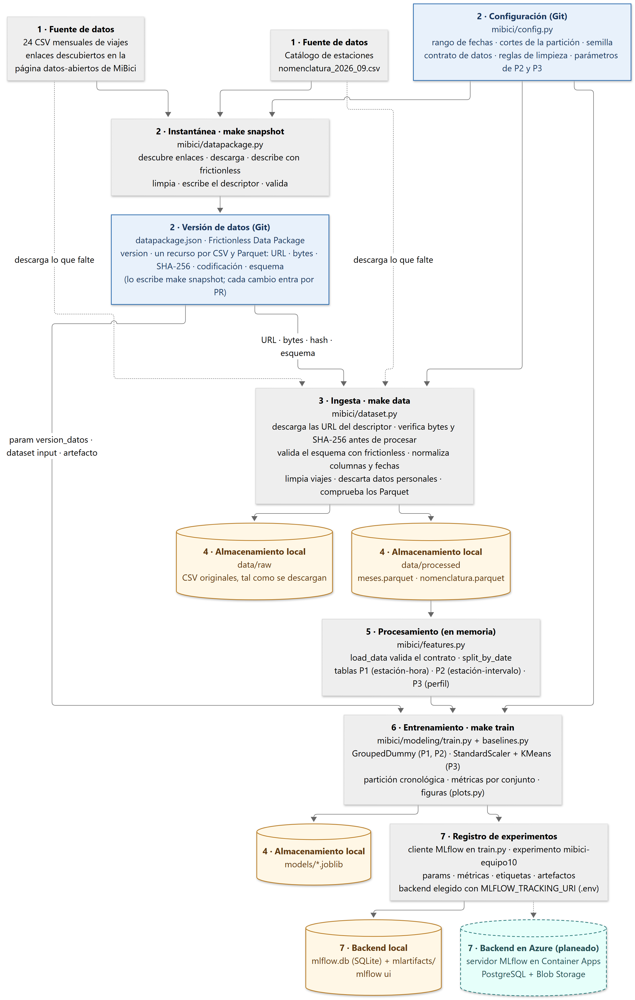
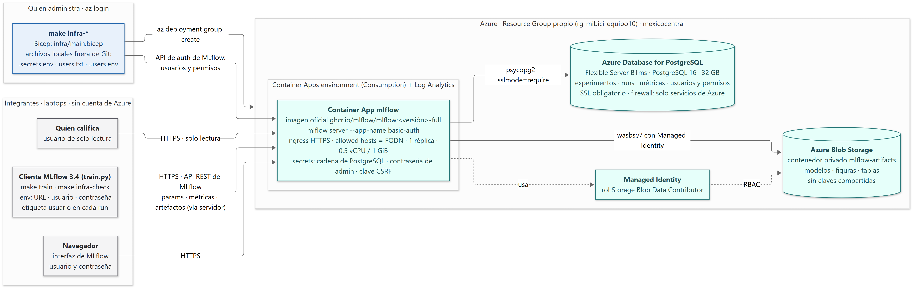

# TC5061-Proyecto-Equipo10

<a target="_blank" href="https://cookiecutter-data-science.drivendata.org/">
    
</a>

Proyecto MiBici — propuesta de solución de *Machine Learning* sobre los datos abiertos del
sistema de bicicleta pública del Área Metropolitana de Guadalajara. Proyecto integrador del
curso **Operaciones de aprendizaje automático (TC5061)**, Tecnológico de Monterrey, Equipo 10.

## Propósito del proyecto

MiBici opera todos los días del año con 470 estaciones y 5,040 bicicletas en Guadalajara,
Zapopan y Tlaquepaque, y publica en su
[portal de datos abiertos](https://mibici.net/es/datos-abiertos/) un CSV por mes con cada
viaje realizado desde diciembre de 2014, además del catálogo de estaciones con su ubicación y
capacidad.

El proyecto traduce tres retos operativos de MiBici en tres problemas complementarios de
*Machine Learning* (regresión, clasificación y *clustering*) que apoyan la planeación de la
flota, el rebalanceo de bicicletas y la expansión del sistema. Esta primera entrega deja la
base del curso: la propuesta de solución, una ingesta reproducible con datos versionados, el
módulo de *feature engineering* y una línea base por pregunta registrada en MLflow, contra la
que se medirá cualquier mejora posterior.

El alcance es el procesamiento por lotes en una sola máquina: las predicciones son diarias
(P1), cada tres horas (P2) y mensuales (P3), y el volumen de datos cabe en una computadora
portátil, por lo que no se necesita un servicio de predicción en línea ni cómputo distribuido.

## Preguntas del proyecto

| # | Pregunta de negocio | Tipo de tarea | Quién la usaría y qué decide |
|---|---|---|---|
| **P1** | ¿Cuántos viajes se iniciarán en una estación o zona en un periodo futuro? | Regresión | Operador del sistema: dimensiona la flota activa en calle, programa mantenimiento en horas valle y asigna turnos. |
| **P2** | ¿Una estación estará en riesgo de quedarse sin bicicletas o sin anclajes disponibles en un periodo futuro? | Clasificación | Equipo de rebalanceo: decide qué estaciones atender primero y cuántas bicicletas abastecer o retirar. |
| **P3** | ¿Qué grupos de estaciones comparten patrones de uso y dónde se ubican en la ciudad? | *Clustering* | Planeación urbana y expansión: dónde instalar estaciones nuevas y cuáles ampliar. |

### Formulación como problemas de ML

| | P1 · Regresión | P2 · Clasificación | P3 · *Clustering* |
|---|---|---|---|
| **Qué se predice o agrupa** | Número de viajes iniciados (salidas) en una estación. | Una de tres clases: *riesgo de vaciarse*, *riesgo de llenarse* o *sin riesgo*. | Perfiles funcionales de estaciones con hábitos de uso similares, proyectados después en el mapa. |
| **Granularidad** | Estación × hora. | Estación × intervalo de 3 horas (8 intervalos por día). | Estación (comportamiento consolidado de todo el periodo). |
| **Horizonte** | 24 horas: al cierre de cada día se pronostica hora por hora el día siguiente. | 3 horas: al cierre de cada intervalo se pronostica el intervalo siguiente. | Estructural e histórico; se recalcula mensualmente. |
| **Variable objetivo** | Conteo de salidas por estación y hora; las combinaciones sin viajes valen cero y se excluyen las horas de 1:00 a 4:59, sin servicio, y las horas antes de que abriera o después de que cerrara cada estación. | Flujo neto (llegadas − salidas) del intervalo comparado con la capacidad de la estación. | No hay: se agrupa sobre el perfil de uso de cada estación. |
| **Modelo *baseline*** | `DummyRegressor(strategy="mean")` por estación y hora del día. | `DummyClassifier(strategy="prior")` por estación, intervalo del día y tipo de día (laboral o fin de semana). | `StandardScaler` + `KMeans` con 4 grupos; silueta y Davies-Bouldin registradas para `k` de 2 a 8. |
| **Modelos candidatos** | `Ridge` con rezagos y calendario; `HistGradientBoostingRegressor` o LightGBM. | `LogisticRegression(class_weight="balanced")`; `HistGradientBoostingClassifier`. | `KMeans` con selección de `k`; `AgglomerativeClustering`. |
| **Métricas** | `test_mae`, `test_rmse` — en unidades de viajes; la RMSE penaliza los fallos grandes en hora pico. | `test_recall_vaciarse`, `test_recall_llenarse`, precisión y precisión promedio por clase, `test_f1_macro` — el falso negativo es el error más caro para rebalanceo. | `train_silhouette`, `train_davies_bouldin` — cohesión y separación de los grupos. |

**Aproximación del riesgo en P2.** Los datos abiertos no incluyen el inventario de bicicletas
por estación, así que el riesgo se aproxima con la presión del flujo neto sobre el tamaño
físico de la estación. Para cada estación e intervalo de 3 horas se cuentan las llegadas y
las salidas, se calcula el flujo neto (llegadas − salidas) y se compara con la capacidad de
anclajes del catálogo: *riesgo de vaciarse* si el flujo es ≤ −40 % de la capacidad, *riesgo
de llenarse* si es ≥ +40 % y *sin riesgo* en el resto. El criterio pondera la gravedad según
el tamaño real de cada estación (perder 8 bicicletas es crítico con 12 anclajes y manejable
con 40) y evita arrastrar errores acumulados de los movimientos de rebalanceo, que no están
en los datos. El umbral y el intervalo viven en [`mibici/config.py`](mibici/config.py).

La formulación completa está en la
[sección 2 de la propuesta](docs/entregas/entrega01/secciones/02-formulacion.md).

## Datos utilizados

### Fuente

Portal de datos abiertos de MiBici: <https://mibici.net/es/datos-abiertos/>, administrado por
la Agencia Metropolitana de Servicios de Infraestructura para la Movilidad (AMIM).

| Archivo | Contenido | Formato |
|---|---|---|
| `datos_abiertos_AAAA_MM.csv` (uno por mes) | Un registro por viaje: identificador, usuario, fecha y hora de inicio y fin, estación de origen y destino. | CSV; la codificación (Latin-1 o UTF-8), el formato de fecha y el estilo de comillas varían entre meses. |
| [`nomenclatura_2026_09.csv`](https://www.mibici.net/site/assets/files/1118/nomenclatura_2026_09.csv) | Catálogo de estaciones: `id`, `name`, `latitude`, `longitude`, `dpcapacity` (anclajes). | CSV; se sobrescribe en la misma URL en cada actualización. |

Los enlaces de los archivos mensuales llevan un identificador numérico que asigna el portal,
por lo que la ingesta los descubre leyendo la página en lugar de mantener una lista a mano. La
lista de los 24 archivos usados está en la
[sección 4 de la propuesta](docs/entregas/entrega01/secciones/04-datos.md).

### Rango de fechas y justificación

Se usan los **24 meses de septiembre de 2024 a agosto de 2026** (`START_DATE` y `END_DATE` en
`config.py`). Es el periodo más reciente con dos ciclos anuales completos, lo que captura la
estacionalidad con hábitos de movilidad actuales, evita los años 2020 y 2021 alterados por la
pandemia y excluye estaciones que ya no existen. La ventana se congela durante todo el curso
para que las métricas de las entregas sean comparables.

### Tamaño real obtenido

| Medida | Valor |
|---|---|
| Meses | 24 (2024-09 a 2026-08) |
| Viajes | 8,943,941 (promedio de 372,664 por mes); 8,702,429 tras la limpieza, según el recurso `meses` de `datapackage.json` |
| Estaciones en el catálogo | 484 |
| Estaciones con viajes en el periodo | 472, de las cuales 470 están en el catálogo |
| Estaciones con viajes pero sin catálogo | 2 (ID 405 y 407; se excluyen en la limpieza) |
| Tamaño en disco | 758 MB en CSV; 158 MB en Parquet |

### Variables originales y variables derivadas

| Variable original | Archivo | Uso en el proyecto |
|---|---|---|
| `Viaje_Id` | viajes | Eliminación de duplicados. |
| `Inicio_del_viaje`, `Fin_del_viaje` | viajes | Hora de salida y de llegada; se convierten a un formato de fecha uniforme. |
| `Origen_Id`, `Destino_Id` | viajes | Estación de salida y de llegada; se cruzan con el catálogo. |
| `id`, `name` | nomenclatura | Identificador y nombre (el prefijo indica el municipio, p. ej. `GDL-001`). |
| `latitude`, `longitude` | nomenclatura | Proyección de los grupos de P3 en el mapa; no entran al algoritmo. |
| `dpcapacity` | nomenclatura | Capacidad de anclajes; define el umbral de riesgo de P2 y la rotación por anclaje de P3. |

Las variables derivadas se implementan como funciones documentadas en
[`mibici/features.py`](mibici/features.py), siguiendo el procedimiento del notebook de
exploración y el catálogo de la propuesta: salidas, llegadas y flujo neto por estación y
periodo, desde el día en que abrió cada estación; hora del día, día de la semana y fin de
semana; capacidad de la estación; las variables históricas; la etiqueta de riesgo de P2; y el
perfil de uso de cada estación para P3 (porcentaje de movimientos por periodo del día y en días
laborales, uso diario por anclaje en escala logarítmica y balances de mañana y tarde,
calculados solo con el periodo de entrenamiento). Las variables históricas dependen del
horizonte de cada pregunta:

- **P1** (pronóstico al cierre del día para todas las horas del siguiente): salidas 24 h y 7
  días antes, llegadas y flujo neto 24 h antes y promedio de las salidas de las 3 horas que
  terminan a la misma hora del día anterior.
- **P2** (pronóstico del intervalo siguiente): salidas 1, 8 y 56 intervalos antes (3 h, 24 h y
  7 días), llegadas y flujo neto 1 y 8 intervalos antes y promedio móvil de los 3 intervalos
  cerrados previos.

Los rezagos, las ventanas y el horizonte de P1 viven en `config.py`, y las variables que
recibe cada modelo, en `P1_FEATURES` y `P2_FEATURES` de `features.py`. El catálogo y su
justificación están en la
[sección 5 de la propuesta](docs/entregas/entrega01/secciones/05-pipeline.md).

### Condiciones de uso y datos personales

El portal no publica una licencia explícita. El Reglamento Interno en materia de Transparencia
de la AMIM establece que la Agencia gestiona su información bajo una política de datos
abiertos y que esta es pública y de libre acceso, salvo la reservada o confidencial. Con base
en ello, los datos se usan **solo con fines académicos**, no se redistribuyen (ningún archivo
de MiBici entra al repositorio) y no se usan para identificar personas.

Las columnas `Usuario_Id`, `Genero` y `Año_de_nacimiento` son datos personales que, combinados
con horarios y estaciones, podrían identificar a una persona. Ninguna pregunta las necesita, así
que **la ingesta las descarta** antes de escribir el Parquet limpio: ninguna tabla, modelo,
artefacto ni *run* de MLflow posterior las contiene.

### Estrategia de partición

La partición es **cronológica, nunca aleatoria**, porque los datos son series de tiempo:
entrenamiento de septiembre de 2024 a febrero de 2026 (18 meses), validación de marzo a mayo de
2026 y prueba de junio a agosto de 2026. Las fechas de corte (`TRAIN_START`, `VALIDATION_START`,
`TEST_START` y `DATA_END`) se definen una sola vez en `config.py` y `split_by_date` las aplica a
las tres preguntas. Para evitar fuga de información del futuro:

- Toda variable histórica se calcula solo con datos cerrados antes del momento de la
  predicción: en P1 hasta el cierre del día anterior, en P2 hasta el cierre del intervalo
  anterior y en P3 solo con el periodo de entrenamiento. En P1 esto obliga a usar rezagos de
  al menos 24 h: el de 1 h de las 18:00 serían las 17:00 del mismo día que se pronostica.
  `add_lag_features` rechaza cualquier rezago menor que el horizonte (`P1_HORIZON_HOURS` en
  `config.py`).
- Los modelos solo reciben las columnas de `P1_FEATURES` y `P2_FEATURES`, nunca la variable
  objetivo ni los movimientos del periodo que se predice: las salidas son exactamente
  llegadas − flujo neto, y la clase de riesgo de P2 sale del flujo neto.
- La serie de cada estación empieza el día de su primer movimiento y termina el día de su
  último. 110 estaciones abrieron durante la ventana (87 en el periodo de prueba); sin este
  corte, el entrenamiento incluiría estaciones que solo existen en el futuro y contaría como
  demanda cero las horas en que todavía no existían.
- Los escaladores y demás transformaciones se ajustan únicamente con el conjunto de
  entrenamiento, dentro de un `Pipeline` de scikit-learn, y se aplican sin recalcular a
  validación y prueba.

### Versionado de los datos

Los datos no están en Git. Lo que está en Git es [`datapackage.json`](datapackage.json): la
lista de los 25 archivos del portal de MiBici (URL, tamaño, hash SHA-256 y columnas de cada
uno), los 2 Parquet que produce la ingesta y una versión (`version`, por ejemplo `2026-10`).
`make data` descarga los archivos y los compara con esa lista antes de procesarlos; si alguno
no coincide, se detiene. Solo `make snapshot` cambia `datapackage.json`, y el cambio entra a
`main` por *Pull Request*.

Todos los comandos se corren desde la raíz del repositorio con el entorno virtual activado
(ver [Instalación](#instalación)).

#### Qué hacer en cada situación

| Quiero | Comando |
|---|---|
| Tener los datos en mi máquina | `make data` |
| Saber qué versión uso | `version` en `datapackage.json` |
| Ver el historial de versiones | `git log -- datapackage.json` |
| Comprobar a fondo mis datos locales | `make validate` |
| Publicar una versión nueva | ver abajo |

`make data` se corre después de clonar y cada vez que `datapackage.json` cambia en `main`.
En MLflow, cada *run* lleva la versión en el parámetro `version_datos`. No edites
`datapackage.json` a mano ni cambies `START_DATE` o `END_DATE` en `config.py` sin publicar
una versión nueva.

#### Publicar una versión nueva

Hace falta en tres casos: `make data` se detuvo porque el portal cambió un archivo; cambiaste
las reglas de limpieza en `config.py` o `dataset.py`; o el equipo cambia la ventana de meses.

```bash
git checkout -b chore/datos-2026-11
make snapshot VERSION=2026-11      # descarga los 25 archivos (~760 MB), limpia, escribe datapackage.json y lo valida
git diff --stat datapackage.json   # confirma que cambió lo que esperabas
make train                         # los baselines deben correr con la versión nueva
git add datapackage.json
git commit -m "chore(datos): congela la versión de datos 2026-11 por republicación de 2025-03"
git push -u origin chore/datos-2026-11   # abre el PR
```

Si solo cambiaste reglas de limpieza y ya tienes los archivos en `data/raw/`, usa
`python -m mibici.datapackage snapshot --version 2026-11 --reuse-raw` para no descargarlos
otra vez. Cuando el PR entre a `main`, el resto del equipo hace `git pull` y `make data`.

#### Revisar un PR que cambia `datapackage.json`

1. `version` es nueva.
2. El *diff* corresponde al motivo del PR. Portal republicó un archivo: cambian `hash` y
   `bytes` de ese recurso. Cambió la limpieza: cambian `rows`, `bytes` y `hash` de `meses`.
   Cambió la ventana: aparecen o desaparecen recursos. Cualquier otro cambio se pregunta.
3. `rows` de `meses` sigue cerca de 8.7 millones.
4. `make data` en la rama termina sin error.

#### Si `make data` se detiene

El mensaje nombra el archivo y la causa. Según el mensaje:

- **`espera N bytes` o `espera sha256 ...`**. El portal republicó ese archivo, o tu
  `datapackage.json` está desactualizado. Haz `git pull` y repite; si sigue, publica una
  versión nueva.
- **`Falta el archivo ...` o HTTP 404**. El portal cambió la URL. Publica una versión nueva;
  `make snapshot` descubre las URL nuevas.
- **`no cumplen el esquema`**. Un mes llegó con otras columnas, codificación o formato de
  fecha. Ajusta la lectura en `dataset.py` (`detect_encoding`, `norm_cols`, `parse_dates`) y
  publica una versión nueva.
- **`espera N filas` o hash distinto en un Parquet**. Cambiaron las reglas de limpieza o tu
  entorno no es el de `requirements.txt`. Si el cambio es tuyo, publica una versión nueva
  con `--reuse-raw`; si no, `pip install -r requirements.txt` y revisa `git status`.
- **`El descriptor cubre ... y config.py pide ...`**. `START_DATE` o `END_DATE` no coinciden
  con `datapackage.json`. Revierte `config.py` o publica una versión nueva.
- **`No existe datapackage.json` o `no declara version`**. Archivo borrado o editado. Haz
  `git checkout main -- datapackage.json`.

## Arquitectura y pipeline



Los nodos azules se versionan en Git, los cilindros naranjas son almacenamiento local fuera de
Git y el cilindro verde es el servidor MLflow compartido del equipo en Azure, definido en
[`infra/`](infra/). Fuente del diagrama: [`references/arquitectura.mmd`](references/arquitectura.mmd).

| # | Componente | Herramienta | Por qué |
|---|---|---|---|
| 1 | Fuentes de datos | Portal de MiBici; enlaces descubiertos con `requests` y BeautifulSoup | Única fuente oficial; el portal asigna los identificadores de las URL. |
| 2 | Configuración y versión de datos | `config.py` y `datapackage.json` (Frictionless Data Package) en Git; `datapackage.py` lo escribe con `make snapshot` | Una sola fuente de rutas, fechas, semillas y parámetros; descriptor estándar con URL, hash, tamaño y esquema de cada archivo para reconstruir y verificar los datos sin almacén remoto. |
| 3 | Ingesta | `dataset.py` con Typer, `frictionless`, pandas, pyarrow, hashlib y loguru | Comando sin pasos manuales que verifica cada archivo contra el descriptor antes de procesarlo; Parquet reduce la lectura de los 24 meses de 135 s a 1.4 s. |
| 4 | Almacenamiento | `data/raw`, `data/processed`, `models/`, `mlflow.db` y `mlartifacts/` (locales, fuera de Git) | Los datos caben en memoria; se reconstruyen en cualquier máquina con el comando de ingesta. Las tablas de modelado se construyen en memoria al entrenar. |
| 5 | *Feature engineering* | Funciones en `features.py` con contrato de datos en `config.py`; `Pipeline` de scikit-learn | Evita fugas temporales y *train-serving skew*; código modular y comprobable. |
| 6 | Entrenamiento | `modeling/train.py` y `modeling/baselines.py` con scikit-learn | Cubre *baselines*, candidatos y métricas; partición cronológica. |
| 7 | Registro de experimentos | MLflow Tracking: local (`mlflow.db` y `mlartifacts/`) o el servidor compartido en Azure (Container Apps, PostgreSQL y Blob Storage, desplegado con Bicep desde `infra/`), según `MLFLOW_TRACKING_URI` | Herramienta del curso; misma interfaz en ambos modos; el servidor compartido deja los *runs* de todo el equipo en un solo lugar. |
| — | Orquestación | `Makefile` (`data`, `train`) | Un grafo de dos pasos no justifica un orquestador. |

### Infraestructura en la nube



El componente 7 en modo compartido es un MLflow Tracking Server propio en Azure, en un Resource Group
exclusivo del proyecto: la imagen oficial de MLflow en Azure Container Apps (HTTPS y
autenticación básica), los metadatos y los usuarios en Azure Database for PostgreSQL y los
artefactos en Azure Blob Storage, a los que el servidor entra con una Managed Identity. Las
laptops solo necesitan la URL, un usuario y una contraseña en `.env`; nunca credenciales de Azure.
Todo se define en Bicep en [`infra/`](infra/) y se despliega con `make infra-deploy`; el detalle de
la arquitectura, el acceso y la operación está en [`infra/README.md`](infra/README.md) y la fuente
del diagrama en [`references/infraestructura_nube.mmd`](references/infraestructura_nube.mmd).

El *pipeline* por pregunta y la justificación de cada herramienta con las lecturas del curso
están en las secciones [5](docs/entregas/entrega01/secciones/05-pipeline.md) y
[7](docs/entregas/entrega01/secciones/07-arquitectura.md) de la propuesta.

## Instalación

Requisitos: **Python 3.10 o superior**, Git y `make` (en Windows viene con Git Bash o se
instala con `winget install GnuWin32.Make`; sin `make`, cada regla del `Makefile` se puede
ejecutar con el comando de Python que indica).

```bash
# 1. Clonar el repositorio
git clone https://github.com/WillSagzz/TC5061-Proyecto-Equipo10.git
cd TC5061-Proyecto-Equipo10

# 2. Crear y activar un entorno virtual
python -m venv .venv
source .venv/bin/activate          # macOS / Linux
# .venv\Scripts\activate           # Windows

# 3. Instalar las dependencias con versión fija y el paquete `mibici` en modo editable
python -m pip install -U pip
python -m pip install -r requirements.txt
python -m pip install -e .
```

`pip install -e .` registra el paquete `mibici` en el entorno, de modo que `python -m
mibici.dataset` y los imports `from mibici.config import ...` funcionan desde cualquier
carpeta. No se instala nada fuera de [`requirements.txt`](requirements.txt).

MLflow lee `MLFLOW_TRACKING_URI` de un archivo `.env` opcional (con `python-dotenv`). Sin
`.env`, escribe en la base local `mlflow.db` (SQLite) con los artefactos en `mlartifacts/`, y no
se necesita ninguna credencial. Con `.env`, registra en el
[servidor compartido del equipo](#servidor-compartido-del-equipo-en-azure) con el usuario y la
contraseña de cada integrante. `.env` está excluido de Git; en el repositorio solo entra un
[`.env.example`](.env.example) con los nombres de las variables.

## Comandos

Todos se ejecutan desde la raíz del repositorio con el entorno activado y sin pasos manuales.
Las rutas, fechas y semillas salen de `config.py`.

| Comando | Equivalente en Python | Qué hace |
|---|---|---|
| `make data` | `python -m mibici.dataset` | **Ingesta reproducible.** Reconstruye la versión de datos de `datapackage.json`: descarga a `data/raw/` lo que falte, verifica tamaño y hash de cada archivo contra el descriptor, valida una muestra de filas contra el esquema, normaliza, conserva solo las columnas del contrato (sin datos personales), limpia los viajes, escribe `meses.parquet` y `nomenclatura.parquet` en `data/processed/` y comprueba que coinciden con el descriptor. |
| `make snapshot VERSION=2026-10` | `python -m mibici.datapackage snapshot --version 2026-10` | **Versión nueva de los datos.** Descubre los enlaces en el portal, descarga, describe cada archivo, limpia, escribe `datapackage.json` y lo valida. Guía en [Versionado de los datos](#versionado-de-los-datos). |
| `make validate` | `python -m mibici.datapackage validate` | **Verificación completa** de los archivos locales contra `datapackage.json`: hashes, tamaños y todas las filas de cada CSV. |
| `make train` | `python -m mibici.modeling.train all` (o `p1`, `p2`, `p3` para una sola pregunta) | **Experimento base.** Construye en memoria las tablas de P1, P2 y P3, entrena el *baseline* de cada pregunta con partición cronológica, lo evalúa, guarda el modelo en `models/` y registra el *run* en MLflow. |
| `python -m mibici.modeling.predict p1` (o `p2`, `p3`) | — | **Inferencia.** Carga el modelo de `models/`, reconstruye la tabla de la pregunta y escribe las predicciones del conjunto de prueba (P1 y P2) o el grupo de cada estación (P3) en `data/processed/`. |
| `mlflow ui --backend-store-uri sqlite:///mlflow.db` | — | Abre la interfaz de MLflow en <http://127.0.0.1:5000> sobre la base local. |
| `make infra-check` | `python infra/scripts/check_server.py` | **Prueba de conexión** al servidor compartido con las credenciales del `.env`: crea un *run* de prueba con un artefacto y lo vuelve a leer. |
| `make mlflow-password` | `python infra/scripts/change_password.py` | Cambia tu propia contraseña en el servidor compartido (sin Azure). |
| `make infra-*` | `az ...` | Despliegue y mantenimiento del servidor en Azure; solo para quien administra la suscripción. Ver [`infra/README.md`](infra/README.md). |
| `make lint` / `make format` | `ruff format --check && ruff check` / `ruff check --fix && ruff format` | Verifica o corrige el estilo del código. |
| `make entrega01` | `python docs/entregas/build.py docs/entregas/entrega01` | Compila la propuesta (Markdown → HTML → PDF) en `docs/entregas/entrega01/build/`. |
| `make entrega02` | `python docs/entregas/build.py docs/entregas/entrega02` | Compila el reporte de experimentos con MLflow (Markdown → HTML → PDF) en `docs/entregas/entrega02/build/`. |

## Experimento base en MLflow

El experimento se ejecuta desde el código del repositorio (`train.py`), nunca solo desde un
*notebook*:

- **Un experimento por proyecto:** `mibici-equipo10` (`MLFLOW_EXPERIMENT_NAME` en `config.py`).
- **Un *run* por pregunta con nombre descriptivo** `P{n}-{etapa}-{modelo}`:
  `P1-baseline-dummy-estacion-hora`, `P2-baseline-dummy-estacion-intervalo-tipo-dia` y
  `P3-baseline-kmeans-k4`.
- **Parámetros para reproducir el *run*:** `version_datos`, `inicio_entrenamiento`,
  `inicio_validacion`, `inicio_prueba`, `fin_datos`, `semilla`, modelo e hiperparámetros, número
  de filas de cada conjunto y de grupos, y `variables` (las columnas de entrada del modelo).
- **Métricas con el conjunto como prefijo:** `train_`, `val_` y `test_` de `mae` y `rmse` (P1);
  `recall`, `precision` y `avg_precision` de las clases `vaciarse` y `llenarse` y `f1_macro`
  (P2); `train_silhouette` y `train_davies_bouldin`, más sus curvas por `k` (P3).
- **Etiquetas:** `equipo=equipo10`, `usuario` (quién ejecutó el *run*: el usuario del servidor
  compartido o, en modo local, el del sistema), `pregunta` (`P1`, `P2` o `P3`), `git_commit` con el SHA del
  commit que lo ejecutó, `git_cambios_sin_commit` y `tipo_modelo` (`baseline` o `candidato`).
- **Conjunto de datos como entrada del *run*:** el *dataset* `datapackage`, con
  `version_datos` como huella, en la pestaña *Datasets* de la interfaz.
- **Artefactos:** al menos una figura por pregunta (serie real contra predicha en P1, matriz de
  confusión en P2, mapa de los grupos de estaciones en P3), el modelo serializado, el
  descriptor `datapackage.json` y, en P3, las tablas de grupos.
- **Nunca** credenciales ni datos personales como parámetros, etiquetas o artefactos.

Para reproducirlo desde un clon limpio:

```bash
make data                                          # descarga, verifica contra datapackage.json, limpia y escribe Parquet
make train                                         # construye las tablas y registra los tres baselines
mlflow ui --backend-store-uri sqlite:///mlflow.db  # revisa los runs en http://127.0.0.1:5000
```

Las capturas de la interfaz (lista de *runs*, detalle de un *run*, artefacto y comparación)
se guardan en `docs/entregas/entrega01/figuras/` para el PDF de la propuesta.

### Servidor compartido del equipo en Azure

Para que los *runs* de todos los integrantes queden en el mismo lugar, el equipo tiene un
**MLflow Tracking Server propio en Azure**: la imagen oficial de MLflow en Azure Container
Apps, los metadatos en Azure Database for PostgreSQL y los artefactos en Azure Blob Storage.
Es la misma interfaz que el modo local; la infraestructura se define en Bicep en
[`infra/`](infra/) y se despliega con `make infra-deploy` (detalle en
[`infra/README.md`](infra/README.md)).

Cómo se conecta un integrante:

1. Pide a quien administra el servidor tu usuario y contraseña inicial (una por persona; el
   equipo tiene además un usuario de solo lectura para quien califica). La lista de usuarios
   no se versiona: solo la tiene quien administra el servidor.
2. Copia [`.env.example`](.env.example) a `.env` y llena `MLFLOW_TRACKING_URI`,
   `MLFLOW_TRACKING_USERNAME` y `MLFLOW_TRACKING_PASSWORD`. No se necesita ninguna cuenta ni
   credencial de Azure: los artefactos viajan a través del servidor.
3. `make infra-check` confirma la conexión; a partir de ahí `make train` registra en el servidor
   sin cambiar nada más. La interfaz está en la misma URL, con el mismo usuario y contraseña.
4. `make mlflow-password` cambia tu contraseña cuando quieras.

Sin `.env`, todo sigue funcionando en modo local, que es el modo para iterar y depurar.

## Estructura del proyecto

Generada con [Cookiecutter Data Science](https://cookiecutter-data-science.drivendata.org/)
(`ccds`, con `include_code_scaffold = Yes`).

```
├── Makefile              <- Reglas: data, snapshot, validate, train, lint, format, entrega01, entrega02, infra-*, mlflow-password
├── README.md             <- Este documento
├── pyproject.toml        <- Metadatos del paquete `mibici` y configuración de Ruff
├── requirements.txt      <- Dependencias con versión fija para reproducir el entorno
├── .gitignore            <- Excluye data/, mlruns/, mlartifacts/, mlflow.db, .env, modelos serializados y secretos de infra/
├── .env.example          <- Variables de entorno para conectarse al servidor MLflow del equipo (sin credenciales)
├── datapackage.json      <- Versión de datos (Frictionless Data Package): URL, bytes, SHA-256 y esquema de cada CSV y Parquet; lo escribe `make snapshot`
│
├── data                  <- Excluida de Git; la genera `make data`
│   ├── raw               <- CSV tal como se descargan del portal (inmutables)
│   ├── processed         <- meses.parquet (viajes limpios, sin datos personales) y nomenclatura.parquet
│   ├── interim           <- Datos intermedios de la plantilla (sin uso por ahora)
│   └── external          <- Datos de terceros (sin uso por ahora)
│
├── docs
│   ├── entregas          <- Fuente de los PDF de cada entrega y el compilador `build.py`
│   │   ├── entrega01     <- Propuesta: secciones en Markdown, figuras y capturas de MLflow
│   │   └── entrega02     <- Reporte de experimentos con MLflow: secciones en Markdown y capturas
│   └── mkdocs.yml        <- Sitio mkdocs de la plantilla
│
├── infra                 <- Servidor MLflow compartido en Azure (ver infra/README.md)
│   ├── main.bicep        <- Container Apps + PostgreSQL + Blob Storage + Managed Identity
│   ├── main.bicepparam   <- Parámetros no secretos (región, imagen); los secretos salen de infra/.secrets.env (fuera de Git)
│   ├── users.example.txt <- Formato de la lista de usuarios; la lista real (users.txt) no se versiona
│   └── scripts           <- generate_secrets.sh, create_users.py, change_password.py, check_server.py
│
├── models                <- Modelos serializados; excluidos de Git
│
├── notebooks             <- Solo exploración: `1.0-gsg-descarga-dataset.ipynb` y `2.0-gsg-exploracion-variables.ipynb`
│
├── references            <- ML Canvas (html, pdf y png) y diagramas de arquitectura, trazabilidad e infraestructura en la nube (mmd y png)
│
├── reports               <- Análisis generados (HTML, PDF, etc.)
│   └── figures           <- Gráficas y figuras para los reportes
│
└── mibici                <- Código fuente del proyecto
    ├── __init__.py       <- Hace de `mibici` un paquete de Python
    ├── config.py         <- Rutas, fechas, semilla, contrato de datos y parámetros: la única fuente de configuración
    ├── dataset.py        <- Ingesta reproducible: descarga y verifica contra el descriptor, normaliza, limpia y guarda en Parquet
    ├── datapackage.py    <- Versión de los datos: `snapshot` escribe datapackage.json y `validate` lo comprueba con frictionless
    ├── features.py       <- Funciones reutilizables y documentadas de feature engineering
    ├── plots.py          <- Figuras que se registran como artefactos en MLflow
    └── modeling
        ├── __init__.py
        ├── baselines.py  <- Modelos base de P1, P2 y P3 con la interfaz de scikit-learn
        ├── train.py      <- Entrenamiento y registro de runs en MLflow
        └── predict.py    <- Inferencia con modelos entrenados
```

## Buenas prácticas y dónde se verifican

| Ámbito | Práctica | Cómo la aplica el equipo | Dónde se verifica |
|---|---|---|---|
| MLflow Tracking | Un experimento por proyecto y *runs* con nombre descriptivo. | Experimento `mibici-equipo10`; nombres `P{n}-{etapa}-{modelo}` fijados en `train.py`. | Interfaz de MLflow. |
| MLflow Tracking | Registrar todo lo necesario para reproducir el *run*. | Parámetros `version_datos`, fechas de la partición, `semilla`, modelo e hiperparámetros, tomados de `config.py` y de `datapackage.json`; el *dataset* como entrada del *run*. | Parámetros y pestaña *Datasets* del *run*. |
| MLflow Tracking | Ligar cada *run* con el código, la pregunta y quien lo ejecutó. | Etiquetas `git_commit`, `pregunta`, `equipo`, `usuario` y `tipo_modelo`. | Etiquetas del *run*. |
| MLflow Tracking | Métricas con el conjunto en el nombre. | `test_mae`, `test_recall_vaciarse`, `train_silhouette`, etc. | Métricas del *run*. |
| MLflow Tracking | Sin credenciales ni datos personales. | La ingesta descarta `Usuario_Id`, `Genero` y `Año_de_nacimiento`; `.env` está fuera de Git. | Interfaz de MLflow y código. |
| Estructura y código | *Notebooks* solo para exploración, con la convención de la plantilla. | La lógica final vive en `mibici/`; los *notebooks* se nombran `numero.version-iniciales-descripcion.ipynb`. | Carpeta `notebooks/`. |
| Estructura y código | Configuración en un solo lugar. | Rutas, fechas y cortes, semilla, contrato de datos, reglas de limpieza, umbral e intervalo de P2, periodos y grupos de P3 y nombre del experimento en `config.py`; prohibido repetirlos. | `config.py` y revisión de PR. |
| Estructura y código | Dependencias con versión fija y entorno reproducible. | `requirements.txt` con `==` en cada paquete; instalación documentada arriba y probada desde un clon limpio en cada PR. | `requirements.txt` y este README. |
| Datos y Git | Ningún dato de MiBici, modelo, carpeta de MLflow ni credencial en el historial. | `.gitignore` excluye `data/`, `mlruns/`, `mlartifacts/`, `mlflow.db`, `*.pkl`, `*.joblib`, `*.pickle` y `.env`; el revisor lo comprueba en cada PR. | `.gitignore` e historial. |
| Datos y Git | Todo cambio entra a `main` por *Pull Request* revisado. | *Ruleset* sobre `main`: PR obligatorio con una aprobación, conversaciones resueltas, solo *squash merge*, sin *force push* ni borrado. | Pestaña de *Pull Requests*. |

## Flujo de trabajo con Git/GitHub

El equipo trabaja con **[GitHub Flow](https://docs.github.com/en/get-started/using-github/github-flow)**:
una sola rama de larga duración (`main`), ramas de trabajo cortas y todo cambio entra por
*Pull Request* revisado. Los nombres de ramas siguen
**[Conventional Branch](https://conventionalbranch.org/)** y los mensajes de commit,
**[Conventional Commits 1.0.0](https://www.conventionalcommits.org/en/v1.0.0/)**.

### 1. Rama principal protegida

`main` siempre debe estar en un estado funcional: cualquier integrante puede clonarla y
reproducir la ingesta y el experimento base. **Nadie hace `push` directo a `main`.**

`main` está protegida con un
**[ruleset](https://docs.github.com/en/repositories/configuring-branches-and-merges-in-your-repository/managing-rulesets/about-rulesets)**
de repositorio (*Settings → Rules → Rulesets*) con estas reglas:

- **Require a pull request before merging**, con **1 aprobación** requerida, aprobaciones que
  caducan al llegar commits nuevos (*dismiss stale approvals*), **conversaciones resueltas**
  antes de mezclar y **solo *squash merge***: cada PR entra a `main` como un solo commit cuyo
  mensaje sigue Conventional Commits y termina con el número del PR.
- **Block force pushes** — el historial no puede reescribirse.
- **Restrict deletions** — la rama no puede borrarse.

### 2. El ciclo de trabajo

```bash
git checkout main && git pull origin main          # 1. partir de una main actualizada
git checkout -b feature/ingesta-parquet            # 2. crear la rama de trabajo
git add mibici/dataset.py                          # 3. commits pequeños con Conventional Commits
git commit -m "feat(dataset): normaliza nombres de columnas al leer los CSV"
git push -u origin feature/ingesta-parquet         # 4. publicar la rama
# 5. abrir el Pull Request hacia main en GitHub y asignar revisor
# 6. atender la revisión con commits nuevos sobre la misma rama
# 7. tras la aprobación, squash merge desde GitHub y borrar la rama remota
git checkout main && git pull origin main          # 8. limpiar en local
git branch -d feature/ingesta-parquet
```

### 3. Nombres de ramas

**Formato:** `tipo/descripcion`, solo minúsculas, dígitos y guiones; sin guiones bajos,
espacios ni acentos. La única rama sin prefijo es `main`. Una rama, un propósito; nacen de una
`main` actualizada y se borran al mezclarse.

| Tipo | Cuándo se usa | Ejemplo |
|---|---|---|
| `feature/` (alias `feat/`) | funcionalidad nueva | `feature/ingesta-parquet` |
| `bugfix/` (alias `fix/`) | corrección de un defecto | `bugfix/encoding-csv-2015` |
| `hotfix/` | corrección urgente sobre algo ya en `main` | `hotfix/ruta-parquet` |
| `release/` | preparación de una entrega | `release/v1.0.0` |
| `chore/` | dependencias, configuración y documentación | `chore/fijar-dependencias` |
| `docs/` | documentación extensa (entregas, README, referencias) | `docs/entrega01-arquitectura` |
| `ai/`, `claude/`, `codex/`, `copilot/`, `cursor/` | ramas generadas por un agente de IA | `claude/readme` |

**Reglas de escritura:** solo minúsculas, dígitos y guiones (los puntos se permiten en la
descripción para versiones); sin separadores consecutivos ni al inicio o al final, y un guion
nunca va pegado a un punto; descriptiva pero breve, e incluye el número de issue cuando exista
(`feature/issue-123-nueva-ingesta`).

| Válida | Inválida | Por qué falla |
|---|---|---|
| `feature/ingesta-parquet` | `Feature/Ingesta-Parquet` | mayúsculas |
| `bugfix/encoding-csv-2015` | `fix/encoding csv` | espacio |
| `chore/readme-flujo-trabajo` | `readme_flujo` | sin tipo y con guion bajo |
| `chore/fijar-dependencias` | `chore/fijar--dependencias` | guiones consecutivos |
| `release/v1.0.0` | `release/v1.-0.0` | guion pegado a un punto |

### 4. Mensajes de commit

**Estructura:** `tipo(ámbito): descripción`, con cuerpo y pies de página opcionales separados
por una línea en blanco. La descripción va en imperativo ("agrega", no "agregado"), en
minúsculas y sin punto final. Un commit = un cambio coherente. Nunca incluir credenciales,
rutas absolutas ni datos personales.

| Tipo | Cuándo se usa |
|---|---|
| `feat` | funcionalidad nueva |
| `fix` | corrección de un defecto |
| `docs` | documentación, incluido este README |
| `refactor` | reescritura sin cambiar el comportamiento |
| `test` | pruebas |
| `perf` | mejora de rendimiento |
| `build` | dependencias y empaquetado |
| `ci` | integración continua |
| `chore` | mantenimiento que no toca el código fuente |
| `revert` | revierte un commit anterior, citando su SHA en el pie |

Ámbitos del proyecto: `dataset`, `features`, `config`, `modeling`, `mlflow`, `infra`,
`notebooks`, `readme`, `entregas`, `references`, `deps`.

```
feat(dataset): descarga los CSV mensuales y los guarda en Parquet
fix(features): evita usar información posterior al momento de la predicción
chore(deps): fija las versiones de scikit-learn y mlflow
feat(dataset)!: cambia el esquema del Parquet de salida
```

Un cambio que rompe compatibilidad se marca con `!` tras el tipo o con un pie
`BREAKING CHANGE: ...` en mayúsculas.

### 5. Pull Requests y revisiones

Todo cambio a `main` entra por PR y ningún PR se mezcla sin la aprobación de otro integrante.
El título del PR sigue el formato de un commit (`tipo(ámbito): descripción`), porque con el
*squash merge* se convierte en el mensaje del commit que llega a `main`. La descripción
responde qué cambia, por qué y cómo probarlo desde un clon limpio.

**Qué revisa quien aprueba:**

- El código corre desde un clon limpio siguiendo el README y `make lint` pasa.
- No se versionan datos de MiBici, `mlflow.db`, `mlruns/`, `mlartifacts/`, modelos ni credenciales.
- Las rutas, fechas y semillas viven en `config.py`, no repetidas en varios archivos.
- Las funciones nuevas de `features.py` tienen *docstring* y no usan información del futuro.
- El nombre de la rama y los mensajes de commit siguen las convenciones.

**Evidencia de colaboración.** Cada integrante ha abierto al menos un *Pull Request* y
revisado al menos uno de otro integrante; la evidencia está en la
[pestaña de *Pull Requests*](https://github.com/WillSagzz/TC5061-Proyecto-Equipo10/pulls?q=is%3Apr)
del repositorio.

### 6. Qué nunca entra al repositorio

Se versiona el **código que produce** los datos, los experimentos y los modelos; nunca el
**resultado de ejecutarlo**. El [`.gitignore`](.gitignore) excluye:

| Excluido | Motivo |
|---|---|
| `data/` | los datos de MiBici se reconstruyen con `make data`, que verifica cada archivo contra `datapackage.json` antes de procesarlo |
| `mlflow.db`, `mlartifacts/`, `mlruns/` | salida de los experimentos; cada *run* lleva el commit y la versión de datos con que se reproduce |
| `*.pkl`, `*.pickle`, `*.joblib` | modelos serializados; se regeneran con `make train` |
| `.env` y cualquier credencial | nunca deben salir del equipo local |
| `docs/entregas/**/build/` | salidas compiladas de las entregas; se regeneran con `make entrega01` y `make entrega02` |

Si algo de esto llega a `main`, borrarlo en un commit posterior **no** lo quita del historial:
avisa al equipo antes de reescribir nada.

## Convenciones de código

El código sigue **[PEP 8](https://peps.python.org/pep-0008/)**, verificado automáticamente con
**[Ruff](https://docs.astral.sh/ruff/)**, que ya viene configurado en
[`pyproject.toml`](pyproject.toml). El proyecto requiere **Python 3.10 o superior**
(`requires-python` en `pyproject.toml`).

### 1. Formateo automático

No se discute el formato en las revisiones: lo resuelve la herramienta.

```bash
make format   # ruff check --fix && ruff format  -> corrige y formatea
make lint     # ruff format --check && ruff check -> solo verifica
```

Ejecuta `make format` **antes de cada commit**. Un PR cuyo `make lint` falle no se aprueba.

**Configuración vigente** (en `pyproject.toml`, no la cambies sin acuerdo del equipo):

| Ajuste | Valor | Nota |
|---|---|---|
| `line-length` | `99` | PEP 8 sugiere 79; el equipo adopta los 99 de la plantilla, desviación que la propia PEP 8 permite cuando el equipo lo acuerda |
| `extend-select` | `["I"]` | activa el ordenamiento de imports |
| `known-first-party` | `["mibici"]` | separa los imports del proyecto de los de terceros |
| `force-sort-within-sections` | `true` | mezcla `import x` y `from x import y` en un solo orden alfabético |

### 2. Nomenclatura

Todos los identificadores se escriben **en inglés** y sin acentos; los comentarios y
*docstrings*, en español.

| Elemento | Estilo | Ejemplo |
|---|---|---|
| Módulos y paquetes | `minusculas_cortas` | `dataset.py`, `features.py` |
| Funciones y métodos | `snake_case` | `build_hourly_trip_counts()` |
| Variables | `snake_case` | `trips_by_station` |
| Constantes | `UPPER_SNAKE_CASE` | `RAW_DATA_DIR`, `RANDOM_SEED` |
| Clases | `PascalCase` | `StationFeatureBuilder` |
| Uso interno | `_prefijo_guion_bajo` | `_normalize_column_names()` |

Nombres descriptivos sobre nombres cortos: `df` solo se acepta como parámetro de una función
que recibe un único DataFrame.

### 3. Orden de imports

Tres bloques separados por una línea en blanco, ordenados por Ruff:

```python
from pathlib import Path          # 1. biblioteca estándar

from loguru import logger         # 2. terceros
import pandas as pd
from tqdm import tqdm
import typer

from mibici.config import PROCESSED_DATA_DIR, RAW_DATA_DIR   # 3. del proyecto
```

Prohibido `from modulo import *`.

### 4. Docstrings

Toda función pública lleva *docstring* siguiendo **[PEP 257](https://peps.python.org/pep-0257/)**
en **formato Google**. Las funciones de `features.py` indican, además,
**qué hacen y por qué son pertinentes para la pregunta que atienden**:

```python
def build_hourly_trip_counts(
    trips: pd.DataFrame,
    freq: str = "h",
) -> pd.DataFrame:
    """Agrega los viajes por estación de origen y ventana de tiempo.

    Atiende P1: el modelo de regresión predice el conteo de viajes iniciados,
    por lo que esta función construye la variable objetivo a su granularidad.

    Args:
        trips: Viajes limpios, con las columnas `origin_station_id` y `start_time`.
        freq: Frecuencia de agregación de pandas. Por defecto, horaria.

    Returns:
        DataFrame con una fila por estación y ventana, y la columna `n_trips`.

    Raises:
        KeyError: Si falta alguna de las columnas requeridas.
    """
```

**Regla crítica:** ninguna variable puede usar información posterior al momento de la
predicción. Si una función calcula una media móvil, un rezago o cualquier agregado temporal,
el *docstring* debe decir explícitamente qué ventana usa y por qué no hay fuga de información
del futuro.

### 5. Anotaciones de tipo

Las funciones del módulo llevan anotaciones de tipo
([PEP 484](https://peps.python.org/pep-0484/)) en parámetros y valor de retorno, como ya hace
la plantilla:

```python
def load_stations(path: Path) -> pd.DataFrame:
    ...
```

### 6. Configuración centralizada

**Ninguna ruta, fecha ni semilla se escribe a mano en más de un archivo.** Todo vive en
[`mibici/config.py`](mibici/config.py) y se importa desde ahí:

```python
# Correcto
from mibici.config import RAW_DATA_DIR, RANDOM_SEED

# Incorrecto: ruta absoluta y semilla sueltas en el código
df = pd.read_csv("C:/Users/yo/Desktop/proyecto/data/raw/datos_2024_01.csv")
train_test_split(X, y, random_state=42)
```

Las rutas se construyen siempre con `pathlib.Path` y los operadores `/`, nunca concatenando
cadenas, para que el código corra igual en Windows, macOS y Linux.

### 7. Registro de eventos

Se usa `loguru`, ya incluido en las dependencias, **no `print()`**:

```python
from loguru import logger

logger.info("Descargando datos de {mes}...", mes=mes)
logger.success("Ingesta completa: {n} registros.", n=len(df))
```

Nunca registrar credenciales ni datos personales en los logs.

### 8. Notebooks

Los notebooks son **solo para exploración**; la lógica final vive en el módulo
`mibici/`. Se nombran con la convención de la plantilla CCDS:

```
numero.version-iniciales-descripcion-corta.ipynb
```

Por ejemplo, `1.0-gsg-exploracion-descarga.ipynb`. Antes de hacer commit de un notebook,
limpia sus salidas para que el *diff* sea legible.

## Integrantes y roles

Los roles siguen los perfiles de un equipo de MLOps que describen Treveil et al. (2020,
cap. 2, "People of MLOps"): *subject matter experts*, *data scientists*, *data engineers*,
*software engineers*, *DevOps*, *model risk managers* y *machine learning architects*. En un
equipo de cuatro personas cada integrante es el responsable principal de uno de esos roles,
pero todos participan en las decisiones de la propuesta, abren *Pull Requests* y revisan los
de los demás.

| Integrante | Matrícula | Usuario de GitHub | Rol |
|---|---|---|---|
| Mariely Toribio Rodríguez | A01797848 | [a01797848](https://github.com/a01797848) | **Data Scientist** |
| Guillermo Sáenz González | A00823049 | [WillSagzz](https://github.com/WillSagzz) | **Data Engineer** |
| Victor Yoguel Salazar Alanis | A01797950 | [CFOP2357](https://github.com/CFOP2357) | **Machine Learning Architect** |
| Alan Augusto Herrera Sánchez | A01338336 | [alanhsa9](https://github.com/alanhsa9) | **Subject Matter Expert** |

**Declaración de uso de IA.** El equipo usó asistentes de IA para edición de código y gestión
del repositorio bajo un esquema *human-in-the-loop*: las decisiones fueron dirigidas, revisadas
y aprobadas por los autores.

- Anthropic. (2026). *Claude Code (Claude Opus 5 y Claude Fable 5.1)* [Modelo de lenguaje grande]. https://claude.com/claude-code
- OpenAI. (2026). *ChatGPT* [Modelo de lenguaje grande]. https://chatgpt.com

## Referencias

- Cookiecutter Data Science. (s.f.). *Cookiecutter Data Science* [Plantilla de proyecto]. DrivenData. https://cookiecutter-data-science.drivendata.org/
- Dorard, L. (2018, 9 de marzo). *From data to AI with the Machine Learning Canvas (Part I)*. Own Machine Learning (Medium). https://medium.com/louis-dorard/from-data-to-ai-with-the-machine-learning-canvas-part-i-d171b867b047
- Huyen, C. (2022). *Designing machine learning systems: An iterative process for production-ready applications*. O'Reilly Media.
- MiBici. (s.f.). *Datos abiertos* [Conjunto de datos]. Sistema de Bicicleta Pública del Área Metropolitana de Guadalajara. https://mibici.net/es/datos-abiertos/
- MLflow. (s.f.). *MLflow Tracking* [Documentación]. https://mlflow.org/docs/latest/ml/tracking/
- scikit-learn developers. (s.f.). *Metrics and scoring: quantifying the quality of predictions* [Documentación]. https://scikit-learn.org/stable/modules/model_evaluation.html
- Treveil, M., Omont, N., Stenac, C., Lefevre, K., Phan, D., Zentici, J., Lavoillotte, A., Miyazaki, M., & Heidmann, L. (2020). *Introducing MLOps: How to scale machine learning in the enterprise*. O'Reilly Media.
- Wilson, B. (2022). *Machine Learning Engineering in Action*. Manning Publications.
