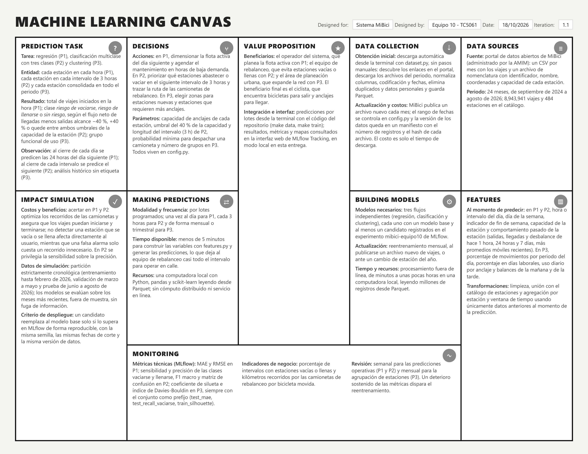

# ML Canvas

El ML Canvas (Dorard, 2018) resume en una página cómo el proyecto convierte las tres preguntas de negocio en un sistema de *Machine Learning* operable. La Figura 1 muestra la iteración 1.1 del canvas del equipo, alineada con la formulación de la sección 2 (en particular, con la definición de P2 en tres clases e intervalos de 3 horas), y la Tabla 1 transcribe el contenido de cada bloque. La fuente del canvas (`references/ml_canvas.html`), su exportación a PDF (`references/ml_canvas_mibici.pdf`) y la imagen (`references/ml_canvas.png`) se guardan en el repositorio, como pide la actividad.

## Contenido del canvas por bloque

**Tabla 1.** ML Canvas del proyecto MiBici por bloque.

| Bloque | Contenido |
|--------|-----------|
| **Propuesta de valor** (*Value proposition*) | **Beneficiarios:** el operador del sistema, que planea la flota activa con las predicciones de P1; el equipo de rebalanceo, que evita estaciones vacías o llenas con las alertas de P2; y el área de planeación urbana, que expande la red con los perfiles de P3. El beneficiario final es el ciclista, que encuentra bicicletas para salir y anclajes para llegar. **Integración e interfaz:** las predicciones se generan por lotes desde la terminal con el código del repositorio (`make data`, `make train`); los resultados, las métricas y los mapas se consultan en la interfaz web de MLflow Tracking, que en esta entrega corre en modo local. |
| **Decisiones** (*Decisions*) | **Acciones:** en P1, dimensionar la flota activa del día siguiente y agendar el mantenimiento preventivo en las horas de menor demanda esperada. En P2, priorizar qué estaciones abastecer o vaciar en el siguiente intervalo de 3 horas y trazar la ruta de las camionetas de rebalanceo. En P3, elegir zonas para estaciones nuevas y estaciones que requieren más anclajes. **Parámetros:** la capacidad de anclajes de cada estación, el umbral del 40 % de la capacidad que separa las clases de riesgo en P2, la longitud del intervalo de P2 (3 horas), la probabilidad mínima para despachar una camioneta y el número de grupos a formar en P3. Todos viven en `config.py`. |
| **Tarea de predicción** (*Prediction task*) | **Tarea:** regresión (P1), clasificación multiclase con tres clases (P2) y *clustering* (P3). **Entidad:** cada estación en cada hora (P1), cada estación en cada intervalo de 3 horas (P2) y cada estación consolidada en todo el periodo (P3). **Resultado:** el total de viajes iniciados en la hora (P1); una de las clases *riesgo de vaciarse*, *riesgo de llenarse* o *sin riesgo*, según el flujo neto de llegadas menos salidas alcance −40 %, +40 % o se quede entre ambos umbrales de la capacidad de la estación (P2); y el grupo funcional de uso al que pertenece la estación (P3). **Momento de la observación:** al cierre de cada día se predicen las 24 horas del día siguiente (P1); al cierre de cada intervalo se predice el intervalo siguiente (P2); P3 es un análisis histórico sin etiqueta. |
| **Simulación de impacto** (*Impact simulation*) | **Costos y beneficios:** acertar en P1 y P2 optimiza los recorridos de las camionetas y asegura que los viajes puedan iniciarse y terminarse; no detectar una estación que se vacía o se llena afecta directamente al usuario, mientras que una falsa alarma solo cuesta un recorrido innecesario. Por eso en P2 se privilegia la sensibilidad sobre la precisión. **Datos de simulación:** partición estrictamente cronológica (entrenamiento hasta febrero de 2026, validación de marzo a mayo y prueba de junio a agosto de 2026); los modelos se evalúan sobre los meses más recientes, fuera de muestra, para simular el desempeño futuro sin fuga de información. **Criterio de despliegue:** un modelo candidato reemplaza al modelo base solo si lo supera en MLflow de forma reproducible, con la misma semilla, las mismas fechas de corte y la misma versión de datos. |
| **Generación de predicciones** (*Making predictions*) | **Modalidad y frecuencia:** por lotes programados; una vez al día para P1, cada 3 horas para P2 y de forma mensual o trimestral para P3. **Tiempo disponible:** menos de 5 minutos para construir las variables con `features.py` y generar las predicciones, lo que deja al equipo de rebalanceo prácticamente todo el intervalo para operar en calle. **Recursos:** una computadora local con Python, pandas y scikit-learn leyendo los datos desde Parquet; no se requiere cómputo distribuido ni un servicio en línea (sección 7). |
| **Fuentes de datos** (*Data sources*) | **Fuente:** el portal de datos abiertos de MiBici (MiBici, s.f.), administrado por la AMIM: un archivo CSV por mes con los viajes y un archivo de nomenclatura con el identificador, nombre, coordenadas y capacidad de cada estación. **Periodo:** los 24 meses de septiembre de 2024 a agosto de 2026, con 8,943,941 viajes y 484 estaciones en el catálogo (sección 4). |
| **Recolección de datos** (*Data collection*) | **Obtención inicial:** descarga automática desde la terminal con `dataset.py`, sin pasos manuales: descubre los enlaces en el portal, descarga los archivos del periodo, normaliza nombres de columnas, codificación y fechas, elimina duplicados y datos personales y guarda el resultado en Parquet. **Actualización y costos:** cada mes MiBici publica un archivo nuevo; el rango de fechas se controla desde `config.py` y la versión de los datos queda registrada en un manifiesto con el número de registros y el *hash* de cada archivo, de modo que cualquier integrante reconstruye exactamente los mismos datos. El costo de recolección es solo el tiempo de descarga. |
| **Variables** (*Features*) | **Al momento de predecir:** en P1 y P2, hora o intervalo del día, día de la semana, indicador de fin de semana, capacidad de la estación y el comportamiento pasado de la estación (salidas, llegadas y desbalance de hace 1 hora, 24 horas y 7 días, más promedios móviles recientes). En P3, porcentaje de movimientos por periodo del día, porcentaje en días laborales, uso diario por anclaje y balances de la mañana y de la tarde. **Transformaciones:** limpieza, unión con el catálogo de estaciones y agregación por estación y ventana de tiempo usando únicamente datos anteriores al momento de la predicción (sección 5). |
| **Construcción de modelos** (*Building models*) | **Modelos necesarios:** tres flujos independientes (regresión, clasificación y *clustering*), cada uno con un modelo base y al menos un candidato registrados en el experimento `mibici-equipo10` de MLflow (sección 6). **Actualización:** reentrenamiento mensual, al publicarse un archivo nuevo de viajes, o ante un cambio de estación del año. **Tiempo y recursos:** procesamiento fuera de línea, de minutos a unas pocas horas en una computadora local, leyendo millones de registros desde Parquet. |
| **Monitoreo** (*Monitoring*) | **Métricas técnicas (MLflow):** error absoluto medio y raíz del error cuadrático medio en P1; sensibilidad y precisión de las clases *vaciarse* y *llenarse*, F1 macro y matriz de confusión en P2; coeficiente de silueta e índice de Davies-Bouldin en P3, siempre con el nombre del conjunto como prefijo (`test_mae`, `test_recall_vaciarse`, `train_silhouette`). **Indicadores de negocio:** porcentaje de intervalos con estaciones vacías o llenas y kilómetros recorridos por las camionetas de rebalanceo por bicicleta movida. **Revisión:** semanal para las predicciones operativas (P1 y P2) y mensual para la agrupación de estaciones (P3). Un deterioro sostenido de las métricas dispara el reentrenamiento. |
