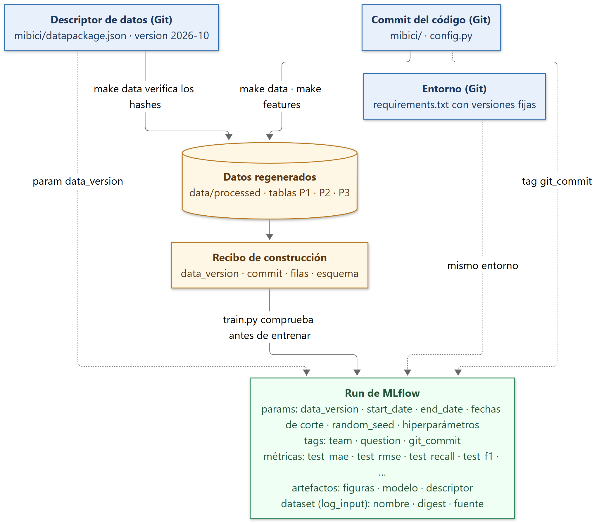

# Arquitectura del sistema

Esta sección describe los componentes de la solución, cómo se conectan desde el portal de datos abiertos de MiBici hasta el registro de experimentos en MLflow, y qué herramienta se usa en cada uno y por qué. Materializa el *pipeline* de la sección 5 y las decisiones sobre datos de la sección 4; el repositorio que la implementa se describe en la sección 9. Las cifras se midieron descargando y procesando los 24 archivos mensuales del periodo de estudio.

## Principios de diseño

**1. Procesamiento por lotes en una sola máquina.** Las tres preguntas se responden con predicciones por lotes (diarias en P1, cada tres horas en P2 y mensuales en P3), así que no se necesita un servicio de predicción en línea; Huyen (2022, cap. 7) recomienda la predicción por lotes como punto de partida cuando la latencia lo permite. El volumen tampoco exige cómputo distribuido: los 24 archivos suman 758 MB en CSV y 8,943,941 viajes, que ocupan 158 MB en Parquet y 718 MB en memoria, y la malla estación-hora de P1 tiene 8.27 millones de filas. Todo cabe en una computadora portátil, y Wilson (2022, cap. 13) advierte contra añadir infraestructura antes de que el problema la exija.

**2. El repositorio guarda recetas y huellas, nunca resultados.** En Git viven el código, la configuración, el descriptor que describe los datos y la documentación. Los CSV, los Parquet, los modelos, las carpetas de MLflow y las credenciales se regeneran en cada máquina y están excluidos por el `.gitignore`. Esto sigue las opiniones de Cookiecutter Data Science de que los datos crudos son inmutables y de que secretos y configuración local quedan fuera del control de versiones (DrivenData, s.f.), y cumple la restricción de la actividad de que ningún dato de MiBici, modelo ni carpeta de MLflow entre al historial.

**3. Todo *run* registra el commit, la versión de datos y el entorno con que se produjo.** Los *runs* no se versionan en Git: viven en MLflow y cada uno lleva como etiquetas y parámetros el SHA del commit, el nombre de la versión de datos, las fechas de corte y la semilla, de modo que cualquier integrante puede volver a ese commit, reconstruir esa versión de datos y reproducirlo. Treveil et al. (2020, cap. 4) señalan que la reproducibilidad exige versionar por separado código, datos y entorno, y Huyen (2022, cap. 6) describe el *experiment tracking* como el mecanismo que une esas piezas.

## Diagrama de arquitectura

La Figura 2 muestra los siete componentes. Los nodos azules son archivos versionados en Git, los cilindros naranjas son almacenamiento local fuera de Git y el cilindro verde punteado es el servidor en Azure planeado para la siguiente entrega. La fuente en Mermaid (`references/arquitectura.mmd`) y su exportación a imagen se guardan en el repositorio.

El flujo es el siguiente. El descriptor `datapackage.json` lista los archivos fuente con su URL, tamaño y hash SHA-256, y `config.py` toma de él la versión de datos y las fechas del periodo. `make data` ejecuta `dataset.py`, que descarga cada archivo, comprueba su hash contra el descriptor, lo normaliza y lo limpia, y guarda el resultado en Parquet. `make features` ejecuta `features.py`, que construye las tres tablas de modelado (estación-hora para P1, estación-intervalo para P2 y perfil por estación para P3) y escribe junto a ellas un recibo con la versión de datos y el commit que las produjeron. `make train` ejecuta `train.py`, que verifica ese recibo, entrena el modelo indicado con una partición cronológica y registra parámetros, métricas, etiquetas y artefactos en MLflow, en un *backend* local o, cuando esté desplegado, en el servidor compartido del equipo, según una variable de entorno.

## Componentes y herramientas

### 1. Fuentes de datos

La única fuente es el portal de datos abiertos de MiBici (MiBici, s.f.): un CSV por mes con los viajes iniciados en ese mes y un archivo de nomenclatura con identificador, nombre, coordenadas y capacidad de cada estación. El proyecto usa los 24 meses de septiembre de 2024 a agosto de 2026 (sección 4). Los enlaces se descubren leyendo la página del portal, porque cada archivo se sirve desde una URL con un identificador numérico que el portal asigna al publicarlo.

Tres propiedades de la fuente condicionan el diseño:

- **Los archivos se vuelven a publicar sin aviso y en la misma URL.** Dentro del periodo de estudio, el archivo de marzo de 2025 se reescribió 153 días después de su publicación y el de agosto de 2025, 36 días después. Solo un hash del contenido permite detectarlo.
- **El catálogo de estaciones no tiene historial.** Se sobrescribe en la misma URL cada vez que se actualiza, por lo que debe fijarse por hash como cualquier otro archivo.
- **El formato cambia entre meses.** En el propio periodo conviven dos formatos de fecha (`DD/MM/AAAA H:MM` sin segundos en septiembre y octubre de 2024, `AAAA-MM-DD HH:MM:SS` en el resto), dos codificaciones (Latin-1 en siete archivos, UTF-8 en el resto) y dos estilos de comillas y saltos de línea.

### 2. Configuración y versionado de datos

`config.py` es la única fuente de rutas, fechas, semillas y parámetros de negocio: la versión de datos y las fechas del periodo (tomadas del descriptor de datos), las fechas de corte de entrenamiento, validación y prueba, la semilla, el umbral y el intervalo de la etiqueta de P2, el historial mínimo de una estación para participar en los rezagos y el nombre del experimento de MLflow.

La actividad pide un mecanismo de versionado que permita reconstruir exactamente los mismos datos en cualquier computadora y registrar la versión en MLflow. Como el repositorio no puede contener ningún byte de MiBici, lo versionable es una descripción de los datos suficiente para reconstruirlos y verificarlos. Es la opción que sugiere la actividad (manifiesto en Git con conteo y hash por archivo) y el mismo patrón con que Nix, Bazel, pip en modo de verificación de hashes y DVC fijan dependencias externas: URL y hash de contenido en el control de versiones, bytes fuera de él y fallo explícito si el origen cambió.

- **El descriptor sigue el estándar Frictionless Data Package:** un único archivo `mibici/datapackage.json` con un recurso por archivo fuente (24 meses de viajes y la nomenclatura), cada uno con `path` (la URL), `bytes`, `hash` SHA-256, `encoding` y el esquema de columnas, más `version`, `created`, `sources` y `licenses` del paquete. Usar un estándar permite validar tamaños, hashes y esquema con la biblioteca `frictionless` en lugar de código propio, y el descriptor sirve además como ficha del dataset.
- **La versión es el campo `version` del descriptor y el commit que lo contiene.** `version` lleva el mes en que se congeló la instantánea (`2026-10`, que cubre de septiembre de 2024 a agosto de 2026); cualquier cambio en los archivos fuente produce un descriptor nuevo con otra `version`, que entra a `main` por *Pull Request*. El historial de versiones es el historial de Git de ese archivo, como ocurre con cualquier *lockfile*. La ventana se mantiene congelada durante el curso para que las métricas de las entregas sean comparables.
- **Vive dentro del módulo** porque lo lee el código en tiempo de ejecución: `config.py` toma de él la versión y las fechas, `dataset.py` verifica contra él y `train.py` lo registra en cada *run*.

**Tabla 7.** Comandos del versionado de datos.

| Comando | Qué hace |
|---------|----------|
| `make data` | Reconstruye la versión descrita en `datapackage.json`: descarga las URL listadas, verifica tamaño y hash de cada archivo, normaliza y escribe Parquet. Si un archivo difiere del descriptor, termina con error indicando cuál; no hay opción para omitir la verificación, el remedio es un descriptor nuevo. |
| `make snapshot VERSION=... START=... END=...` | Regenera el descriptor a partir del portal (descubre enlaces, descarga, calcula tamaños y hashes). El cambio entra a `main` por *Pull Request*, así que una versión de datos nueva se revisa como un cambio de código. |

El descriptor describe las entradas, no las salidas: las tablas procesadas son una función determinista de la versión de datos y del commit, y esa pareja es lo que registra cada *run*. Así, un cambio en las reglas de limpieza no invalida una versión cuyos bytes de entrada no cambiaron. Huyen (2022, cap. 6) y Treveil et al. (2020, cap. 4) exigen versionar los datos para reproducir un modelo; el descriptor lo logra sin un almacén remoto.

### 3. Ingesta reproducible

`dataset.py` es un comando de terminal construido con Typer, sin pasos manuales. Trabaja archivo por archivo, porque el formato varía entre meses, y después consolida:

1. **Descarga y verifica.** Calcula el SHA-256 de cada archivo y lo compara con el descriptor; un archivo presente con hash correcto no se vuelve a descargar.
2. **Normaliza por archivo.** Lee con la codificación declarada en el descriptor, unifica los nombres de columna y convierte las fechas indicando explícitamente el formato detectado; nunca se deja que la biblioteca lo adivine, porque con el formato de día primero pandas interpreta `01/09/2024` como 9 de enero sin emitir error.
3. **Limpia.** Elimina duplicados por identificador de viaje, descarta en esta frontera las columnas de usuario, género y año de nacimiento para que ninguna tabla ni artefacto posterior contenga datos personales, y cruza con el catálogo de estaciones.
4. **Consolida la ventana y escribe Parquet** particionado por mes. El archivo mensual es la partición de la fuente, no la unidad de análisis: 622 viajes del periodo terminan en el mes siguiente al de su archivo, los rezagos de 24 horas y 7 días cruzan los bordes de mes y 111 estaciones abrieron durante la ventana, así que los 24 meses se unen en una sola tabla antes de cualquier agregación.

Herramientas: Python 3.10, Typer, requests y BeautifulSoup para descubrir y descargar, pandas y pyarrow para transformar y escribir, hashlib para los hashes y loguru para el registro de eventos. Huyen (2022, cap. 3) contrapone el CSV, orientado a filas, con Parquet, orientado a columnas y comprimido; aquí leer los 24 CSV toma 135 segundos y leer el Parquet equivalente, 1.4. La frontera de datos personales responde a las condiciones de uso de la sección 4 y a la práctica obligatoria de no registrar datos personales en MLflow.

### 4. Almacenamiento

El almacenamiento es local, en la carpeta `data/` excluida de Git, con los niveles de la plantilla de Cookiecutter Data Science (DrivenData, s.f.). No hay almacenamiento compartido por decisión: la actividad exige que los datos puedan reconstruirse en cualquier computadora, así que el sistema de registro es el portal más el descriptor, no la copia de ningún integrante.

**Tabla 8.** Niveles de almacenamiento local.

| Carpeta | Contenido | Quién la escribe |
|---------|-----------|------------------|
| `data/raw/` | CSV tal como se descargaron; copia inmutable contra la que se verifica el descriptor | `make data` |
| `data/interim/` | Viajes limpios en Parquet particionado por mes y catálogo de estaciones, sin datos personales | `make data` |
| `data/processed/` | Tablas de modelado P1, P2 y P3 y recibo de construcción con versión de datos, commit, filas y esquema | `make features` |
| `models/` | Modelos serializados; el modelo también se registra como artefacto del *run* | `make train` |

### 5. Procesamiento y *feature engineering*

`features.py` contiene las transformaciones como funciones reutilizables con *docstring* que indica qué hacen y por qué son pertinentes para su pregunta (catálogo en la sección 5). `make features` las aplica sobre el Parquet limpio y produce la malla estación-hora de P1, la malla estación-intervalo de P2 a la granularidad definida en `config.py` y el perfil histórico por estación de P3.

La regla crítica es que ninguna variable use información posterior al momento de la predicción. Huyen (2022, cap. 5) enumera las fugas más frecuentes (particiones aleatorias en datos temporales, escalado ajustado antes de dividir, variables calculadas con datos del futuro) y la arquitectura las cierra en tres puntos: los rezagos y promedios móviles se calculan con desplazamientos sobre ventanas cerradas, los escaladores viven dentro de un `Pipeline` de scikit-learn que se ajusta solo con el conjunto de entrenamiento, y las estaciones con menos historial que el mínimo configurado no aportan filas. Mantener las funciones en el módulo y no en los *notebooks* sigue a Cookiecutter Data Science (DrivenData, s.f.) y a Wilson (2022, cap. 9), y garantiza que el futuro `predict.py` use las mismas funciones que el entrenamiento, evitando el *train-serving skew* (Huyen, 2022).

### 6. Entrenamiento

`train.py` recibe la pregunta y el modelo (`baseline` o candidato), de modo que `make train` lo invoca una vez por combinación y cada ejecución es un *run* independiente. Lee el recibo de construcción y se niega a entrenar si la versión de datos o el esquema no coinciden con `config.py`. Construye un `Pipeline` de scikit-learn con preprocesamiento y estimador, lo ajusta con el bloque de entrenamiento, evalúa con el bloque de prueba y guarda el modelo en `models/`. scikit-learn cubre los modelos base y candidatos y las métricas de la sección 6; LightGBM o XGBoost entrarían como dependencias fijadas si se usan como candidatos. Empezar por un *baseline* sencillo y comparar siempre contra él sigue a Huyen (2022, cap. 6).

### 7. Registro de experimentos

El registro se hace con MLflow Tracking (MLflow, s.f.) desde `train.py`, nunca solo desde un *notebook*. Un único experimento, `mibici-equipo10`, agrupa todos los *runs*; cada uno lleva un nombre descriptivo con pregunta, modelo y etapa (`P1-ridge-baseline`, `P2-logreg-baseline`, `P3-kmeans-baseline`) y registra lo que exige la actividad: como parámetros, `data_version`, `start_date`, `end_date`, las fechas de corte, `random_seed` y los hiperparámetros; como métricas, las de la sección 6 con el conjunto como prefijo (`test_mae`, `test_f1`, `train_silhouette`); como etiquetas, `team`, `question` y `git_commit`; como artefactos, al menos una figura por pregunta, el modelo y una copia del descriptor. Además, con `mlflow.log_input` el *run* registra el conjunto de datos como entrada, con el nombre de la versión, un *digest* calculado a partir de los hashes del descriptor y la URL del portal como fuente, de modo que la versión aparece en la pestaña de *datasets* del *run* en la interfaz de MLflow. Nunca credenciales ni datos personales, lo que queda garantizado porque las tablas de modelado ya no los contienen.

El código no nombra ningún *backend*: lee `MLFLOW_TRACKING_URI` del archivo `.env` mediante python-dotenv. Esto permite dos modos con el mismo código, el mismo experimento y las mismas etiquetas:

**Tabla 9.** Modos de registro de experimentos.

| Modo | Cuándo se usa | Configuración | Qué necesita el integrante |
|------|---------------|---------------|----------------------------|
| Local | Iterar y depurar; reproducir desde un clon limpio sin credenciales | Sin `.env`: MLflow escribe en `mlruns/`, que se consulta con `mlflow ui` | Nada |
| Compartido en Azure (planeado para la siguiente entrega) | *Runs* que el equipo quiere ver y comparar en tiempo real | `MLFLOW_TRACKING_URI` apunta al servidor del equipo | Tres variables en `.env`: URI, usuario y contraseña de MLflow |

En esta entrega todos los *runs* y las capturas provienen del modo local. El servidor compartido está diseñado y se desplegará para la siguiente entrega como una instancia propia de MLflow Tracking Server en Azure: correrá en un contenedor en Azure Container Apps, guardará los metadatos en Azure Database for PostgreSQL y los artefactos en Azure Blob Storage, y protegerá el acceso con la autenticación básica de MLflow; como los artefactos pasan por el servidor, los integrantes no necesitarán credenciales de Azure. Se prefiere a la integración de MLflow en Azure Machine Learning porque ofrece la misma interfaz que el modo local (la actividad pide capturas de la interfaz de MLflow) y habilita el Model Registry para entregas siguientes. Wilson (2022, cap. 8) presenta MLflow como la herramienta para registrar y comparar los experimentos de un producto mínimo viable; Treveil et al. (2020, cap. 4) describen este registro como lo que vuelve auditables las decisiones de modelado. `mlruns/`, `mlartifacts/` y `.env` permanecen fuera de Git; en el repositorio solo entra un `.env.example` con los nombres de las variables.

La Figura 3 resume cómo se encadenan estas piezas: el descriptor fija qué se leyó, el commit fija qué se hizo con ello, el recibo de construcción comprueba localmente que los datos corresponden a ambos, y el *run* registra los tres identificadores, de modo que `data_version` más `git_commit` más el entorno fijado bastan para repetirlo en otra máquina.

<figure><figcaption>Figura 3. Cadena de trazabilidad: del descriptor de datos y el commit de Git al <em>run</em> de MLflow.</figcaption></figure>

## Resumen de herramientas y justificación

**Tabla 10.** Herramientas por componente, alternativa considerada y justificación.

| Componente | Herramienta | Alternativa considerada | Justificación |
|------------|-------------|-------------------------|---------------|
| Fuentes de datos | Portal de MiBici; enlaces descubiertos con requests y BeautifulSoup | URL escritas a mano | Única fuente oficial; el portal asigna los identificadores de las URL, así que descubrirlos evita una lista manual (MiBici, s.f.) |
| Ingesta | Python 3.10, Typer, pandas, pyarrow, hashlib, loguru | *Notebook* ejecutado a mano | La actividad exige un comando sin pasos manuales; Cookiecutter Data Science organiza el análisis como pasos reproducibles desde la terminal (DrivenData, s.f.) |
| Formato de almacenamiento | Parquet | CSV intermedios | Orientado a columnas, comprimido y tipado (Huyen, 2022, cap. 3); reduce la lectura de 135 s a 1.4 s |
| Motor de procesamiento | pandas | Spark o Dask | Los datos caben en memoria; el cómputo distribuido añadiría costo sin beneficio (Wilson, 2022, cap. 13) |
| Versionado de datos | Descriptor Frictionless `datapackage.json` en Git con URL, bytes y SHA-256 por archivo; versiones en el historial de Git | DVC `import-url`; manifiesto en formato propio | Versionar datos es requisito de reproducibilidad (Huyen, 2022, cap. 6; Treveil et al., 2020, cap. 4); el descriptor lo logra sin almacén remoto, es la opción que sugiere la actividad y el estándar aporta validación con `frictionless` |
| *Feature engineering* | Funciones en `features.py` con *docstring*; `Pipeline` de scikit-learn | Transformaciones en el *notebook* | Evita las fugas que cataloga Huyen (2022, cap. 5) y el *train-serving skew*; código modular y comprobable (Wilson, 2022, cap. 9) |
| Modelado | scikit-learn | Otras bibliotecas | Cubre modelos y métricas de las secciones 5 y 6; empezar por el modelo más simple (Huyen, 2022, cap. 6) |
| Registro de experimentos | MLflow Tracking local; servidor propio en Azure (Container Apps, PostgreSQL, Blob Storage) planeado para la siguiente entrega; `mlflow.log_input` para la versión de datos | MLflow de Azure Machine Learning | Herramienta del curso; registra parámetros, métricas, etiquetas, artefactos y *datasets* (MLflow, s.f.; Wilson, 2022, cap. 8; Treveil et al., 2020, cap. 4); misma interfaz en ambos modos |
| Configuración y entorno | `config.py`, `.env` con python-dotenv, `requirements.txt` con versiones fijas | Constantes repartidas; dependencias sin fijar | Una sola fuente de rutas, fechas y semillas y un entorno reproducible son requisitos de la actividad; Treveil et al. (2020, cap. 4) piden versionar el entorno |
| Orquestación | Makefile con `data`, `features`, `train` y `snapshot` | Airflow o Prefect | Un grafo de tres pasos no justifica un orquestador; Huyen (2022, cap. 10) ubica cron y Make en el primer escalón |
| Colaboración | Git y GitHub con `main` protegida, *Pull Requests* y Ruff | Trabajo directo sobre `main` | Requisito de la actividad; estándares de código y mantenibilidad en equipo (Wilson, 2022, cap. 10); detalle en la sección 9 |
