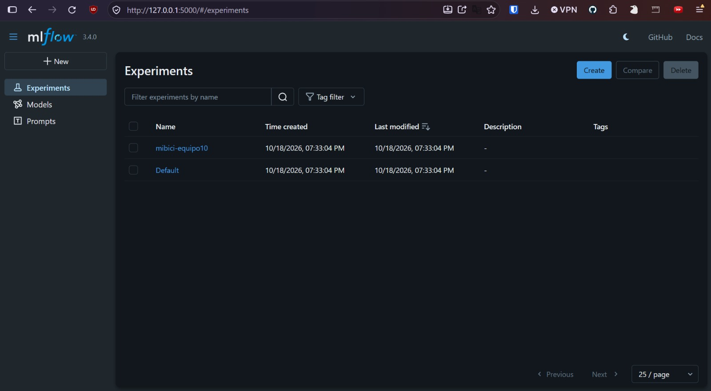
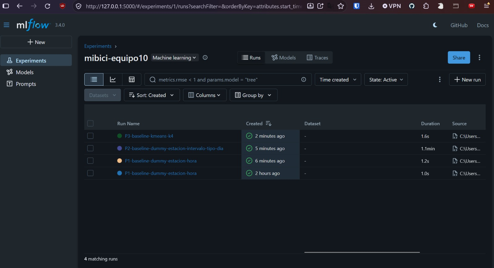
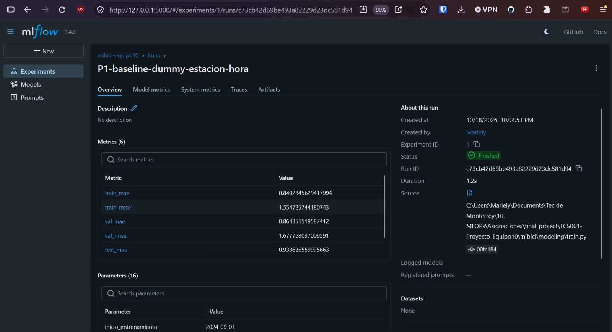
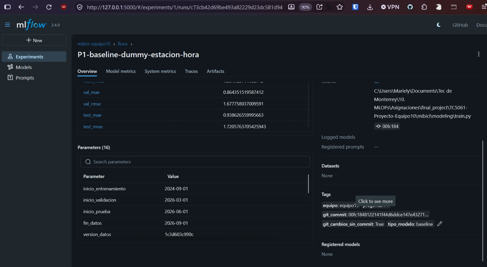
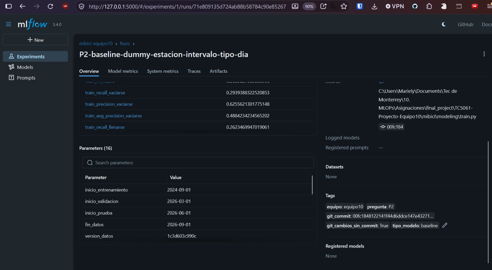
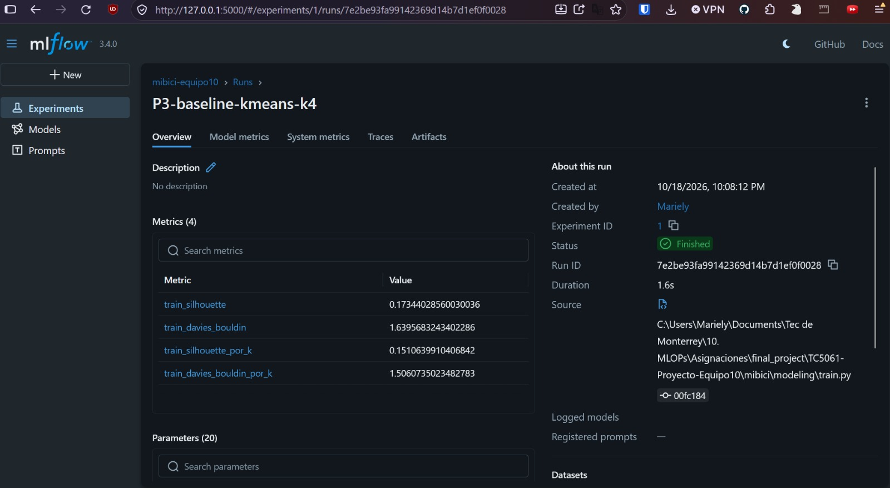
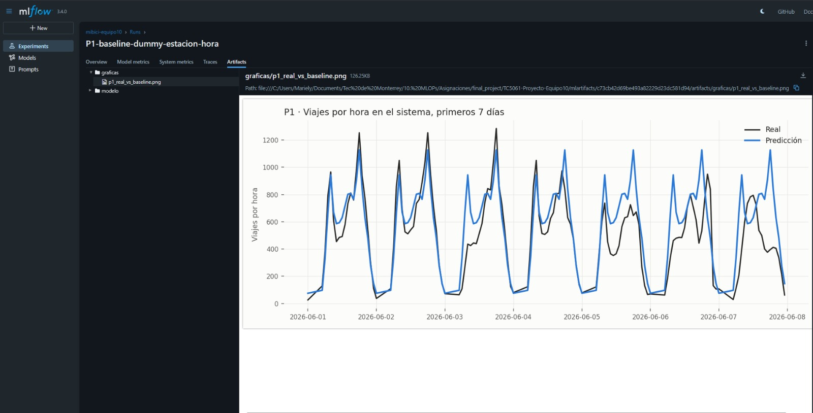
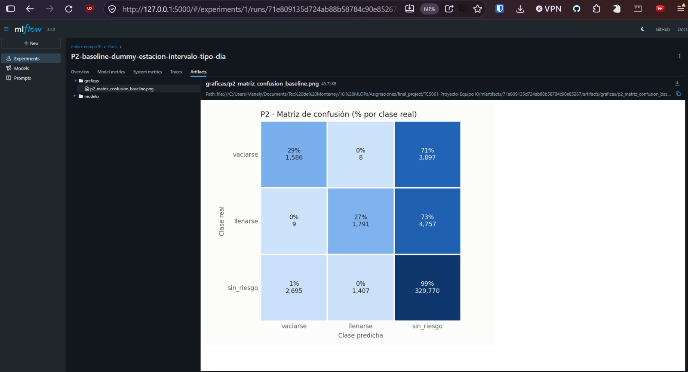
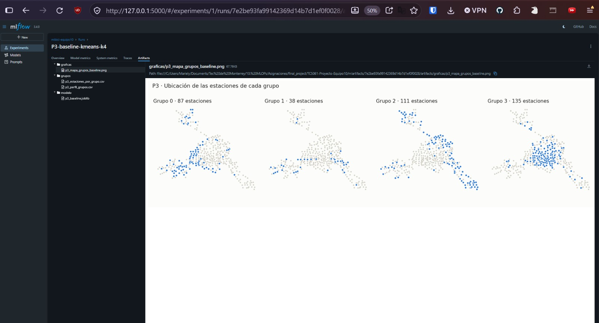
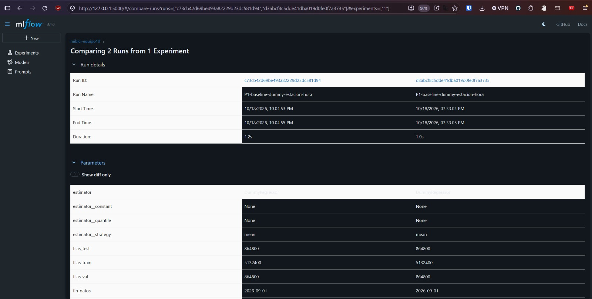

# Experimento base en MLflow

El experimento base comprueba que la propuesta es técnicamente viable de extremo a extremo: los datos de la sección 4 se reconstruyen con la ingesta, las variables de la sección 5 se calculan con `features.py`, los modelos base de la sección 6 se entrenan desde `train.py` y todo queda registrado en MLflow Tracking (MLflow, s.f.) con la trazabilidad de la sección 7. Las métricas de estos *runs* son la línea base contra la que se medirá cualquier mejora en las entregas siguientes.

## Diseño del experimento

**Un solo experimento, `mibici-equipo10`**, agrupa todos los *runs* del proyecto (Figura 4). Cada *run* se nombra con la pregunta, la etapa y el modelo, nunca con el nombre aleatorio de MLflow, y se ejecuta desde `mibici/modeling/train.py`, no desde un *notebook*. La Tabla 12 lista los *runs* de esta entrega: el modelo base de cada pregunta.

**Tabla 12.** *Runs* del experimento base.

| *Run* | Pregunta | Modelo | Conjunto de evaluación | Métricas registradas | Artefactos |
|-------|----------|--------|------------------------|----------------------|------------|
| `P1-baseline-dummy-estacion-hora` | P1 | `DummyRegressor` con `strategy="mean"` agrupado por estación y hora del día (9,400 grupos) | Entrenamiento, validación y prueba cronológicos | `train_`, `val_` y `test_` de `mae` y `rmse` | Gráfica de viajes reales contra predichos en los primeros 7 días de prueba; modelo |
| `P2-baseline-dummy-estacion-intervalo-tipo-dia` | P2 | `DummyClassifier` con `strategy="prior"` agrupado por estación, intervalo del día y tipo de día (predice la clase más frecuente del grupo) | Entrenamiento, validación y prueba cronológicos | Sensibilidad, precisión y precisión promedio de las clases *vaciarse* y *llenarse*, y F1 macro, por conjunto | Matriz de confusión; modelo |
| `P3-baseline-kmeans-k4` | P3 | `KMeans`, `k = 4`, sobre el perfil estandarizado de cada estación | Perfiles de estación del periodo de entrenamiento | `train_silhouette`, `train_davies_bouldin` y las mismas por cada `k` evaluado | Mapa de estaciones por grupo; estaciones y perfil promedio por grupo (CSV); modelo |

Todos los *runs* comparten la configuración de `config.py`, que es la única fuente de rutas, fechas y semillas, y registran lo que exige la actividad y las buenas prácticas de la rúbrica:

**Tabla 13.** Contenido de cada *run*.

| Elemento | Contenido | Para qué sirve |
|----------|-----------|----------------|
| Parámetros | `inicio_entrenamiento`, `inicio_validacion`, `inicio_prueba` y `fin_datos` (rango de fechas y cortes de la partición), `version_datos` (huella de la versión de datos), `semilla`, `modelo`, `estimator` y sus hiperparámetros (`estimator__strategy` en los modelos *dummy*; `n_clusters`, `n_init` y `random_state` en K-medias), `group_columns`, `n_grupos` y el número de filas de cada conjunto (`filas_train`, `filas_val`, `filas_test`) en P1 y P2; `conjunto_usado`, `variables`, `periodos_del_dia` y `n_estaciones` en P3 | Reproducir el *run* exactamente: con el mismo *commit*, la misma versión de datos y la misma semilla se obtienen las mismas métricas |
| Métricas | Las de la sección 6, siempre con el conjunto como prefijo (`test_mae`, no `mae`) | Distinguir en la interfaz de MLflow sobre qué datos se calculó cada número |
| Etiquetas | `equipo = equipo10`; `pregunta` con valor `P1`, `P2` o `P3`; `git_commit` (SHA del *commit* con que se ejecutó); `git_cambios_sin_commit` (si había cambios locales sin confirmar); `tipo_modelo` con valor `baseline` o `candidato` | Ligar cada *run* con la pregunta que atiende y con el código que lo produjo |
| Artefactos | Al menos una figura por pregunta (gráfica, matriz de confusión o mapa), el modelo serializado y, en P3, las tablas de grupos | Evidencia visual del resultado |

Nunca se registran credenciales ni datos personales: las tablas de modelado ya no contienen las columnas de usuario, género ni año de nacimiento (sección 4), y la URI del servidor de MLflow se lee de un archivo `.env` excluido de Git.

## Comando de reproducción

Desde un clon limpio del repositorio, y siguiendo la sección de instalación del README, el experimento completo se reproduce con tres comandos sin pasos manuales:

```bash
make data                                          # descarga los 24 meses y la nomenclatura, limpia, escribe Parquet y el manifiesto
make train                                         # construye las tablas de P1, P2 y P3 y registra en MLflow los runs de la Tabla 12
mlflow ui --backend-store-uri sqlite:///mlflow.db  # abre la interfaz en http://127.0.0.1:5000 para consultar el experimento
```

`make train` ejecuta `python -m mibici.modeling.train all`; también puede ejecutarse un solo *run* indicando la pregunta:

```bash
python -m mibici.modeling.train p1
python -m mibici.modeling.train p2
python -m mibici.modeling.train p3
```

Sin un archivo `.env`, MLflow escribe en la base local `mlflow.db` y guarda los artefactos en `mlartifacts/`, ambos excluidos de Git; con `MLFLOW_TRACKING_URI` definido, los mismos comandos registran en el servidor compartido del equipo (sección 7, Tabla 10). En esta entrega todos los *runs* se ejecutaron en modo local, con el *commit* `00fc184` y la versión de datos `1c3d603c990c`.

## Resultados del experimento base

La partición cronológica usada en los tres *runs* es la de la sección 4: entrenamiento del 1 de septiembre de 2024 al 28 de febrero de 2026 (5,132,400 filas estación-hora en P1), validación del 1 de marzo al 31 de mayo de 2026 (864,800 filas) y prueba del 1 de junio al 31 de agosto de 2026 (864,800 filas). Las cifras corresponden a las 470 estaciones activas por las 20 horas diarias de servicio de cada día del conjunto, y los 9,400 grupos del *baseline* de P1 son esas 470 estaciones por 20 horas. En P3 participan 371 estaciones: las que tienen capacidad registrada en el catálogo y movimientos en el periodo de entrenamiento.

**Tabla 14.** Métricas del experimento base (versión de datos `1c3d603c990c`, *commit* `00fc184`, semilla 42).

| *Run* | Conjunto | Métricas |
|-------|----------|----------|
| `P1-baseline-dummy-estacion-hora` | Entrenamiento | `train_mae` = 0.840; `train_rmse` = 1.555 |
| `P1-baseline-dummy-estacion-hora` | Validación | `val_mae` = 0.864; `val_rmse` = 1.678 |
| `P1-baseline-dummy-estacion-hora` | Prueba | `test_mae` = 0.939; `test_rmse` = 1.721 |
| `P2-baseline-dummy-estacion-intervalo-tipo-dia` | Entrenamiento | `train_recall_vaciarse` = 0.294; `train_precision_vaciarse` = 0.626; `train_avg_precision_vaciarse` = 0.488; `train_recall_llenarse` = 0.262 |
| `P2-baseline-dummy-estacion-intervalo-tipo-dia` | Prueba (calculadas a partir de la matriz de confusión de la Figura 11) | `test_recall_vaciarse` = 0.289; `test_precision_vaciarse` = 0.370; `test_recall_llenarse` = 0.273; `test_precision_llenarse` = 0.559 |
| `P3-baseline-kmeans-k4` | Perfiles de entrenamiento | `train_silhouette` = 0.173; `train_davies_bouldin` = 1.640; grupos de 87, 38, 111 y 135 estaciones |

**Lectura de los resultados.** En P1, el promedio histórico por estación y hora se equivoca en menos de un viaje por hora en promedio (`test_mae` de 0.94), pero el RMSE casi duplica al MAE, lo que confirma que el error se concentra en las horas pico: la gráfica de la Figura 10 muestra que el *baseline* reproduce el ciclo diario pero subestima los picos de la mañana y la tarde y no distingue el fin de semana. El ligero aumento del error de entrenamiento a prueba (0.84 a 0.94) indica un cambio moderado en la demanda de los meses más recientes, que los candidatos con rezagos deben capturar. En P2, el *baseline* por estación, intervalo y tipo de día recupera en el conjunto de prueba cerca de un 29 % de los intervalos que terminan en *riesgo de vaciarse* y un 27 % de los que terminan en *riesgo de llenarse*, cifras casi iguales a las de entrenamiento, como corresponde a un modelo que solo memoriza frecuencias; la matriz de confusión (Figura 11) muestra que casi todos los errores consisten en predecir *sin riesgo*, que la confusión entre *vaciarse* y *llenarse* es marginal (menos de diez intervalos en cada sentido) y que la clase *sin riesgo* domina con más de 333 mil intervalos frente a 5.5 mil y 6.6 mil de las clases de riesgo, lo que justifica las métricas por clase y el manejo del desbalance en los candidatos. En P3, la silueta de 0.17 y el índice de Davies-Bouldin de 1.64 indican grupos con traslape, esperable al describir estaciones con cinco variables continuas; aun así, el mapa de la Figura 12 muestra que los grupos no se reparten al azar en el territorio: el grupo de 135 estaciones se concentra en la zona central de la red y el de 38 estaciones ocupa sobre todo la periferia, lo que es la base para asignarles una vocación con el área de planeación.

## Evidencia: capturas de la interfaz de MLflow

Las capturas siguientes provienen de la interfaz de MLflow en modo local (`mlflow ui`) tras ejecutar los tres *runs*.




















