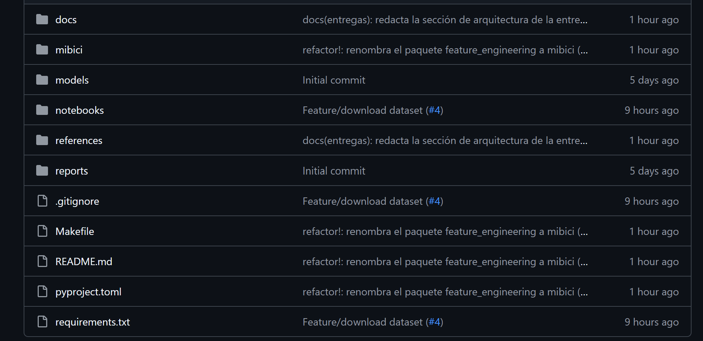

# Repositorio del equipo

El repositorio `TC5061-Proyecto-Equipo10` es público y está disponible en <https://github.com/WillSagzz/TC5061-Proyecto-Equipo10>. Contiene el código que reproduce los datos y el experimento base, la documentación del proyecto y la fuente de este documento; nunca contiene datos de MiBici, modelos, carpetas de MLflow ni credenciales. Esta sección resume lo que el README documenta con detalle: la estructura, las buenas prácticas, el flujo de trabajo y los integrantes.

## Estructura del repositorio

La estructura se generó con la plantilla Cookiecutter Data Science (DrivenData, s.f.) mediante `pipx install cookiecutter-data-science` y `ccds`, con la opción `include_code_scaffold` en `Yes`, y se subió como primer *commit*. Se respeta la separación de carpetas de la plantilla (datos en `data/`, notebooks en `notebooks/`, código en el módulo `mibici/`, modelos en `models/`, figuras en `reports/figures/`, ML Canvas y diagramas en `references/`) y se agrega únicamente la carpeta `docs/entregas/`, con la fuente en Markdown de este documento (Figura 14). El README describe cada carpeta y archivo.

## Buenas prácticas aplicadas

La Tabla 15 recorre las prácticas obligatorias de la actividad e indica cómo las aplica el equipo y dónde puede verificarse cada una.

**Tabla 15.** Buenas prácticas obligatorias y su aplicación en el proyecto.

| Ámbito | Práctica | Cómo la aplica el equipo | Dónde se verifica |
|--------|----------|--------------------------|-------------------|
| MLflow Tracking | Un experimento por proyecto y *runs* con nombre descriptivo | Experimento único `mibici-equipo10`; `train.py` asigna el nombre `P{n}-{etapa}-{modelo}` a cada *run* (Tabla 12) | Interfaz de MLflow |
| MLflow Tracking | Registrar todo lo necesario para reproducir el *run* | Parámetros `version_datos`, fechas del periodo y de corte, `semilla`, modelo e hiperparámetros, tomados de `config.py` (Tabla 13) | Parámetros del *run* |
| MLflow Tracking | Ligar cada *run* con el código y la pregunta | Etiquetas `git_commit`, `pregunta`, `equipo` y `tipo_modelo` escritas por `train.py` | Etiquetas del *run* |
| MLflow Tracking | Nombrar las métricas con el conjunto en que se calculan | `test_mae`, `test_recall_vaciarse`, `train_silhouette`; nunca `mae` a secas | Métricas del *run* |
| MLflow Tracking | No registrar credenciales ni datos personales | `dataset.py` conserva solo las columnas del contrato de datos, sin usuario, género ni año de nacimiento; la URI del servidor vive en `.env`, excluido de Git | Interfaz de MLflow y código |
| Estructura y código | Notebooks solo para exploración, con la convención de la plantilla | La lógica final vive en `mibici/`; los notebooks de exploración se llaman `1.0-gsg-descarga-dataset.ipynb` y `2.0-gsg-exploracion-variables.ipynb`, y la lógica definitiva está en `dataset.py` y `features.py` | Carpeta `notebooks/` |
| Estructura y código | Configuración en un solo lugar | Rutas (`pathlib`), fechas del periodo y de corte, semilla, umbral e intervalo de P2 y nombre del experimento, todos en `config.py` | `mibici/config.py` |
| Estructura y código | Dependencias con versión fija y entorno reproducible | `requirements.txt` con versiones fijadas; Python 3.10; instalación documentada en el README desde un clon limpio | `requirements.txt` y README |
| Datos y Git | Ningún dato, modelo, carpeta de MLflow ni credencial en el historial | `.gitignore` excluye `data/`, `mlruns/`, `mlartifacts/`, `mlflow.db`, `*.pkl`, `*.joblib` y `.env`; la revisión de cada PR lo comprueba | `.gitignore` e historial |
| Datos y Git | Todo cambio entra a la rama principal por *Pull Request* revisado | Regla de protección de `main` que exige PR con una aprobación; todos los PR mezclados han sido revisados por otro integrante | Pestaña de *Pull Requests* |

## Flujo de trabajo con Git/GitHub

El equipo sigue GitHub Flow (GitHub, s.f.-b): `main` es la única rama de larga duración, cada cambio nace en una rama corta nombrada según Conventional Branch (Conventional Branch, s.f.), con *commits* según Conventional Commits 1.0.0 (Conventional Commits, s.f.), y entra a `main` mediante un *Pull Request* revisado y aprobado por otro integrante (GitHub, s.f.-c). `main` tiene una regla de protección activa (GitHub, s.f.-a) que exige *Pull Request* con al menos una aprobación, descarta las aprobaciones anteriores cuando llegan *commits* nuevos, exige resolver las conversaciones antes de mezclar y bloquea los *force push* y el borrado de la rama, también para el dueño del repositorio. Los cuatro integrantes han abierto al menos un *Pull Request*, han revisado y aprobado al menos uno de otro integrante y tienen *commits* en el historial de `main`.

El flujo completo (ciclo de trabajo, tipos de rama y de *commit*, plantilla y lista de revisión de los *Pull Requests*) está documentado en el README del repositorio, y la evidencia de colaboración se consulta en la pestaña de *Pull Requests* (<https://github.com/WillSagzz/TC5061-Proyecto-Equipo10/pulls?q=is%3Apr>), que se mantiene actualizada conforme avanza el proyecto.

## Integrantes y roles

Todos los integrantes participan en la propuesta, revisan los *Pull Requests* de los demás y contribuyen código y documentación; el rol indica el frente del que cada uno es responsable principal.

**Tabla 16.** Integrantes del equipo y roles.

| Integrante | Matrícula | Usuario de GitHub | Rol |
|------------|-----------|-------------------|-----|
| Mariely Toribio Rodríguez | A01797848 | `a01797848` | Data Scientist |
| Guillermo Sáenz González | A00823049 | `WillSagzz` | Data Engineer |
| Victor Yoguel Salazar Alanis | A01797950 | `CFOP2357` | Machine Learning Architect |
| Alan Augusto Herrera Sánchez | A01338336 | `alanhsa9` | Subject Matter Expert |
