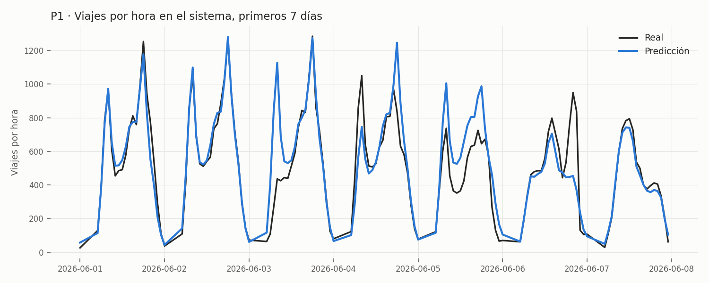
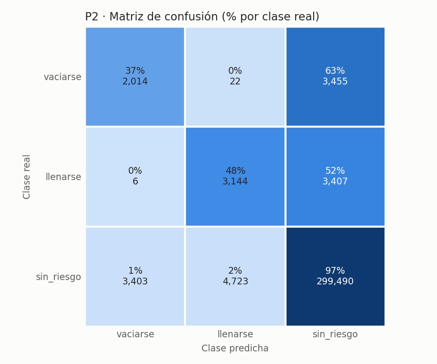
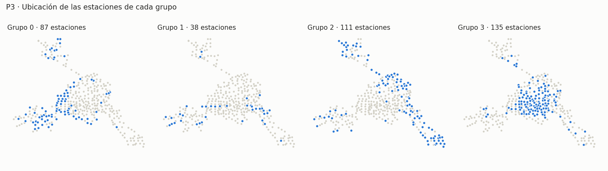

# Comparación de experimentos y selección del modelo

Se mantienen la partición temporal y las métricas de la Entrega 01. Los modelos se entrenan solo con el periodo de entrenamiento (`2024-09-01` a `2026-02-28`), se eligen con validación (`2026-03-01` a `2026-05-31`) y se confirman en prueba (`2026-06-01` a `2026-08-31`), con la versión de datos `2026-10`. Cada corrida registra las métricas de los tres conjuntos, pero los hiperparámetros, el umbral de P2 y el modelo de cada pregunta se eligieron mirando únicamente validación; prueba solo se usa para confirmar al final.

Cada pregunta tiene su *baseline* y al menos tres candidatos de scikit-learn (Pedregosa et al., 2011) que varían el algoritmo o los hiperparámetros. Las corridas se filtran en la interfaz de MLflow con las etiquetas `pregunta`, `familia_modelo` (`dummy`, `lineal`, `boosting`, `kmeans`, `jerarquico`, `mezcla_gaussiana`) y `etapa` (`baseline`, `candidato` o `busqueda`). Cada pregunta tiene además una búsqueda de hiperparámetros con *nested runs*: una corrida padre y una hija por combinación de la rejilla `SEARCH_GRIDS` de `config.py` (6 combinaciones en P1, 4 en P2 y 7 valores de *k* en P3). La mejor combinación se volvió a entrenar como candidata, con todos sus artefactos.

## Corrección respecto a la Entrega 01

Al preparar esta entrega se encontraron dos problemas en las tablas de modelado. En P1 se usaban variables de viajes de "hace una hora" que no se conocen al momento de predecir, porque el pronóstico se hace al cierre del día anterior. Además, las horas anteriores a la apertura de cada estación se llenaban con cero viajes. Ambos problemas se corrigieron en el código (Pull Request #18) y los *baselines* se volvieron a registrar. El `val_mae` del *baseline* de P1 pasó de 0.864 a 1.099 (`test_mae`, de 0.939 a 1.159), porque ya no cuenta como aciertos los ceros de estaciones que aún no abrían; el `val_f1_macro` de P2 pasó de 0.570 a 0.568. Todas las cifras de este reporte usan la versión corregida.

## P1: viajes por estación y hora

**Tabla 1.** P1: *baseline* y corridas candidatas. La mejora es la reducción del error respecto al *baseline*.

| Corrida | Modelo | Hiperparámetros clave | `val_mae` | `val_rmse` | `test_mae` | `test_rmse` | Duración | Mejora en `val_mae` | Mejora en `test_mae` |
|---------|--------|-----------------------|-----------|------------|------------|-------------|----------|---------------------|----------------------|
| `P1-baseline-dummy-estacion-hora` | `DummyRegressor` por estación y hora | `strategy=mean` | 1.099 | 1.891 | 1.159 | 1.838 | 34.4 s | — | — |
| `P1-candidato-ridge-alpha=1.0` | `Ridge` | `alpha=1.0` | 1.027 | 1.741 | 0.987 | 1.638 | 45.7 s | 6.6 % | 14.8 % |
| `P1-candidato-rf` | `RandomForestRegressor` | `n_estimators=5`, `max_depth=12` | 1.046 | 1.734 | 1.001 | 1.635 | 29.4 s | 4.8 % | 13.6 % |
| `P1-candidato-hgb` | `HistGradientBoostingRegressor` | `learning_rate=0.1`, `max_leaf_nodes=127` | 0.955 | 1.567 | 0.913 | 1.483 | 2.1 min | 13.1 % | 21.2 % |
| `P1-candidato-hgb_poisson` | `HistGradientBoostingRegressor` (pérdida de Poisson) | `learning_rate=0.1`, `max_leaf_nodes=127` | 0.951 | 1.570 | 0.908 | 1.491 | 2.4 min | 13.5 % | 21.7 % |

El modelo elegido es **`P1-candidato-hgb_poisson`** (`Run ID: bd2634f0c67f4dedaba9a755bbc079f8`). Tiene el menor error de validación (`val_mae = 0.951` viajes, 13.5 % menos que el *baseline*) y la prueba lo confirma (`test_mae = 0.908`, 21.7 % menos). En la práctica, el operador recibe un pronóstico que se equivoca en menos de un viaje por estación y hora. El error es parecido en entrenamiento (0.968), validación y prueba, así que el modelo no se aprendió de memoria el periodo de entrenamiento. Queda prácticamente empatado con `hgb`: gana en `val_mae` por 0.004 y pierde en `val_rmse` por 0.003. El desempate es que la pérdida de Poisson está pensada para conteos y nunca predice viajes negativos. Su costo, 2.4 minutos de entrenamiento y una predicción instantánea, es despreciable para un pronóstico que se hace una vez al día. La mejor combinación de la búsqueda quedó en el borde de la rejilla (los valores más altos de `learning_rate` y `max_leaf_nodes`), por lo que ampliarla es una mejora posible.

## P2: riesgo de vaciarse o llenarse

**Tabla 2.** P2: *baseline* y corridas candidatas, validación. Las corridas candidatas se llaman `P2-candidato-{modelo}-{hiperparámetros}`.

| Modelo | Hiperparámetros clave | `val_recall_vaciarse` | `val_precision_vaciarse` | `val_recall_llenarse` | `val_precision_llenarse` | `val_f1_macro` | Duración |
|--------|-----------------------|-----------------------|--------------------------|-----------------------|--------------------------|----------------|----------|
| *Baseline*: `DummyClassifier` por estación, intervalo y tipo de día | `strategy=prior` | 0.285 | 0.391 | 0.289 | 0.639 | 0.568 | 1.4 min |
| `logreg`: `LogisticRegression` con pesos por clase | `C=1.0` | 0.745 | 0.116 | 0.761 | 0.139 | 0.430 | 1.8 min |
| `hgb`: `HistGradientBoostingClassifier` con pesos por clase | `learning_rate=0.05`, `max_leaf_nodes=63` | 0.835 | 0.137 | 0.878 | 0.157 | 0.454 | 4.1 min |
| `hgb_unweighted`: el mismo, sin pesos por clase | `learning_rate=0.05`, `max_leaf_nodes=63` | 0.188 | 0.543 | 0.242 | 0.739 | 0.541 | 2.8 min |
| `hgb_threshold`: `hgb` con umbral de alerta | `learning_rate=0.05`, `max_leaf_nodes=63`; umbrales 0.90 (`vaciarse`) y 0.85 (`llenarse`) | 0.362 | 0.383 | 0.521 | 0.444 | 0.608 | 5.2 min |

**Tabla 3.** P2: *baseline* y corridas candidatas, prueba y mejora en `test_f1_macro` respecto al *baseline*.

| Modelo | `test_recall_vaciarse` | `test_precision_vaciarse` | `test_recall_llenarse` | `test_precision_llenarse` | `test_f1_macro` | Mejora en `test_f1_macro` |
|--------|------------------------|---------------------------|------------------------|---------------------------|-----------------|---------------------------|
| *Baseline* | 0.289 | 0.370 | 0.273 | 0.559 | 0.557 | — |
| `logreg` | 0.736 | 0.108 | 0.747 | 0.122 | 0.424 | −23.9 % |
| `hgb` | 0.820 | 0.127 | 0.861 | 0.139 | 0.446 | −19.9 % |
| `hgb_unweighted` | 0.195 | 0.524 | 0.218 | 0.688 | 0.533 | −4.3 % |
| `hgb_threshold` | 0.367 | 0.371 | 0.479 | 0.399 | 0.593 | +6.5 % |

El modelo elegido es **`P2-candidato-hgb_threshold`** (`Run ID: 7b0a4e39e3dc47fa8b639815f5dedfc0`). Con 94 % de intervalos sin riesgo, el F1 macro es la métrica que no se deja engañar por un modelo que nunca alerta. Los candidatos con pesos por clase (`logreg` y `hgb`) detectaban más del 74 % de los intervalos en riesgo, pero solo 12 a 16 % de sus alertas eran ciertas; esa cantidad de falsas alarmas saturaría a las cuadrillas de rebalanceo, y su F1 quedó por debajo del *baseline*. Sin embargo, `hgb` era el que mejor distinguía el riesgo: su precisión promedio, que no depende del umbral, fue la más alta en validación (0.353 en `vaciarse` y 0.491 en `llenarse`, contra 0.320 y 0.470 del *baseline*). Por eso se agregó `hgb_threshold`, el mismo modelo con un umbral de alerta por clase. Los umbrales se eligieron con validación entre 0.05 y 0.95 (0.90 para `vaciarse` y 0.85 para `llenarse`) y quedan guardados dentro del modelo. Es el único candidato que supera al *baseline* en F1 macro, tanto en validación (0.608 contra 0.568) como en prueba (0.593 contra 0.557). En prueba, detecta casi el doble de intervalos en que una estación se llena (47.9 % contra 27.3 %) y más de los que se vacía (36.7 % contra 28.9 %), con la misma precisión en `vaciarse` y algo menor en `llenarse` (0.40 contra 0.56). Para el equipo de rebalanceo, una estación llena que no se atiende cuesta más que una falsa alarma, así que el intercambio conviene. Como el umbral se eligió con validación, su `val_f1_macro` es algo optimista; la caída pequeña en prueba (de 0.608 a 0.593) muestra que el ajuste no se sobreajustó a ese periodo.

## P3: grupos de estaciones

**Tabla 4.** P3: *baseline* y corridas candidatas. P3 no tiene validación ni prueba: los grupos se calculan solo con el periodo de entrenamiento.

| Corrida | Modelo | Hiperparámetros clave | `train_silhouette` | `train_davies_bouldin` | Tamaño de los grupos | Duración | Cambio en silueta |
|---------|--------|-----------------------|--------------------|------------------------|----------------------|----------|-------------------|
| `P3-baseline-kmeans-k4` | `StandardScaler` + `KMeans` | `n_clusters=4` | 0.173 | 1.640 | 87 / 38 / 111 / 135 | 38.5 s | — |
| `P3-candidato-kmeans-n_clusters=5` | `StandardScaler` + `KMeans` | `n_clusters=5` | 0.165 | 1.602 | 75 / 37 / 63 / 98 / 98 | 23.8 s | −4.9 % |
| `P3-candidato-agglomerative-n_clusters=4` | `StandardScaler` + `AgglomerativeClustering` (Ward) | `n_clusters=4` | 0.154 | 1.822 | 82 / 31 / 112 / 146 | 28.0 s | −11.1 % |
| `P3-candidato-gmm-n_clusters=4` | `StandardScaler` + `GaussianMixture` | `n_clusters=4` | 0.132 | 2.110 | 92 / 34 / 105 / 140 | 26.6 s | −24.0 % |

Se queda el *baseline*, **`P3-baseline-kmeans-k4`** (`Run ID: 52e808005b9c45208f2a2a6004232425`), porque ningún candidato forma grupos mejor separados. La búsqueda anidada con *k* de 2 a 8 confirmó que *k* = 4 tiene la mayor silueta (0.173). Con *k* = 5, el índice de Davies-Bouldin mejora apenas (1.602 contra 1.640), pero la silueta baja a 0.165; ese modelo queda registrado como `challenger`. El agrupamiento jerárquico y la mezcla gaussiana, con el mismo *k*, separan peor en las dos métricas. Las siluetas son bajas en general, así que los grupos se traslapan; aun así, los perfiles promedio de cada grupo (artefacto `grupos/p3_perfil_grupos.csv`) distinguen estaciones residenciales que expulsan viajes en la mañana, receptoras laborales, de alta rotación céntrica y de baja demanda periférica, lo que los hace útiles para planeación urbana. K-Means tarda menos de 40 segundos y, a diferencia del agrupamiento jerárquico, puede asignar grupo a estaciones nuevas. Esto importa porque 99 de las 470 estaciones abrieron a partir de marzo de 2026 y no tienen perfil en el periodo de entrenamiento, por lo que no entran en estos grupos.
