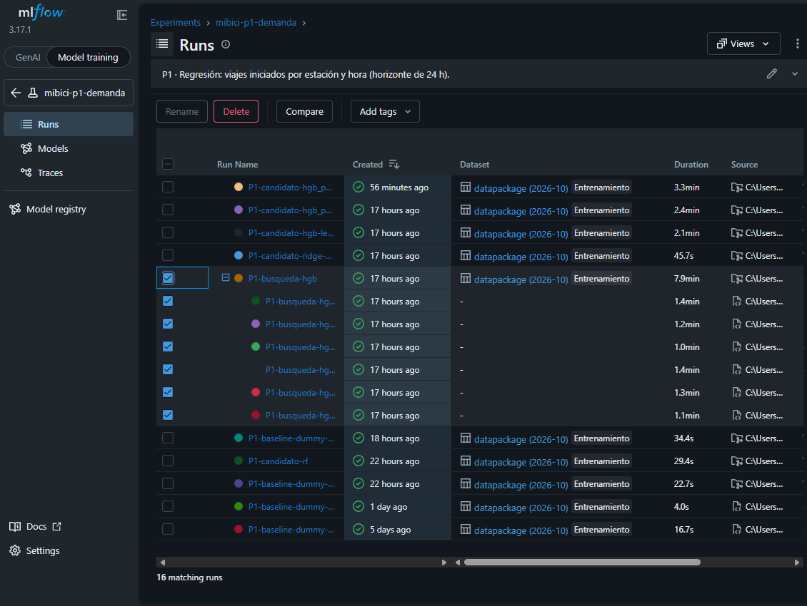

# Capturas de la interfaz de MLflow

<!-- Guardar las capturas en ../figuras/ con estos nombres y descomentar. -->

## Comparación de corridas con *nested runs*

<!--  -->

## Artefactos de una corrida candidata

<!--  -->

## Modelos registrados en producción con su linaje

<!--  -->

<!--  -->

<!--  -->

<!--  -->
