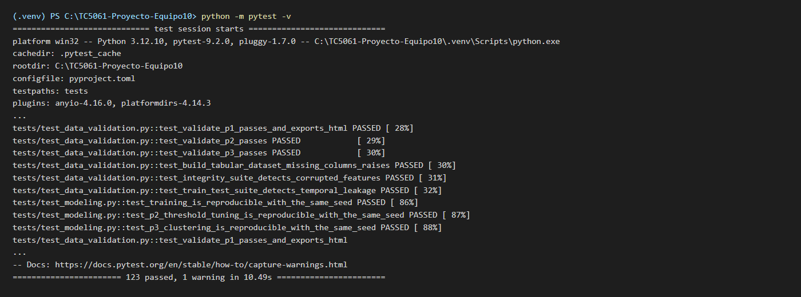
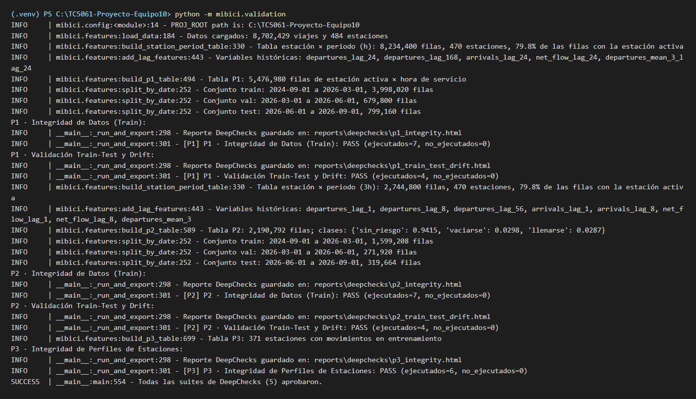
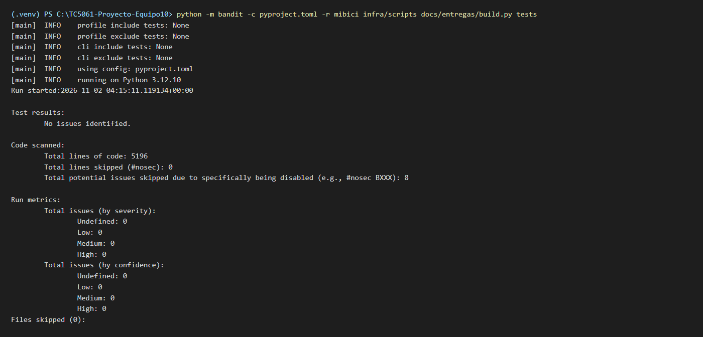
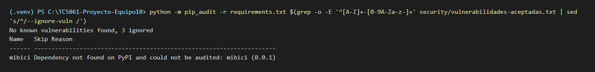
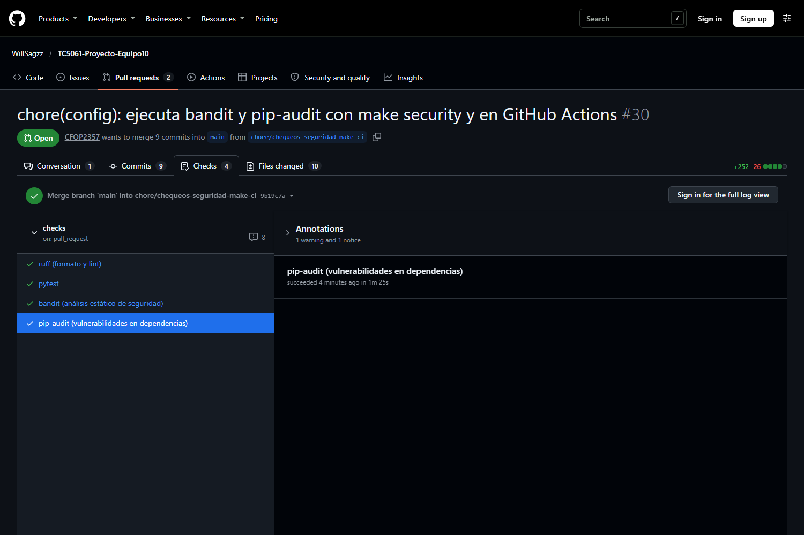

# Tests y chequeos de seguridad integrados al repositorio

**Repositorio: <https://github.com/WillSagzz/TC5061-Proyecto-Equipo10>.** Las pruebas y los chequeos de esta actividad están integrados ahí y se ejecutan con un solo comando, `make check`, desde un clon limpio con un entorno virtual de Python 3.12 y `pip install -r requirements.txt`; no requieren descargar los datos de MiBici.

## 1. Pruebas unitarias con PyTest

La carpeta `tests/` tiene 123 pruebas en 10 archivos que cubren las funciones clave de limpieza (`clean_trips`), *feature engineering* (`build_station_period_table`, `label_risk`, `split_by_date`, `validate_contract`, `add_lag_features`) y modelado (`resolve_hyperparams`, `ThresholdClassifier`, los *baselines*), con casos normales y límite. `tests/test_modeling.py` comprueba la reproducibilidad: entrenar dos veces con la semilla de `config.py` da las mismas predicciones y métricas en P1, P2 y P3. Se corren con `make test`; lo que prueba cada archivo está en el README, sección *Pruebas unitarias*.

## 2. Validación de datos con DeepChecks

`mibici/validation.py` construye las tablas de modelado de P1, P2 y P3 y les aplica una suite de integridad (columnas constantes, nulos, duplicados, tipos mezclados, correlaciones y fugas de la etiqueta) y, en P1 y P2, una suite *train-test* (solapamiento de fechas y *drift* de variables y etiqueta), con los umbrales de `config.py`. `make check-data` exporta cinco reportes HTML a `reports/deepchecks/`, y `tests/test_data_validation.py` verifica que las suites aprueben con datos correctos y fallen ante columnas faltantes, datos dañados y fugas temporales. La captura es de `make check-data` sobre los datos reales de la versión `2026-11` (8.7 millones de viajes y 484 estaciones, descargados y verificados con `make data`): las cinco suites aprueban, sin fugas temporales ni *drift* por encima de los umbrales entre entrenamiento y prueba.

## 3. Chequeos de seguridad básicos

`.gitignore` excluye los datos, los modelos, las salidas de MLflow, el `.env`, los secretos de `infra/` y los formatos de credenciales (`*.pem`, `*.key`, `credentials.json`…); las credenciales del servidor MLflow se pasan por variables de entorno (`.env.example`) y el historial de Git no contiene ninguna. `make security` corre `bandit` sobre el código del proyecto (`pyproject.toml [tool.bandit]`; 0 hallazgos tras atender los 8 iniciales) y `pip-audit` sobre `requirements.txt`, que pasó de 139 vulnerabilidades en 12 paquetes a solo los 2 avisos aceptados de `setuptools`, justificados en `security/vulnerabilidades-aceptadas.txt`, tras actualizar las dependencias y subir el proyecto a Python 3.12. *Secret Protection* de GitHub debe confirmarlo quien administra el repositorio en *Settings → Code security*. Detalle en el README, *Seguridad del repositorio*.

## 4. Organización y documentación de las pruebas

Todas las pruebas viven en `tests/`, con la configuración de PyTest en `pyproject.toml`, y `make check` encadena `lint`, `test` y `security` en un solo comando. El README explica cómo correr cada chequeo (*Comandos*, *Validación de calidad de datos y pruebas automatizadas*, *Seguridad del repositorio*) y muestra estas mismas capturas en *Evidencia de ejecución de las pruebas y los chequeos de seguridad*; las de terminal son renders de la salida real de cada comando el 1 de noviembre de 2026. El *workflow* `.github/workflows/checks.yml` ejecuta los mismos cuatro chequeos (`ruff`, `pytest`, `bandit`, `pip-audit`) en cada *Pull Request* y en cada *push* a `main`.

