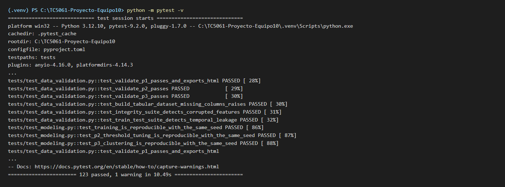

# Pruebas unitarias con PyTest

## Diseño de la suite

Las pruebas viven en `tests/` y se ejecutan con `make test` (`python -m pytest -v`); PyTest las descubre por la configuración `[tool.pytest.ini_options]` de `pyproject.toml` (`testpaths = ["tests"]`, `python_files = ["test_*.py"]`). Tres decisiones de diseño valen para toda la suite:

- **Datos inventados, nunca los reales.** Cada prueba construye en memoria una tabla pequeña (dos estaciones, unas cuantas horas, un viaje válido y uno inválido) en la que el resultado esperado se puede calcular a mano. Así la prueba documenta la regla que verifica y falla por una sola causa.
- **Un generador sintético para las tablas completas.** Las pruebas que necesitan el *pipeline* entero (tablas de modelado, DeepChecks, reproducibilidad) usan `build_synthetic_raw_data` de `mibici/validation.py`: seis estaciones y viajes cada dos horas entre `TRAIN_START` y agosto de 2026, generados con `RANDOM_SEED` y con el mismo contrato de columnas y tipos que `load_data`. Por eso la suite corre desde un clon limpio y en GitHub Actions sin descargar nada ni usar `.env`.
- **Un caso normal y un caso límite por regla.** Cada función clave tiene al menos una prueba del comportamiento esperado y una por cada borde o error que debe manejar (fechas justo en el corte, umbral exacto, columnas faltantes, rezago menor al horizonte). Los casos límite repetidos se escriben con `@pytest.mark.parametrize` para que cada uno aparezca como una prueba independiente en el reporte.

Siguiendo a Grossmann, Wiesbrock y Motta (2021), las pruebas cubren las tres capas donde un sistema de ML suele fallar en silencio: el procesamiento de datos, la construcción de variables y el entrenamiento. La suite pasó de 27 pruebas (PR #27 y PR #28) a 123 (PR #31) al cubrir las funciones que el README ya presentaba como garantías del proyecto (`validate_contract`, `split_by_date`, `add_lag_features`) y los componentes de modelado propios (`ThresholdClassifier`, `GroupedDummy`, el catálogo de candidatos).

## Funciones clave cubiertas

**Tabla 2.** Funciones clave probadas, con el caso normal y los casos límite de cada archivo de `tests/`. El número de pruebas es el que recolecta `pytest` (cada parámetro cuenta como una prueba).

| Archivo (pruebas) | Función o componente | Caso normal | Casos límite |
|---|---|---|---|
| `test_dataset.py` (10) | `clean_trips` (`mibici/dataset.py`) | Conserva los viajes válidos, incluidos los que están justo en el borde: salida a las 5:00 y duración de 24 h exactas | Quita, uno por uno, los 9 tipos de viaje inválido: fecha ilegible, duración negativa, mayor a 24 h, menos de 1 min en la misma estación, salida a la 1:00 o a las 4:59, origen o destino fuera de la nomenclatura y `viaje_id` duplicado |
| `test_features.py` (35) | `build_station_period_table` | Cuenta salidas y llegadas por estación y hora (P1) | Intervalos de 3 h (P2), horas sin viajes en 0 y estación inactiva antes de abrir |
| | `label_risk` | Etiqueta `vaciarse`, `llenarse` y `sin_riesgo` con el 40 % de la capacidad (`RISK_THRESHOLD`) | El límite exacto cuenta como riesgo y el umbral cambia con la capacidad |
| | `split_by_date` | Cada fila cae en el conjunto de su fecha, en orden cronológico | Cada corte incluye su inicio y excluye su fin, las fechas fuera de rango se descartan y un conjunto vacío lanza `ValueError` con su nombre |
| | `validate_contract` | Acepta los tipos del contrato de `config.py` | Rechaza cada tipo incorrecto (fecha como texto, identificador decimal, capacidad o latitud como texto) y el mensaje lista todas las columnas que fallan |
| | `get_data_version` | Lee `version` de `datapackage.json` | Falla sin descriptor o sin `version` |
| | `add_calendar_features` | Hora, día de la semana y fin de semana sin alterar la tabla de entrada | Fronteras del fin de semana (viernes 23:00, sábado 0:00, domingo 23:00, lunes 0:00) |
| `test_features_lags.py` (13) | `add_lag_features` | `departures_lag_24` en *t* es la salida de la misma estación en *t* − 24 h; el promedio móvil cubre la ventana cerrada un horizonte antes; reescribir el futuro no cambia ningún rezago | Las primeras horas quedan `NaN` (no 0); un rezago menor al horizonte lanza `ValueError` (incluido `LAG_HOURS` con el horizonte de P1); el igual al horizonte se acepta; malla irregular rechazada; periodos inactivos como historial desconocido; el orden de entrada no importa |
| `test_features_tables.py` (8) | `build_p1_table`, `build_p2_table`, `build_p3_table` | P1 trae `P1_FEATURES` y el objetivo completo; P2 trae `P2_FEATURES`, 8 intervalos por día y las tres clases; P3 una fila por estación con porcentajes que suman 100 | P1 excluye las horas sin servicio pero las conserva como historial; P2 cuenta rezagos en intervalos; estaciones sin capacidad fuera de P2 y P3; P3 solo con movimientos de entrenamiento y balance firmado |
| `test_candidates.py` (26) | `get_spec`, `resolve_hyperparams` (`mibici/modeling/candidates.py`) | Devuelve la especificación del catálogo; cada modelo del catálogo se construye con sus valores por defecto; el texto de `mlflow run -P` toma el tipo del valor por defecto | Pregunta o modelo desconocidos lanzan `ValueError` con las opciones; vacío, `""`, espacios y `None` significan el valor de `config.py`; hiperparámetro ajeno ignorado; decimal para un entero truncado |
| `test_thresholds.py` (14) | `ThresholdClassifier`, `_macro_f1` (`mibici/modeling/thresholds.py`) | Sin umbrales predice como el clasificador interno; `tune_thresholds` elige la pareja con mejor F1 macro; `_macro_f1` coincide con scikit-learn | Justo en el umbral alerta y justo debajo no; si ambos riesgos llegan gana el que más lo supera en proporción; la rejilla por defecto es `P2_THRESHOLD_GRID`; F1 macro de nunca alertar y de una clase ausente |
| `test_baselines.py` (8) | `GroupedDummy`, `build_p1_baseline`, `build_p2_baseline`, `build_p3_baseline` | P1 predice el promedio de cada estación y hora; P2 la clase más frecuente del grupo; P3 estandariza y agrupa con `KMeans` y `RANDOM_SEED` | Grupos nuevos usan el promedio o las frecuencias globales; el *baseline* de regresión no tiene `predict_proba`; la estandarización deja pesar a una variable de 0 a 1 frente a otra de miles |
| `test_modeling.py` (3) | Reproducibilidad del entrenamiento (P1, P2 y P3) | Dos entrenamientos con la misma semilla dan el mismo resultado | — |
| `test_data_validation.py` (6) | Suites de DeepChecks de `validation.py` | Las tablas de P1, P2 y P3 aprueban y los reportes HTML se exportan | Columna faltante, variables dañadas y fuga temporal se detectan (sección 3) |

## Pruebas de reproducibilidad

El paso 1 pide al menos una prueba que demuestre que dos ejecuciones con la misma semilla producen los mismos resultados. `tests/test_modeling.py` tiene tres, una por pregunta, y las tres usan la semilla de `config.py` (`RANDOM_SEED = 42`), la misma que fijan las corridas de MLflow, de modo que lo que se prueba es la configuración real del proyecto y no una semilla de la prueba:

- **P1, `hgb_poisson`.** Se construye la tabla de P1 con los datos sintéticos, se parte con `split_by_date` y se entrena dos veces el modelo elegido (`get_spec("p1", "hgb_poisson")`) sobre entrenamiento. Se comparan las **predicciones** sobre validación con `np.testing.assert_array_equal` y el **MAE** de ambas corridas.
- **P2, `hgb_threshold`.** Se entrena dos veces el clasificador y en cada una se ajusta el umbral de alerta con validación (`tune_thresholds`). Se comparan los **umbrales elegidos** (`thresholds_`), las **predicciones** sobre prueba y el **F1 macro**.
- **P3, `kmeans`.** Se agrupa dos veces la tabla de perfiles de estaciones y se comparan las **etiquetas** de cada estación y la **silueta** calculada sobre las variables estandarizadas.

Las pruebas solo reducen `max_iter` a 30 para que corran en segundos; los demás hiperparámetros son los valores por defecto de `config.py`. Un cambio que rompiera la reproducibilidad (quitar `random_state`, mezclar los datos sin semilla) hace fallar la prueba de esa pregunta.

## Comportamientos documentados por las pruebas

Ninguna prueba reveló un defecto en el código. Dos comportamientos de `resolve_hyperparams` quedaron documentados con una prueba cada uno, en lugar de cambiarse, porque podrían sorprender a quien lanza una corrida con `mlflow run -P`:

- Un hiperparámetro que el modelo no usa no lanza error: `resolve_hyperparams` avisa con `logger.warning` y lo ignora (`test_resolve_hyperparams_ignores_hyperparameters_the_model_does_not_use`).
- Los hiperparámetros se convierten con el tipo de su valor por defecto, así que un decimal para un entero se trunca sin aviso: `"3.9"` se convierte en `3` (`test_resolve_hyperparams_truncates_decimals_for_integer_hyperparameters`).

## Evidencia de ejecución

Las capturas de terminal de este reporte son renders del texto real que imprimió cada comando en la fecha indicada en la portada, sobre un clon del repositorio con las ramas de esta entrega integradas y un entorno virtual nuevo con Python 3.12. La Figura 1 muestra el final de `python -m pytest -v`: las 123 pruebas pasan (`123 passed, 1 warning`; el aviso es la importación de `pkg_resources` por `deepchecks`).

