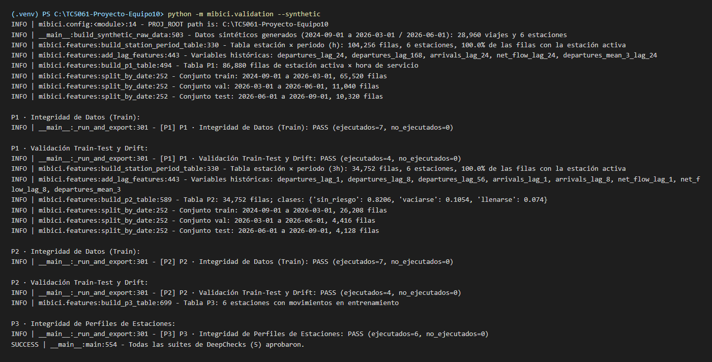
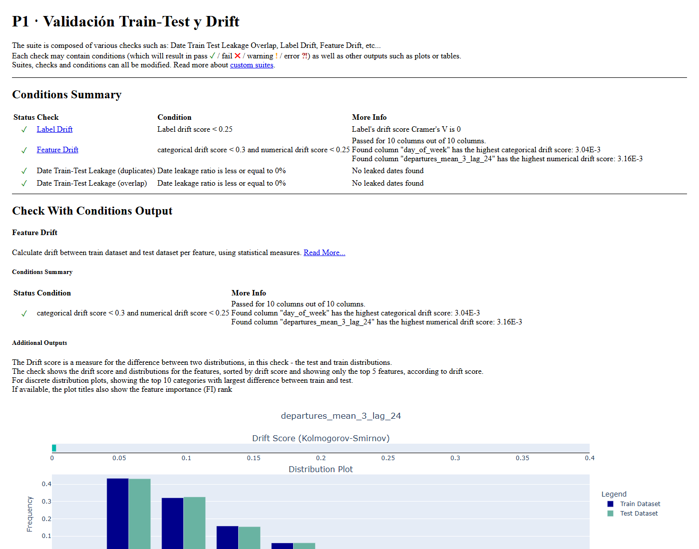
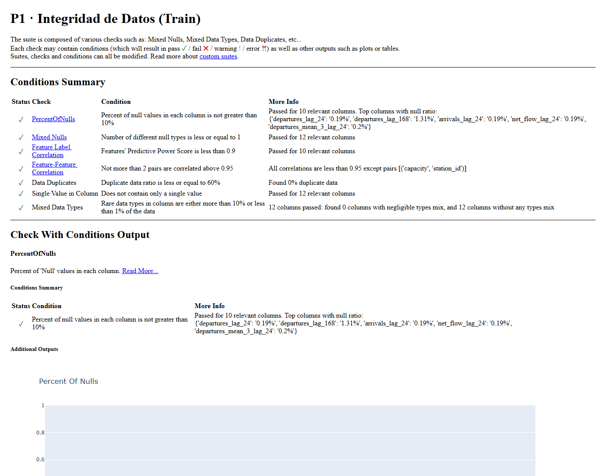

# Validación de datos con DeepChecks

## Validación en dos capas

El proyecto valida los datos en dos capas para no duplicar controles. La primera actúa en la ingesta: `frictionless` verifica el tamaño, el hash SHA-256 y el esquema de cada CSV y Parquet contra `datapackage.json` (`make data`, `make validate`), y `clean_trips` aplica las reglas de limpieza. La segunda, la de esta entrega, actúa sobre las **tablas de modelado** que entran a los modelos: `mibici/validation.py` construye las tablas de P1, P2 y P3 con `features.py`, las convierte en un `deepchecks.tabular.Dataset` restringido al contrato de cada modelo (`P1_FEATURES`, `P2_FEATURES`, `P3_FEATURES`, el objetivo y la columna temporal `period_start`) y corre dos suites con condiciones explícitas. Como recomienda Huyen (2022), lo que se valida no es el archivo crudo sino lo que el modelo va a ver.

Las suites se arman con `build_integrity_suite` y `build_train_test_suite`; los umbrales viven en `config.py` para que no se repitan en el código. En P1 y P2 las columnas de rezagos empiezan con `NaN` en las primeras horas de cada estación (no hay historial), por eso se tolera hasta 10 % de nulos; en P3, que es una tabla de perfiles con una fila por estación, no se admite ningún nulo ni duplicado.

**Tabla 3.** Suite de integridad (`build_integrity_suite`), ejecutada sobre el conjunto de entrenamiento de P1 y P2 y sobre la tabla completa de P3.

| Chequeo | Condición | Umbral |
|---|---|---|
| `IsSingleValue` | ninguna columna constante | — |
| `PercentOfNulls` | proporción de nulos por columna | `DEEPCHECKS_MAX_NULL_RATIO = 0.10` (P1, P2); 0 en P3 |
| `DataDuplicates` | proporción de filas con el mismo vector de variables | 0.60 (P1, P2: horas valle de semanas distintas comparten rezagos en cero); 0 en P3 |
| `MixedNulls` | tipos distintos de nulo en una columna | a lo más 1 |
| `MixedDataTypes` | mezcla de texto y números en una columna | proporción del tipo raro fuera del rango por defecto |
| `FeatureFeatureCorrelation` | pares de variables casi redundantes | a lo más 2 pares con correlación > 0.95 |
| `FeatureLabelCorrelation` | fuga de la etiqueta en una variable | PPS < 0.90 (solo P1 y P2, que tienen objetivo) |

**Tabla 4.** Suite de validación *train-test* y *drift* (`build_train_test_suite`), ejecutada en P1 y P2 entre el conjunto de entrenamiento y el de prueba de `split_by_date`.

| Chequeo | Condición | Umbral |
|---|---|---|
| `DateTrainTestLeakageOverlap` | fechas de prueba anteriores al final de entrenamiento | 0 % |
| `DateTrainTestLeakageDuplicates` | fechas repetidas entre entrenamiento y prueba | 0 % |
| `FeatureDrift` | cambio de distribución por variable | PSI ≤ `DEEPCHECKS_MAX_DRIFT_PSI = 0.30` (categóricas); EMD ≤ `DEEPCHECKS_MAX_DRIFT_EMD = 0.25` (numéricas); se tolera 1 variable por encima |
| `LabelDrift` | cambio de distribución del objetivo | ≤ `DEEPCHECKS_MAX_LABEL_DRIFT = 0.25` |

En P1 y P2 se evalúa una muestra determinista de a lo más `DEEPCHECKS_SAMPLE_SIZE = 50 000` filas por partición (ordenada por fecha, con `RANDOM_SEED`) para que la validación termine en minutos con los datos reales; P3 se evalúa completa.

## Qué detecta y cómo queda documentado

La suite aprueba con los datos sintéticos y eso, por sí solo, no demuestra que detecte problemas. Por eso `tests/test_data_validation.py` incluye tres casos límite que corrompen los datos a propósito y afirman que DeepChecks los rechaza (Tabla 5). Son parte de las 123 pruebas de `make test`, así que cualquier cambio que relaje un umbral o quite un chequeo rompe la suite.

**Tabla 5.** Pruebas de `tests/test_data_validation.py`: casos normales y casos límite.

| Prueba | Qué hace | Resultado esperado |
|---|---|---|
| `test_validate_p1_passes_and_exports_html` | Corre las dos suites de P1 y exporta los HTML a una carpeta temporal | Ambas aprueban, ningún chequeo sin ejecutar, los dos archivos existen y no están vacíos |
| `test_validate_p2_passes`, `test_validate_p3_passes` | Corren las suites de P2 y la de P3 | Aprueban sin chequeos omitidos |
| `test_build_tabular_dataset_missing_columns_raises` | Quita la columna `capacity` de la tabla de P1 | `ValueError` con el mensaje `Faltan columnas requeridas` |
| `test_integrity_suite_detects_corrupted_features` | Vuelve constante `capacity` y pone 25 % de nulos en `departures_lag_24` | La suite de integridad **falla** (`IsSingleValue` y `PercentOfNulls`) |
| `test_train_test_suite_detects_temporal_leakage` | Mete 50 filas del final de entrenamiento en el conjunto de prueba | La suite *train-test* **falla** (`DateTrainTestLeakageOverlap`) |

Con los datos sintéticos, las cinco suites aprueban y `validation.py` exporta cinco reportes HTML interactivos a `reports/deepchecks/` (carpeta fuera de Git): `p1_integrity.html`, `p1_train_test_drift.html`, `p2_integrity.html`, `p2_train_test_drift.html` y `p3_integrity.html`. Cada reporte lista las condiciones que pasaron, las que fallaron y las que quedaron en aviso, con la distribución de cada variable. Si alguna condición no se cumple, el reporte lo muestra y la consola termina con `Suites con condiciones en alerta o fallo` y la lista de suites afectadas.

## Evidencia de ejecución

Las capturas de esta sección se produjeron con `python -m mibici.validation --synthetic` (`make check-data SYNTHETIC=1`), porque la máquina donde se compiló el reporte no tiene descargado el conjunto de datos de MiBici: el generador sintético produce tablas con el mismo contrato de columnas, tipos y partición temporal, así que las suites, los chequeos y los umbrales que se ejecutan son exactamente los mismos. Para repetirlas con los datos reales basta con `make data` (descarga y verifica los CSV contra `datapackage.json`) y después `make check-data`; los reportes se escriben con los mismos nombres.

