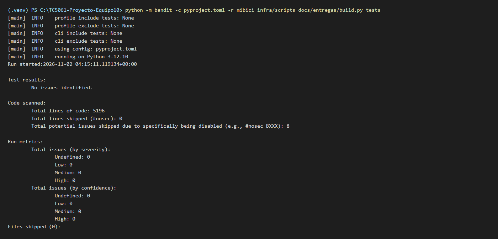
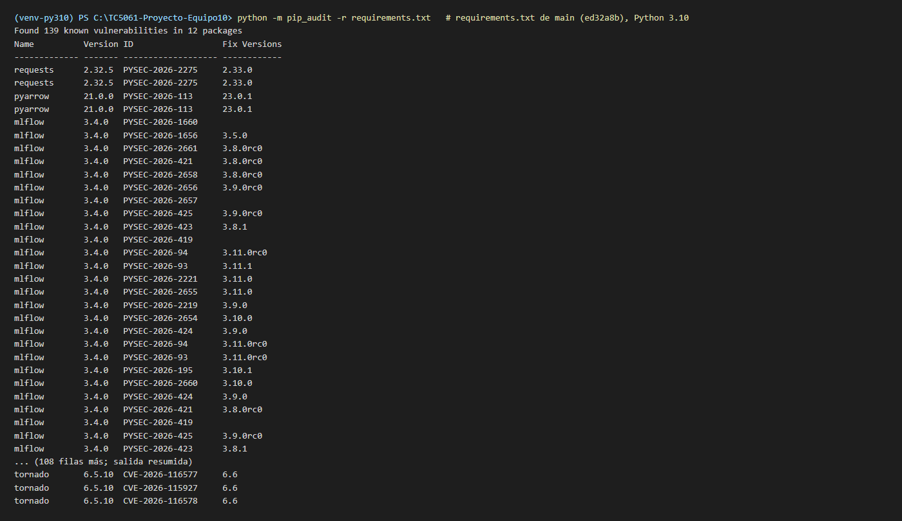
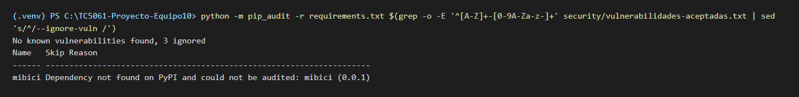
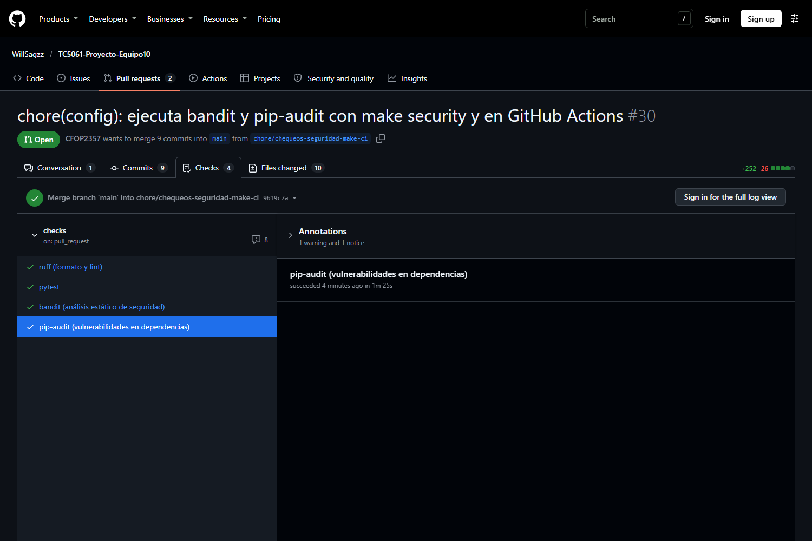

# Chequeos básicos de seguridad

## Prácticas: nada sensible entra al repositorio

El repositorio versiona el **código que produce** los datos, los experimentos y los modelos, nunca el resultado de ejecutarlo ni las credenciales para hacerlo. Las reglas viven en `.gitignore` (Tabla 6) y las revisa quien aprueba cada *Pull Request* (README, *Pull Requests y revisiones*).

**Tabla 6.** Exclusiones de `.gitignore` relacionadas con datos sensibles, credenciales y salidas regenerables.

| Excluido | Motivo |
|---|---|
| `data/`, `notebooks/*.csv` | Los datos de MiBici se reconstruyen con `make data`, que verifica cada archivo contra `datapackage.json`; la ingesta descarta además las columnas con datos personales (`Usuario_Id`, `Genero`, `Año_de_nacimiento`). |
| `mlflow.db`, `mlruns/`, `mlartifacts/`, `*.pkl`, `*.pickle`, `*.joblib`, `reports/figures/*.png`, `reports/deepchecks/` | Salidas de los experimentos, modelos serializados y reportes; se regeneran con `make train` y `make check-data`. |
| `.env`, `.venv`, `venv/` | El `.env` guarda la URI, el usuario y la contraseña del servidor MLflow del equipo; el repositorio solo versiona `.env.example`, con las tres variables comentadas y sin valores. |
| `infra/.secrets.env`, `infra/.users.env`, `infra/users.txt` | Secretos del despliegue en Azure y contraseñas generadas por `make infra-secrets` y `make infra-users`; en el repositorio solo está `infra/users.example.txt`. |
| `*.pem`, `*.key`, `*.crt`, `*.p12`, `*.pfx`, `credentials.json`, `service-account*.json` | Formatos habituales de certificados, llaves y credenciales de servicios en la nube (PR #29). |
| `security/*` (reportes), `docs/entregas/**/build/` | Reportes de `bandit` y `pip-audit` y salidas compiladas de las entregas; solo se versiona `security/vulnerabilidades-aceptadas.txt`. |
| `.claude/` | Configuración local y *worktrees* del asistente de IA de cada integrante. |

Las credenciales se pasan por **variables de entorno**: `train.py` y los scripts de `infra/scripts/` leen `MLFLOW_TRACKING_URI`, `MLFLOW_TRACKING_USERNAME` y `MLFLOW_TRACKING_PASSWORD` con `python-dotenv`, y sin `.env` el proyecto registra en una base SQLite local. La URL del servidor en Azure tampoco se publica: `.env.example` la deja como `https://mlflow.<dominio-del-entorno>.mexicocentral.azurecontainerapps.io` y se obtiene con `make infra-url` solo con acceso a la suscripción. Al preparar esta entrega se revisó el historial completo de Git (`git log --all` sobre nombres de archivo y contenido añadido): nunca se ha versionado un `.env`, un CSV o Parquet de MiBici, un modelo serializado, `mlflow.db` ni una URL o contraseña real del servidor; las únicas coincidencias son los marcadores de posición de `.env.example` y de `infra/README.md`. Los dos *notebooks* de exploración se versionan sin salidas (PR #15), así que tampoco exponen datos.

El README documenta además que **Secret Protection** de GitHub (*secret scanning* con *push protection*) debe estar habilitado por quien administra el repositorio en *Settings → Code security*, para que GitHub bloquee cualquier *push* que contenga una credencial conocida. Desde la cuenta de un integrante no se puede comprobar por línea de comandos, por eso se describe como ajuste requerido y dónde verificarlo.

<div class="pendiente">

Pendiente de confirmar por quien administra el repositorio (WillSagzz): que *Secret Protection* y las alertas de Dependabot estén activas en *Settings → Code security*. Esta nota se borra al confirmarlo o se sustituye por una captura de esa pantalla.

</div>

## Análisis estático del código con bandit

`bandit` (PyCQA, s.f.) recorre el árbol de sintaxis de cada archivo de Python y reporta patrones inseguros: contraseñas escritas en el código, `subprocess` con `shell=True`, `assert` como mecanismo de verificación, deserialización insegura, entre otros. El comando configurado, que ejecutan `make security` y el *job* `bandit` de GitHub Actions, es:

```bash
python -m bandit -c pyproject.toml -r mibici infra/scripts docs/entregas/build.py tests
```

El alcance está restringido a propósito. `bandit` no lee `.gitignore`: un `bandit -r ./` desde la raíz recorre también `.venv/` (miles de archivos de *site-packages* que no son código del equipo) y reporta cada `assert` de `tests/` como `B101`, lo que sepulta los hallazgos reales. Por eso el comando analiza solo el código del proyecto y la configuración vive en `pyproject.toml`, sección `[tool.bandit]`: excluye los entornos virtuales, `notebooks/` y las salidas compiladas de las entregas, y omite `B101` únicamente dentro de `tests/`, donde `assert` es la forma normal de verificar en PyTest.

La primera ejecución sobre el código del proyecto reportó 8 hallazgos, todos de severidad baja (PR #30). Se atendieron uno por uno (Tabla 7) y el análisis termina con **0 hallazgos** (Figura 5).

**Tabla 7.** Hallazgos de `bandit` en el código del proyecto y cómo se atendió cada uno.

| Archivo | Regla | Qué reportaba | Cómo se atendió |
|---|---|---|---|
| `infra/scripts/check_server.py` | B101 (×3) | Tres `assert` verificaban el *run* leído del servidor; `python -O` los elimina y la prueba de humo dejaría de comprobar. | Se sustituyeron por comprobaciones explícitas que terminan con un mensaje claro y código de salida 1. |
| `mibici/experiments.py` | B404, B603 (×2), B607 (×2) | `import subprocess` y dos `subprocess.run(["git", ...])` para etiquetar el *run* con el *commit*. | `# nosec` con la regla concreta y un comentario que justifica cada uno: lista de argumentos fija, sin `shell=True` y sin entrada del usuario. |
| `docs/entregas/build.py` | B404, B603 (×2) | `subprocess.run` que lanza el navegador *headless* o `pandoc` para producir el PDF de la entrega. | `# nosec B603` con justificación: ejecutable resuelto por el propio script (rutas conocidas o `shutil.which`) y argumentos fijos. |
| `tests/` | B101 | Los `assert` de PyTest. | Omitidos por configuración (`[tool.bandit.assert_used]`), solo dentro de `tests/`. |

**Política para `# nosec`.** Un `# nosec` siempre indica la regla que omite (`# nosec B603`, nunca un `# nosec` a secas), va acompañado de un comentario que explica por qué el código es seguro y requiere la aprobación explícita de quien revisa el PR. Si la justificación no convence, se corrige el código en lugar de silenciar la regla.



## Auditoría de dependencias con pip-audit

`pip-audit` (PyPA, s.f.) compara cada paquete de `requirements.txt` (y sus dependencias transitivas, que resuelve con `pip`) contra la base de avisos de PyPI y la de OSV (Open Source Vulnerabilities, s.f.), y lista el identificador de cada aviso y la versión que lo corrige. La primera auditoría, sobre el `requirements.txt` de `main` tras el PR #29 (`ed32a8b`) y con Python 3.10, reportó **139 vulnerabilidades conocidas en 12 paquetes** (Figura 6). Las acciones tomadas para llegar al resultado de la Figura 7 se resumen en la Tabla 8.

**Tabla 8.** Resultado de `pip-audit -r requirements.txt` antes y después de los cambios de esta entrega.

| | Antes (`main` en `ed32a8b`, Python 3.10) | Después (PR #32, Python 3.12) |
|---|---|---|
| Vulnerabilidades conocidas | 139 | 3 avisos (2 identificadores), aceptados y omitidos con `--ignore-vuln` |
| Paquetes afectados | 12 | 1 (`setuptools`) |

**Versiones actualizadas.** Cada paquete directo se subió a la versión más baja que `pip-audit` reporta como corregida (Tabla 9). La mayor parte de los avisos (51) venía de `mlflow`, que se subió a la misma versión que el servidor del equipo en Azure (`infra/main.bicepparam`), de modo que cliente y servidor comparten la versión menor. Ese cambio exigió tocar código: en MLflow 3.17 el formato por defecto de `mlflow.sklearn.log_model` pasó de `cloudpickle` a `skops`, que rechaza los estimadores propios del proyecto (`GroupedDummy` en `baselines.py` y `ThresholdClassifier` en `thresholds.py`) con `MlflowException: The sklearn model could not be serialized in the skops serialization format`; `train.py` fija ahora `serialization_format="cloudpickle"`, el formato que ya usaban los modelos registrados.

**Tabla 9.** Paquetes actualizados por `pip-audit` en `requirements.txt`.

| Paquete | Antes | Después | Avisos corregidos | Nota |
|---|---|---|---|---|
| `mlflow` | 3.4.0 | 3.17.2 | 51 | directa; cliente y servidor comparten versión |
| `cryptography` | 45.0.7 | 50.0.0 | 13 | transitiva de `mlflow` (`< 51`); se fija explícitamente |
| `requests` | 2.32.5 | 2.33.0 | 2 | directa |
| `pyarrow` | 21.0.0 | 23.0.1 | 2 | directa |
| `python-dotenv` | 1.1.1 | 1.2.2 | 2 | directa |
| `fastmcp`, `diskcache`, `dnspython` | 2.14.7, 5.6.3, 2.8.0 | — | 7 | dejan de instalarse: `mlflow` 3.17.2 solo las trae con el extra `mlflow[mcp]` |
| `pillow` | 12.3.0 | 13.0.0 | 39 | transitiva de `matplotlib`; la corrección requiere Python ≥ 3.11 |
| `filelock` | 4.1.0 | 4.2.1 | 17 | transitiva de `pip-audit` (`cachecontrol[filecache]`); requiere Python ≥ 3.11 |
| `tornado` | 6.5.10 | 6.6 | 3 | transitiva de `deepchecks` (`ipykernel`); requiere Python ≥ 3.11 |

**Migración de Python 3.10 a 3.12.** Tras actualizar los paquetes directos quedaban 62 avisos en 4 paquetes, y 59 de ellos (`pillow`, transitiva de `matplotlib`; `filelock`, transitiva de `pip-audit`; `tornado`, transitiva de `deepchecks` vía `ipykernel`) solo se corrigen en versiones que requieren Python ≥ 3.11. Aceptarlos habría dejado una lista de 61 identificadores que crecería con cada aviso nuevo de esos paquetes, así que el equipo decidió subir el proyecto a **Python 3.12**, fijado de forma exacta (`requires-python = ">=3.12,<3.13"` en `pyproject.toml`): cambian también `python_env.yaml` del MLflow Project, `PYTHON_VERSION` en el `Makefile` y en el *workflow* de GitHub Actions y la guía de instalación del README; quien ya tenía un entorno virtual debe recrearlo. Las tres transitivas se fijan explícitamente en `requirements.txt`, en un bloque que dice qué paquete usa cada una. La instalación completa de `requirements.txt`, `pip check`, las pruebas, las cinco suites de DeepChecks y los tres `mlflow run` de entrenamiento con Parquet sintéticos se verificaron en un entorno nuevo con 3.12 antes de adoptarla (PR #32).

**Riesgo aceptado.** Queda un solo paquete con avisos, `setuptools` (Tabla 10): `pip-audit` lista 3 entradas con 2 identificadores. No se puede subir porque la última versión publicada de `deepchecks` importa `pkg_resources`, que las versiones recientes de `setuptools` ya no incluyen (se comprobó que `import pkg_resources` falla con ellas y, sin él, fallan las pruebas de DeepChecks). Los avisos afectan a construir *sdists* en macOS y a instalar *wheels* como *eggs* en Windows; el proyecto no hace ninguna de las dos. Los identificadores viven en `security/vulnerabilidades-aceptadas.txt`, un archivo versionado con un bloque por paquete que dice por qué no se puede corregir y por qué se acepta, y con la regla de borrar el bloque al subir la versión. `make security` y el *workflow* leen ese archivo y pasan cada identificador como `--ignore-vuln`, de modo que la auditoría solo falla ante avisos nuevos:

**Tabla 10.** Riesgo aceptado en la auditoría de dependencias (1 de noviembre de 2026).

| Paquete | Versión | Avisos | Corregido en | Por qué se acepta |
|---|---|---|---|---|
| `setuptools` | 80.9.0 | 3 entradas, 2 identificadores (`PYSEC-2026-3447`, `GHSA-xmj3-9gf7-h52w`) | 83.0.0 / 84.1.0 | `deepchecks` 0.19.1 importa `pkg_resources`, que `setuptools` ≥ 83 ya no incluye. Los avisos afectan a construir *sdists* en macOS y a instalar *wheels* como *eggs* en Windows; el proyecto no hace ninguna de las dos. |

```bash
python -m pip_audit -r requirements.txt $(grep -o -E '^[A-Z]+-[0-9A-Za-z-]+' security/vulnerabilidades-aceptadas.txt | sed 's/^/--ignore-vuln /')
```

Aceptar un aviso nuevo exige agregarlo a ese archivo, con el motivo, en el mismo PR que lo acepta; no se enmascara el resultado con `|| true` ni con `continue-on-error`.





## Integración continua: los mismos chequeos en cada Pull Request

El *workflow* `.github/workflows/checks.yml` ejecuta en GitHub Actions (GitHub, s.f.), en cada *pull request* y en cada *push* a `main`, lo mismo que `make check` en local, separado en cuatro *jobs* para que la pestaña *Checks* del PR diga de un vistazo qué falló (Tabla 11). Todos instalan `requirements.txt` con Python 3.12 y caché de `pip`, el *workflow* solo tiene permiso de lectura sobre el repositorio (`permissions: contents: read`) y ningún *job* usa `continue-on-error`: un *job* rojo bloquea la mezcla hasta que se corrige la causa.

**Tabla 11.** *Jobs* del *workflow* `checks` y lo que verifica cada uno.

| Job | Comando | Qué verifica |
|---|---|---|
| `lint` | `ruff format --check` y `ruff check` | Formato y estilo del código. |
| `test` | `python -m pytest -v` | Las 123 pruebas de `tests/`, con datos sintéticos. |
| `bandit` | `python -m bandit -c pyproject.toml -r mibici infra/scripts docs/entregas/build.py tests` | Análisis estático de seguridad del código del proyecto. |
| `pip-audit` | `python -m pip_audit -r requirements.txt --ignore-vuln ...` | Vulnerabilidades publicadas en `requirements.txt`, salvo las aceptadas en `security/vulnerabilidades-aceptadas.txt`. |

La Figura 8 muestra la pestaña *Checks* del PR #30, el que agregó el *workflow*, con los cuatro *jobs* en verde. Las tres ejecuciones anteriores del mismo PR (Figura 9) terminaron en rojo por el *job* `pip-audit`: mientras el PR #32, que actualiza las dependencias vulnerables, no estaba mezclado, el *workflow* auditaba el `requirements.txt` de `main` con sus 139 avisos. Ese es exactamente el comportamiento buscado: la auditoría no se silenció y el rojo desapareció en cuanto `main` recibió las versiones corregidas.


