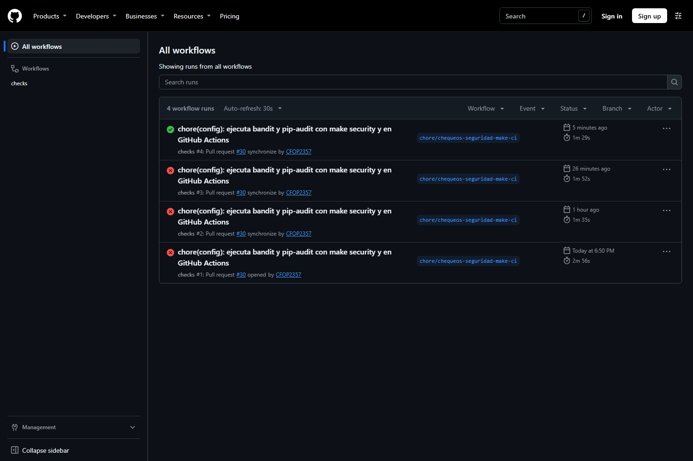
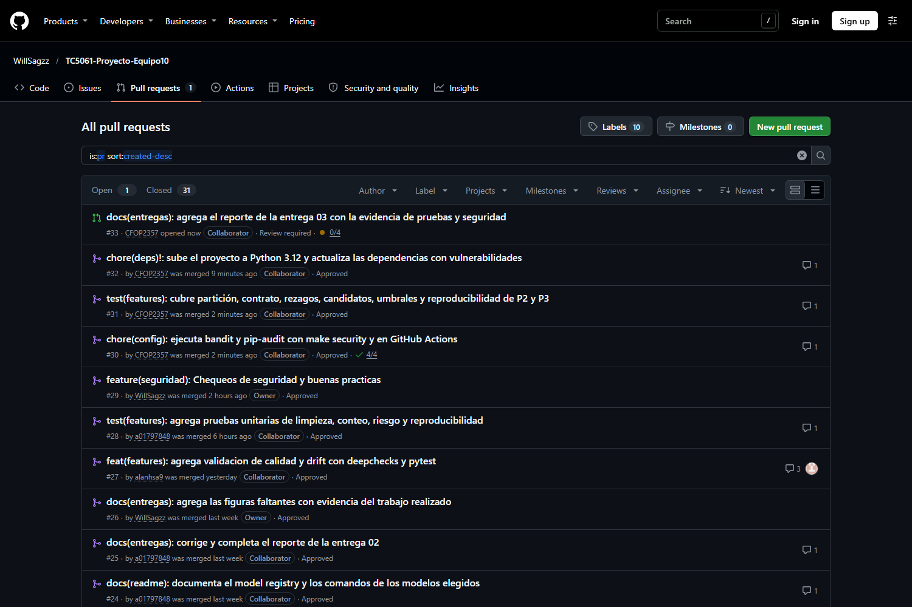
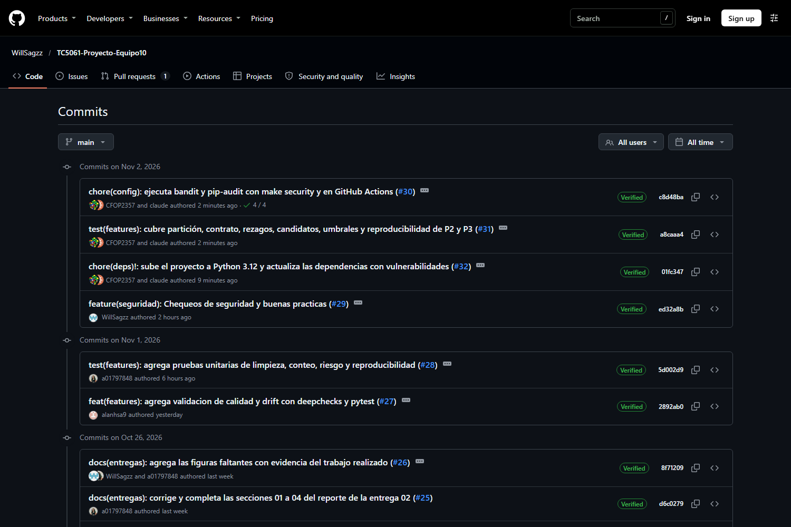
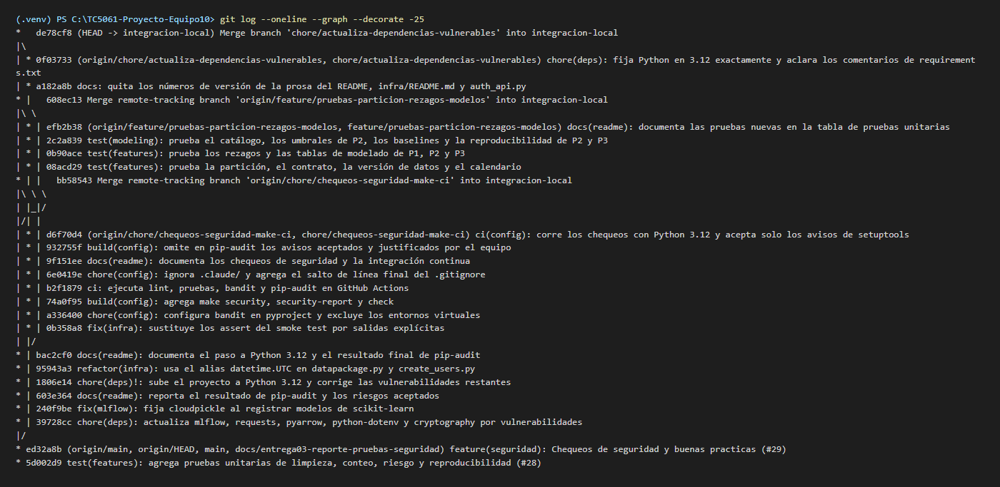
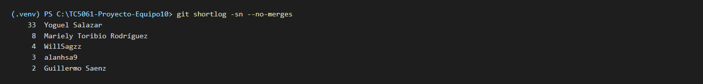

# Organización, documentación y colaboración

## Estructura de las pruebas y archivos relacionados

Las pruebas viven en una carpeta dedicada, `tests/`, con un archivo por módulo o componente probado; la configuración de PyTest, de `bandit` y de `ruff` está en `pyproject.toml`, y los chequeos de seguridad tienen su propia carpeta `security/`:

```text
├── Makefile                       <- test, check-data, security, security-report, check, entrega03
├── pyproject.toml                 <- [tool.pytest.ini_options], [tool.bandit], [tool.ruff]
├── requirements.txt               <- pytest, deepchecks, bandit, pip_audit con versión fija
├── .github/workflows/checks.yml   <- jobs lint, test, bandit y pip-audit en cada PR y push a main
├── .gitignore / .env.example      <- exclusiones y plantilla de variables de entorno sin valores
├── security/
│   ├── .gitignore                 <- los reportes generados no se versionan
│   └── vulnerabilidades-aceptadas.txt <- avisos de pip-audit aceptados, con justificación
├── mibici/
│   ├── config.py                  <- RANDOM_SEED y umbrales DEEPCHECKS_*
│   └── validation.py              <- suites de DeepChecks, generador sintético y CLI
├── reports/deepchecks/            <- reportes HTML de make check-data (fuera de Git)
└── tests/
    ├── __init__.py
    ├── test_dataset.py            <- clean_trips
    ├── test_features.py           <- build_station_period_table, label_risk, split_by_date, validate_contract, get_data_version, add_calendar_features
    ├── test_features_lags.py      <- add_lag_features
    ├── test_features_tables.py    <- build_p1_table, build_p2_table, build_p3_table
    ├── test_candidates.py         <- get_spec, resolve_hyperparams
    ├── test_thresholds.py         <- ThresholdClassifier, _macro_f1
    ├── test_baselines.py          <- GroupedDummy y los baselines de P1, P2 y P3
    ├── test_modeling.py           <- reproducibilidad con la misma semilla (P1, P2, P3)
    └── test_data_validation.py    <- suites de DeepChecks: casos normales y límite
```

**Tabla 12.** Comandos del `Makefile` que ejecutan las pruebas y los chequeos, con su equivalente sin `make`.

| Comando | Equivalente en Python | Qué hace |
|---|---|---|
| `make test` | `python -m pytest -v` | Las 123 pruebas de `tests/`. |
| `make check-data` | `python -m mibici.validation` | Las cinco suites de DeepChecks sobre `data/processed/`; `SYNTHETIC=1` usa el generador sintético y `Q=p1` (`p2`, `p3`) valida una sola pregunta. |
| `make security` | `python -m bandit -c pyproject.toml -r ...` y `python -m pip_audit -r requirements.txt --ignore-vuln ...` | `bandit` y `pip-audit`; termina con error ante cualquier hallazgo nuevo. |
| `make security-report` | los mismos con `-f html`, `-f csv` y `-f markdown` | Escribe `bandit_report.html`, `bandit_report.csv`, `pip_audit_env_report.md` y `pip_audit_req_report.md` en `security/`. |
| `make check` | `make lint test security` | Todos los chequeos con un solo comando; lo mismo que ejecuta GitHub Actions. |
| `make entrega03` | `python docs/entregas/build.py docs/entregas/entrega03` | Compila este reporte (Markdown → HTML → PDF). |

## Documentación en el README

El README del repositorio explica cómo ejecutar cada chequeo y muestra la evidencia de que pasan; las capturas de este reporte son las mismas que ahí se enlazan (viven en `docs/entregas/entrega03/figuras/`). Las secciones relevantes son:

**Tabla 13.** Secciones del README que documentan las pruebas y los chequeos de seguridad.

| Sección del README | Contenido |
|---|---|
| *Comandos* | Tabla con `make test`, `make check-data`, `make security`, `make security-report`, `make check` y `make entrega03`, con su equivalente sin `make`. |
| *Validación de calidad de datos y pruebas automatizadas* | Las dos capas de validación, cómo ejecutar las pruebas y DeepChecks, la tabla *Pruebas unitarias* (qué prueba cada archivo, caso normal y casos límite) y la subsección *Evidencia de ejecución de las pruebas y los chequeos de seguridad* con las capturas. |
| *Seguridad del repositorio* | *Prácticas de seguridad* (`.gitignore`, variables de entorno, Secret Protection), *Análisis estático de código* (comando, alcance, hallazgos atendidos, política de `# nosec`), *Integración continua* (los cuatro *jobs*) y *Análisis de dependencias* (resultado antes y después, versiones actualizadas, riesgos aceptados). |
| *Flujo de trabajo con Git/GitHub* | Ramas, Conventional Commits, Pull Requests, *ruleset* de `main` y *Qué nunca entra al repositorio*. |
| *Buenas prácticas y dónde se verifican* | Fila *Seguridad*: chequeos ejecutables con un solo comando y en cada PR. |

Además del README y de este reporte, GitHub Actions deja una evidencia permanente: cada *Pull Request* y cada *push* a `main` conserva la ejecución de los cuatro *jobs* en la pestaña *Actions* del repositorio (Figura 9), así que la prueba de que los chequeos pasan no depende de una captura tomada a mano.



## Colaboración en Git

Todo cambio entra a `main` por *Pull Request* con la aprobación de otro integrante. `main` está protegida con un *ruleset* de repositorio (*Main - Pull Requests*): PR obligatorio con una aprobación, aprobaciones que caducan al llegar *commits* nuevos, conversaciones resueltas, solo *squash merge*, sin *force push* ni borrado. Las ramas siguen Conventional Branch (`feature/`, `test/`, `chore/`, `docs/` …) y los mensajes de *commit* y los títulos de PR siguen Conventional Commits 1.0.0 (`tipo(ámbito): descripción`), de modo que cada PR llega a `main` como un solo *commit* cuyo mensaje dice qué cambió y termina con el número del PR.

La Tabla 14 lista los *Pull Requests* de esta actividad. Los tres primeros los abrió un integrante distinto, cada uno sobre un paso de la actividad; los tres siguientes integran, extienden y endurecen ese trabajo y ya están mezclados en `main`; el último es este reporte. Los datos salen de la pestaña *Pull requests* del repositorio (Figura 10).

**Tabla 14.** *Pull Requests* de la Actividad 7 (orden cronológico). El PR #33 estaba abierto al compilar este reporte; su revisión se completa en GitHub al cerrar la entrega.

| PR | Título | Autor | Revisor | Qué aporta |
|---|---|---|---|---|
| #27 | `feat(features): agrega validacion de calidad y drift con deepchecks y pytest` | alanhsa9 (Alan Augusto Herrera Sánchez) | a01797848 | `mibici/validation.py`, umbrales en `config.py`, `tests/test_data_validation.py`, `make check-data`, `make test`, `pytest` y `deepchecks` en `requirements.txt`. |
| #28 | `test(features): agrega pruebas unitarias de limpieza, conteo, riesgo y reproducibilidad` | a01797848 (Mariely Toribio Rodríguez) | WillSagzz | `tests/test_dataset.py`, `tests/test_features.py`, `tests/test_modeling.py` (reproducibilidad de P1), `setuptools` fijado, tabla *Pruebas unitarias* en el README. |
| #29 | `feature(seguridad): Chequeos de seguridad y buenas practicas` | WillSagzz (Guillermo Sáenz González) | CFOP2357 | `bandit` y `pip-audit` en `requirements.txt`, carpeta `security/`, patrones de credenciales en `.gitignore`, sección *Seguridad del repositorio* del README. |
| #30 | `chore(config): ejecuta bandit y pip-audit con make security y en GitHub Actions` | CFOP2357 (Victor Yoguel Salazar Alanis) | a01797848 | `make security`, `make security-report`, `make check`, `[tool.bandit]` en `pyproject.toml`, los 8 hallazgos atendidos, `.github/workflows/checks.yml` con Python 3.12, `security/vulnerabilidades-aceptadas.txt`. |
| #31 | `test(features): cubre partición, contrato, rezagos, candidatos, umbrales y reproducibilidad de P2 y P3` | CFOP2357 | a01797848 | De 27 a 123 pruebas: `test_features_lags.py`, `test_features_tables.py`, `test_candidates.py`, `test_thresholds.py`, `test_baselines.py` y la reproducibilidad de P2 y P3. |
| #32 | `chore(deps)!: sube el proyecto a Python 3.12 y actualiza las dependencias con vulnerabilidades` | CFOP2357 | a01797848 | Proyecto en Python 3.12, versiones corregidas en `requirements.txt`, `cloudpickle` en `train.py`, `datetime.UTC` en `datapackage.py` y `create_users.py`, resultado de la auditoría en el README. |
| #33 | `docs(entregas): agrega el reporte de la entrega 03 con la evidencia de pruebas y seguridad` | CFOP2357 | en revisión | Este reporte (`docs/entregas/entrega03/`), `make entrega03` y la subsección de evidencia en el README. |









**Uso de asistentes de IA.** Como declara el README, el equipo usó asistentes de IA (Claude Code y ChatGPT) para la edición de código, la redacción de documentación y la gestión del repositorio bajo un esquema *human-in-the-loop*: los PR #30, #31, #32 y #33 se desarrollaron con Claude Code como programador en pareja, y en todos los casos las decisiones de diseño, los resultados reportados y el contenido final fueron dirigidos, revisados y aprobados por los autores, que asumen la responsabilidad de lo entregado.
