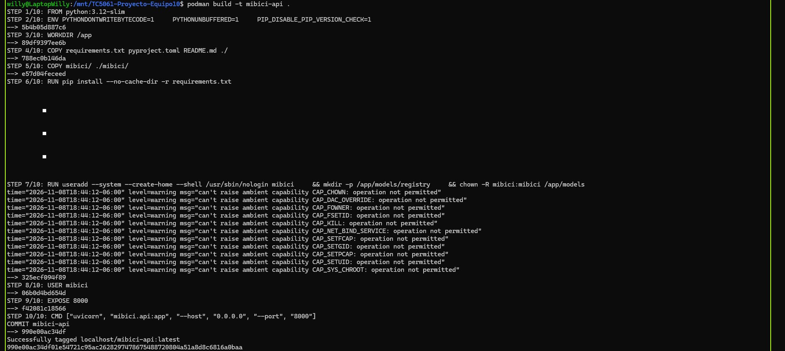
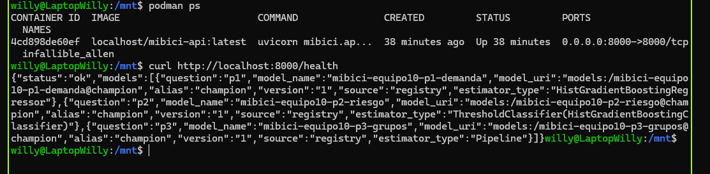
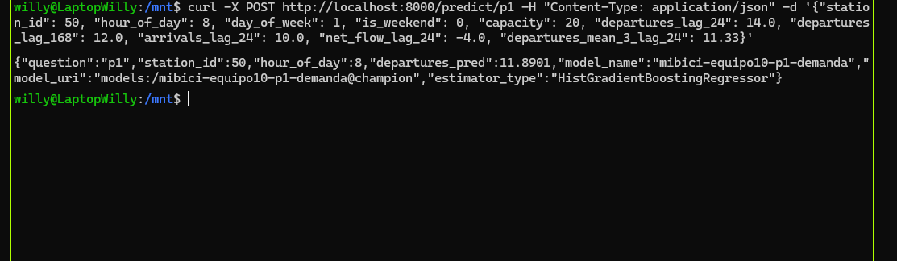

# Empaquetar modelo del proyecto como API REST en contenedor Podman

**Repositorio: <https://github.com/WillSagzz/TC5061-Proyecto-Equipo10>.** La API y su contenedor están integrados ahí. Desde un clon limpio, con un entorno virtual de Python y `pip install -r requirements.txt`, `make image` construye la imagen `mibici-api` y `make container` la ejecuta publicando el puerto 8000; solo hace falta el `.env` con las credenciales del servidor de MLflow del equipo, porque los modelos se recuperan del Model Registry al arrancar. No requiere descargar los datos de MiBici ni entrenar nada.

<div class="pendiente">

**TODO (plantilla).** Este documento es la plantilla del reporte. Los pasos 1 a 3 describen lo que ya está en `main`; los pasos 4 a 6 describen el contrato acordado para el contenedor y se confirman cuando se mezclen los PR de los issues #38 (`Containerfile`, `.dockerignore`, `make image` y `make container`), #39 (versión del modelo en `/health`) y #40 (sección del README sobre el contenedor). Las tres capturas y la tabla de PR se completan con el issue #41. Buscar lo que falta con `grep -rn TODO docs/entregas/entrega04/secciones/`; ningún `TODO` ni recuadro naranja debe quedar en el PDF final.

</div>

## 1. Recuperación del modelo desde el Model Registry

Los tres modelos en producción están registrados en el Model Registry del servidor compartido de MLflow con un nombre por pregunta, `mibici-equipo10-p1-demanda`, `mibici-equipo10-p2-riesgo` y `mibici-equipo10-p3-grupos` (`REGISTERED_MODELS` en `mibici/config.py`), y la versión en producción de cada uno lleva el alias `champion`. El módulo `mibici/modeling/registry.py` encapsula la recuperación: `build_model_uri` arma la URI `models:/<nombre>@<alias>` (o `models:/<nombre>/<versión>` si se pide una versión concreta), `load_registered_model` fija el servidor con `MLFLOW_TRACKING_URI` y carga el modelo con `mlflow.sklearn.load_model`, y `get_registered_model` lo deja en memoria para que la API no descargue el artefacto en cada petición. El alias por defecto es `champion` y se cambia con la variable `MIBICI_MODEL_ALIAS` (por ejemplo, `challenger`). `python -m mibici.modeling.registry check --question all` comprueba desde la terminal que los tres modelos se cargan por nombre y alias.

**Opción elegida: el modelo vive en el Model Registry y el servicio lo recupera al arrancar mediante la variable `MLFLOW_TRACKING_URI`.** Así el contenedor sirve exactamente la misma versión `@champion` que usa el resto del equipo, promover una versión nueva es mover el alias sin reconstruir la imagen, y ni el repositorio ni la imagen contienen modelos serializados ni credenciales (estas se pasan al ejecutar con `--env-file .env`). Como respaldo, `python -m mibici.modeling.registry download` deja una copia del artefacto en `models/registry/<pregunta>/` (ignorada por Git) que `load_registered_model` usa cuando el servidor no está disponible. La decisión y su justificación están en el README, sección *Model Registry*, apartado *Estrategia de carga para el servicio de inferencia*. Las 7 pruebas de `tests/test_registry.py` cubren la construcción de la URI, la carga por alias y por versión, la caché en memoria y el respaldo local, con el servidor de MLflow simulado.

<div class="pendiente">

**TODO (#39).** Cuando se mezcle el PR del issue #39, indicar aquí que `load_registered_model` resuelve también el número de versión detrás del alias (`get_model_version_by_alias`) y que `GET /health` lo muestra en el campo `version`; hoy ese campo responde `null`.

</div>

## 2. API REST con FastAPI

`mibici/api.py` expone los tres modelos como una API REST con FastAPI. Al iniciar (`lifespan`), carga una sola vez los modelos de P1, P2 y P3 con `get_registered_model` y escribe en el log `API lista con los modelos de P1, P2 y P3`; si alguno no se puede recuperar, el servicio no arranca en lugar de fallar con la primera petición. Todas las respuestas son JSON:

| Método y ruta | Qué hace |
|---|---|
| `GET /health` | Indica que el servicio está activo y qué modelos responden: pregunta, nombre, URI, alias, versión, origen (`registry` o `cache`) y tipo de estimador |
| `POST /predict/p1` | **P1 · Demanda:** recibe las 10 variables de una estación y una hora y devuelve los viajes pronosticados (`departures_pred`) |
| `POST /predict/p2` | **P2 · Riesgo:** recibe las 13 variables de una estación y un intervalo de 3 horas y devuelve la clase (`vaciarse`, `llenarse` o `sin_riesgo`) y la probabilidad de cada una |
| `POST /predict/p3` | **P3 · Grupos:** recibe las 8 variables del perfil de uso de una estación y devuelve su grupo |
| `GET /docs` | Documentación interactiva generada por FastAPI, con un ejemplo válido por endpoint |

En local se levanta con `uvicorn mibici.api:app --reload` y se prueba en <http://127.0.0.1:8000/docs>. El README, sección *API REST de predicción*, trae la petición y la respuesta de cada endpoint (en curl y en PowerShell), y `tests/test_api.py` prueba con `TestClient` y modelos simulados los cuatro endpoints, el rechazo de peticiones inválidas y que P1 nunca devuelve viajes negativos (6 pruebas).

## 3. Validación de entradas y salidas con esquemas Pydantic

`mibici/schemas.py` define el contrato de datos de la API. Las entradas `P1FeaturesInput` (10 variables), `P2FeaturesInput` (13) y `P3FeaturesInput` (8) corresponden exactamente a las listas `P1_FEATURES`, `P2_FEATURES` y `P3_FEATURES` de `mibici/features.py`: cada campo es obligatorio, tiene tipo y rango (`station_id` y `capacity` ≥ 1, `hour_of_day` de 0 a 23, `interval_of_day` de 0 a 7, porcentajes de 0 a 100, balances de −1 a 1, sin infinitos ni `NaN`) y los campos desconocidos se rechazan (`extra="forbid"`). Los validadores agregan reglas del dominio: P1 rechaza las horas sin servicio de MiBici (1:00 a 4:59), P1 y P2 exigen que `is_weekend` coincida con `day_of_week`, y P3 exige que los cuatro porcentajes por periodo del día sumen 100 %. El método `to_dataframe()` entrega al modelo las columnas en el orden que espera.

Las salidas también se validan antes de responder: `P1PredictionOutput` exige `departures_pred` ≥ 0 (la predicción se recorta en cero), `P2PredictionOutput` exige una clase válida y las probabilidades de las tres clases en [0, 1], y `P3PredictionOutput` un `group` ≥ 0; las tres incluyen `model_name`, `model_uri` y `estimator_type` para saber qué modelo respondió. Una petición inválida recibe el código 422 con la variable y el motivo, sin llegar al modelo; por ejemplo, P1 con `"hour_of_day": 3` responde `La hora 3:00 pertenece al horario sin servicio ([1, 2, 3, 4])`. Las 7 pruebas de `tests/test_schemas.py` cubren cada regla con casos válidos e inválidos. Documentado en el README, sección *API REST de predicción*.

## 4. Containerfile

El archivo `Containerfile` en la raíz del repositorio empaqueta la API: parte de una imagen oficial de Python *slim* con la misma versión de Python que `pyproject.toml` y la integración continua, copia `requirements.txt`, `pyproject.toml`, `README.md` y el paquete `mibici/`, instala las dependencias con `pip install --no-cache-dir -r requirements.txt`, cambia a un usuario sin privilegios, expone el puerto 8000 y arranca con `uvicorn mibici.api:app --host 0.0.0.0 --port 8000`. El archivo `.dockerignore` (Podman también lo lee) deja fuera del contexto de construcción el `.env`, el entorno virtual, los datos (`data/`), las salidas de MLflow (`mlflow.db`, `mlartifacts/`, `mlruns/`), los modelos descargados (`models/`), `docs/`, `notebooks/`, `reports/` y `tests/`, de modo que la imagen contiene solo el código y sus dependencias: las credenciales del servidor de MLflow nunca van dentro de la imagen, se pasan al ejecutar con `--env-file .env`. Las dependencias de la API (`fastapi`, `uvicorn`, `pydantic`) están en `requirements.txt` junto con las del resto del proyecto.

<div class="pendiente">

**TODO (#38).** Confirmar este párrafo contra el `Containerfile` y el `.dockerignore` que lleguen a `main` (instrucciones, usuario, puerto y lista de exclusiones) y anotar el tamaño final de la imagen que reporta `podman images mibici-api`.

</div>

## 5. Construcción de la imagen y prueba del contenedor

La imagen se construye y se ejecuta con dos comandos de Podman, que el `Makefile` envuelve como `make image` y `make container`:

```bash
podman build -t mibici-api .                                    # make image
podman run --rm --env-file .env -p 8000:8000 mibici-api         # make container
```

Al arrancar, el contenedor carga los tres modelos `@champion` desde el servidor de MLflow y el log muestra `API lista con los modelos de P1, P2 y P3`. Desde la máquina anfitriona, `podman ps` lista el contenedor con el puerto `8000->8000` publicado, `curl http://localhost:8000/health` responde 200 con los tres modelos y `POST /predict/p1` con el ejemplo del README (estación 50 a las 8:00 de un martes) responde 200 con los viajes pronosticados. `podman logs` muestra la carga de los modelos y cada predicción, y `podman stop` detiene el contenedor. El *workflow* `.github/workflows/checks.yml` construye la imagen en cada *Pull Request* (job `image`); solo construye, porque la integración continua no tiene las credenciales del servidor.

<div class="pendiente">

**TODO (#41, Figura 1).** Captura `figuras/contenedor_01_build.png`: final de `podman build -t mibici-api .` con la imagen creada (que se vea el nombre `mibici-api`). Al guardarla, quitar este recuadro y descomentar la figura.

</div>

<!--  -->

<div class="pendiente">

**TODO (#41, Figura 2).** Captura `figuras/contenedor_02_health.png`: `podman ps` con el contenedor en ejecución (imagen `mibici-api`, puerto `8000->8000`) y la respuesta de `GET /health` con los tres modelos. Al guardarla, quitar este recuadro y descomentar la figura.

</div>

<!--  -->

<div class="pendiente">

**TODO (#41, Figura 3).** Captura `figuras/contenedor_03_predict_p1.png`: `POST /predict/p1` y su respuesta 200, donde se vea que la petición va al puerto 8000 publicado por el contenedor. Al guardarla, quitar este recuadro, descomentar la figura y copiar aquí el valor de `departures_pred` que devolvió el contenedor.

</div>

<!--  -->

## 6. Documentación y estrategia de despliegue

El README documenta el servicio completo. La sección *Model Registry* explica dónde vive el modelo y por qué se eligió recuperarlo vía `MLFLOW_TRACKING_URI` (punto 1); *API REST de predicción*, cómo levantar y consumir la API en local con un ejemplo de petición y respuesta por endpoint (puntos 2 y 3); y la sección *Contenedor de la API con Podman* explica cómo construir la imagen, levantar el contenedor, ver sus logs y detenerlo, cómo consumir la API desde el contenedor (`GET /health` y `POST /predict/p1` con su respuesta) y enlaza las tres capturas de este reporte. La tabla *Comandos* incluye `make api`, `make image` y `make container`, y *Estructura del proyecto* describe `Containerfile` y `.dockerignore`.

**Estrategia de despliegue: inferencia en tiempo real vía REST.** P2 (alerta de que una estación tiende a vaciarse o a llenarse en el siguiente intervalo de 3 horas) necesita respuesta bajo demanda, en el momento en que el operador la consulta, por lo que un servicio REST que responda en milisegundos es la opción natural. P1 (pronóstico de salidas por estación y hora del día siguiente) y P3 (perfiles de estaciones, que cambian poco) podrían servirse por lotes en una fase posterior, calculando las predicciones una vez al día; de momento los tres modelos se sirven en el mismo contenedor para mantener un solo punto de despliegue, y la separación en lotes queda como trabajo futuro.

<div class="pendiente">

**TODO (#40).** Confirmar los nombres de las secciones y las filas de la tabla *Comandos* contra el README que llegue a `main`, y copiar aquí la respuesta real de `POST /predict/p1` obtenida desde el contenedor.

</div>

## 7. Trabajo colaborativo en Git

El trabajo se repartió en issues (#38 a #41) y cada uno entra a `main` por su propia rama (`feature/issue-NN-...`, `docs/issue-NN-...`) y un *Pull Request* revisado y aprobado por otro integrante, con *squash merge* y mensajes según Conventional Commits; el *workflow* `checks` corre `ruff`, `pytest`, `bandit`, `pip-audit` y la construcción de la imagen en cada PR. La evidencia está en la pestaña *Pull requests* del repositorio.

**Tabla 1.** Pull Requests de la entrega 04.

| PR | Título | Autor | Issue |
|---|---|---|---|
| [#36](https://github.com/WillSagzz/TC5061-Proyecto-Equipo10/pull/36) | feat(modeling): agrega cargador del model registry y esquemas pydantic de validación | Alan Augusto Herrera Sánchez (`alanhsa9`) | — |
| [#37](https://github.com/WillSagzz/TC5061-Proyecto-Equipo10/pull/37) | feat(modeling): sirve los modelos de P1, P2 y P3 con una API REST de FastAPI | Mariely Toribio Rodríguez (`a01797848`) | — |
| TODO | Containerfile, `.dockerignore` y targets de Make para la imagen Podman de la API | Victor Yoguel Salazar Alanis (`CFOP2357`) | #38 |
| TODO | Resolver la versión del modelo detrás del alias `@champion` y mostrarla en `/health` | Victor Yoguel Salazar Alanis (`CFOP2357`) | #39 |
| TODO | Documentar en el README el contenedor Podman de la API y la estrategia de despliegue | Guillermo Sáenz González (`WillSagzz`) | #40 |
| TODO | docs(entregas): agrega la plantilla del reporte de la entrega 04 | Victor Yoguel Salazar Alanis (`CFOP2357`) | #41 |
| TODO | Evidencia de la entrega 04: capturas del contenedor Podman respondiendo | Guillermo Sáenz González (`WillSagzz`) | #41 |

<div class="pendiente">

**TODO (tabla de PR).** Sustituir cada `TODO` por el número y el título definitivo del PR al mezclarse (el título del PR es el mensaje del commit que llega a `main`) y comprobar que la tabla coincide con la pestaña *Pull requests*.

</div>
