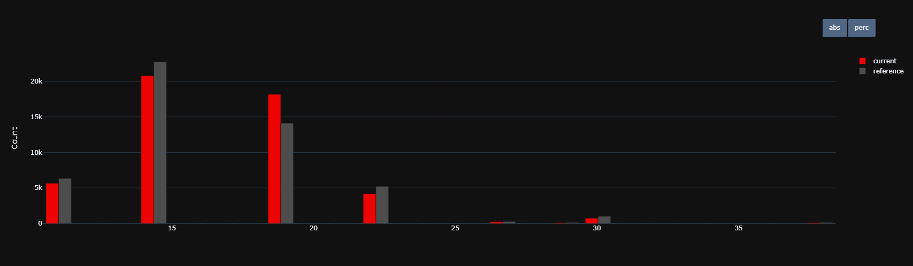
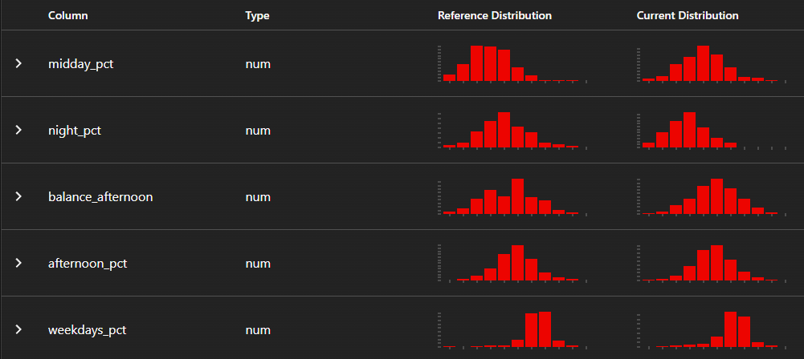

# Reporte de drift con Evidently

**TODO (#55).** Cómo se genera el reporte (`make drift`), el criterio de drift, la tabla de variables con drift por pregunta (método, puntaje y umbral) y las figuras de Evidently `drift_01_p1_resumen.png`, `drift_02_p1_station_capacity.png` y `drift_04_p3_resumen.png`.

## Generación de reportes

El script de `mibici/drift.py` compara el conjunto de referencia con el periodo actual de cada pregunta usando Evidently y escribe en `reports/evidently/` (ignorada por Git):

- `<pregunta>_drift.html`: reporte interactivo con el drift por variable (`DataDriftPreset`) y la calidad de los datos (`DataSummaryPreset`).
- `<pregunta>_drift_resumen.csv`: una fila por variable con el método, el puntaje, el umbral y si hay drift.

Evidently elige la prueba según el tipo de variable y el tamaño de la muestra. Se declara drift del conjunto completo cuando al menos el 50 %
de las variables tiene drift (`DRIFT_SHARE_THRESHOLD` en `config.py`).

## Reporte de P1

### Tabla de drift por variable:

| column | method | score | threshold | drift |
| --- | --- | --- | --- | --- |
| capacity | Wasserstein distance (normed) | 0.105 | 0.1 | True |
| station_id | Jensen-Shannon distance | 0.289 | 0.1 | True |
| departures_lag_24 | Wasserstein distance (normed) | 0.025 | 0.1 | False |
| departures_lag_168 | Wasserstein distance (normed) | 0.045 | 0.1 | False |
| arrivals_lag_24 | Wasserstein distance (normed) | 0.026 | 0.1 | False |
| net_flow_lag_24 | Wasserstein distance (normed) | 0.065 | 0.1 | False |
| departures_mean_ 3_lag_24 | Wasserstein distance (normed) | 0.037 | 0.1 | False |
| departures | Wasserstein distance (normed) | 0.0293 | 0.1 | False |
| hour_of_day | Jensen-Shannon distance | 0.010 | 0.1 | False |
| day_of_week | Jensen-Shannon distance | 0.037 | 0.1 | False |
| is_weekend | Jensen-Shannon distance | 0.016 | 0.1 | False |

En el caso de las features numéricas, `Evidently` utilizó el método de _Wasserstein distance (normed)_, porque este mide qué tanto se parece la distribución numérica actual a la de referencia (Un valor mayor indica mayor desplazamiento). 

Mientras que se aplicó el método de _Jensen-Shannon distance_ para las features de menor cardinalidad o que son categóricas. Porque este método compara distribuciones, incluidas categóricas o discretas, y devuelve una distancia acotada entre 0 y 1.

### Gráficas de distribución de datos

## Reporte de P2

Tabla de drift por variable:
| column | method | score | threshold | drift |
| --- | --- | --- | --- | --- |
| capacity | Wasserstein distance (normed) | 0.101 | 0.1 | True |
| station_id | Jensen-Shannon distance | 0.287 | 0.1 | True |
| departures_lag_1 | Wasserstein distance (normed) | 0.030 | 0.1 | False |
| departures_lag_8 | Wasserstein distance (normed) | 0.034 | 0.1 | False |
| departures_lag_56 | Wasserstein distance (normed) | 0.053 | 0.1 | False |
| arrivals_lag_1 | Wasserstein distance (normed) | 0.029 | 0.1 | False |
| arrivals_lag_8 | Wasserstein distance (normed) | 0.030 | 0.1 | False |
| net_flow_lag_1 | Wasserstein distance (normed) | 0.076 | 0.1 | False |
| net_flow_lag_8 | Wasserstein distance (normed) | 0.075 | 0.1 | False |
| departures_mean_3 | Wasserstein distance (normed) | 0.043 | 0.1 | False |
| interval_of_day | Jensen-Shannon distance | 0.006 | 0.1 | False |
| day_of_week | Jensen-Shannon distance | 0.036 | 0.1 | False |
| is_weekend | Jensen-Shannon distance | 0.015 | 0.1 | False |
| risk | Jensen-Shannon distance | 0.026 | 0.1 | False |

`Evidently` aplico los mismos métodos que con `P1` porque ambos sets de datos contienen más de 1,000 filas, además de ser numéricos y categóricos también.
Las razones para aplicar estos dos métodos a cada tipo de dato son las mismas que se describieron en `P1`.

### Gráficas de distribución de datos

## Reporte de P3

Tabla de drift por variable:

| column | method | score | threshold | drift |
| --- | --- | --- | --- | --- |
| midday_pct | K-S p_value | 0.000 | 0.05 | True |
| afternoon_pct | K-S p_value | 0.009 | 0.05 | True |
| night_pct | K-S p_value | 0.002 | 0.05 | True |
| weekdays_pct | K-S p_value | 0.025 | 0.05 | True |
| balance_afternoon | K-S p_value | 0.004 | 0.05 | True |
| morning_pct | K-S p_value | 0.120 | 0.05 | False |
| log_daily_use_per_dock | K-S p_value | 0.570 | 0.05 | False |
| balance_morning | K-S p_value | 0.931 | 0.05 | False |

En este caso, todas las features eran de tipo numérico y el dataset contenía menos de 1,000 filas. Por esto `Evidently` aplicó el método de K-S p_value a todas las features. Aqui, un p-value menor a 0.05 indica evidencia estadística de que las dos distribuciones son distintas (evidencia de drift).

Este método (la prueba Kolmogorov-Smirnov) compara las distribuciones acumuladas de dos muestras numéricas. Es apropiado porque las variables son proporciones y balances continuos que describen el perfil de uso de cada estación. Permite detectar si la forma de la distribución cambió, por ejemplo, si las estaciones tienen ahora una participación distinta en mediodía, tarde o noche.

### Gráficas de distribución de datos

