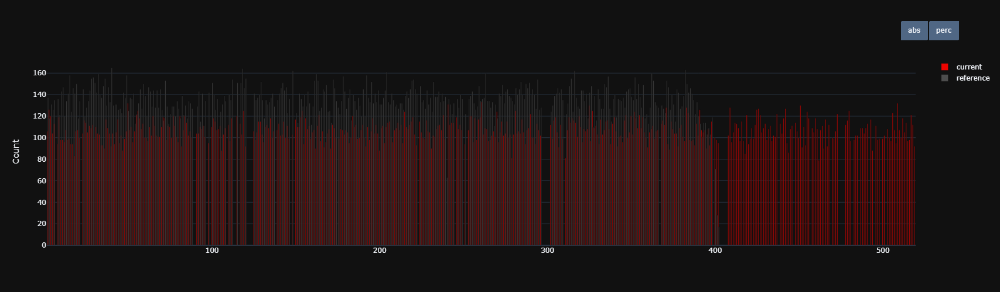

# Reporte de drift con Evidently

`make drift` (`mibici/drift.py`) compara el conjunto de referencia con el actual de cada pregunta y genera un reporte de Evidently con dos partes: el drift por variable (`DataDriftPreset`) y la calidad de los datos (`DataSummaryPreset`). Evidently elige la prueba según el tipo de variable y el tamaño de la muestra. En P1 y P2, que tienen más de 1,000 filas, mide la distancia entre las dos distribuciones: Wasserstein normalizada en las variables numéricas y Jensen-Shannon en las categóricas. Hay drift si la distancia es de 0.1 o más. En P3, con una fila por estación, aplica la prueba de Kolmogorov-Smirnov, y hay drift si el valor p es menor que 0.05. Se declara drift del conjunto completo cuando cambia al menos la mitad de las variables (`DRIFT_SHARE_THRESHOLD` en `config.py`).

**Tabla 2.** Resultado del reporte de drift por pregunta. El puntaje de cada variable está en el Anexo B.

| Pregunta | Variables evaluadas | Con drift | Variables con drift y su puntaje | Drift del conjunto |
|---|---:|---:|---|---|
| P1 · Demanda | 11 | 2 (18 %) | `station_id` (0.289) y `capacity` (0.105) | No |
| P2 · Riesgo | 14 | 2 (14 %) | `station_id` (0.287) y `capacity` (0.101) | No |
| P3 · Perfiles | 8 | 5 (63 %) | `midday_pct` (p < 0.001), `night_pct` (p = 0.002), `balance_afternoon` (p = 0.004), `afternoon_pct` (p = 0.009) y `weekdays_pct` (p = 0.025) | Sí |

En P1 y P2 ninguna otra variable se acerca al umbral: la mayor distancia entre las que no tienen drift es de 0.065 en P1 y de 0.076 en P2.

La parte de calidad de los datos resume cada conjunto: número de filas y de columnas, valores faltantes y estadísticos de cada variable. Los conjuntos que compara son los de la Tabla 1; en P1 y P2 trabaja con la muestra de 50,000 filas por conjunto.

