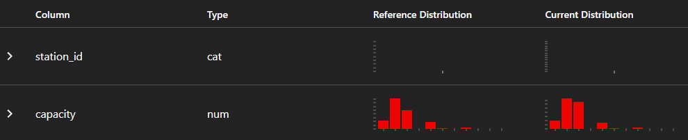

# Anexos

## Anexo A. Comandos para reproducir el reporte

El código está en el repositorio: `mibici/monitoring.py` (conjuntos), `mibici/drift.py` (reporte de Evidently) y `mibici/modeling/ab_test.py` (versión alternativa y A/B testing). Los comandos se ejecutan desde la raíz, con las dependencias de `requirements.txt` instaladas y el archivo `.env` del servidor de MLflow del equipo.

```bash
make data            # descarga y limpia los 24 meses de la versión de datos
make monitor-data    # descarga septiembre de 2026 y arma los conjuntos de referencia y actual
make drift           # reportes de Evidently en reports/evidently/
make retrain         # reentrena P1 y lo registra como @challenger
make ab-test         # compara @champion y @challenger; tabla en reports/ab_test/
make entrega05       # compila este PDF
```

## Anexo B. Drift por variable

**Tabla B1.** P1: drift por variable (11 variables; umbral de 0.1).

| Variable | Método | Puntaje | Drift |
|---|---|---:|---|
| `station_id` | Jensen-Shannon | 0.289 | Sí |
| `capacity` | Wasserstein normalizada | 0.105 | Sí |
| `net_flow_lag_24` | Wasserstein normalizada | 0.065 | No |
| `departures_lag_168` | Wasserstein normalizada | 0.045 | No |
| `departures_mean_3_lag_24` | Wasserstein normalizada | 0.037 | No |
| `day_of_week` | Jensen-Shannon | 0.037 | No |
| `departures` | Wasserstein normalizada | 0.029 | No |
| `arrivals_lag_24` | Wasserstein normalizada | 0.026 | No |
| `departures_lag_24` | Wasserstein normalizada | 0.025 | No |
| `is_weekend` | Jensen-Shannon | 0.016 | No |
| `hour_of_day` | Jensen-Shannon | 0.010 | No |

**Tabla B2.** P2: drift por variable (14 variables; umbral de 0.1).

| Variable | Método | Puntaje | Drift |
|---|---|---:|---|
| `station_id` | Jensen-Shannon | 0.287 | Sí |
| `capacity` | Wasserstein normalizada | 0.101 | Sí |
| `net_flow_lag_1` | Wasserstein normalizada | 0.076 | No |
| `net_flow_lag_8` | Wasserstein normalizada | 0.075 | No |
| `departures_lag_56` | Wasserstein normalizada | 0.053 | No |
| `departures_mean_3` | Wasserstein normalizada | 0.043 | No |
| `day_of_week` | Jensen-Shannon | 0.036 | No |
| `departures_lag_8` | Wasserstein normalizada | 0.034 | No |
| `departures_lag_1` | Wasserstein normalizada | 0.030 | No |
| `arrivals_lag_8` | Wasserstein normalizada | 0.030 | No |
| `arrivals_lag_1` | Wasserstein normalizada | 0.029 | No |
| `risk` | Jensen-Shannon | 0.026 | No |
| `is_weekend` | Jensen-Shannon | 0.015 | No |
| `interval_of_day` | Jensen-Shannon | 0.006 | No |

**Tabla B3.** P3: drift por variable (8 variables; hay drift si el valor p es menor que 0.05).

| Variable | Método | Valor p | Drift |
|---|---|---:|---|
| `midday_pct` | Kolmogorov-Smirnov | < 0.001 | Sí |
| `night_pct` | Kolmogorov-Smirnov | 0.002 | Sí |
| `balance_afternoon` | Kolmogorov-Smirnov | 0.004 | Sí |
| `afternoon_pct` | Kolmogorov-Smirnov | 0.009 | Sí |
| `weekdays_pct` | Kolmogorov-Smirnov | 0.025 | Sí |
| `morning_pct` | Kolmogorov-Smirnov | 0.120 | No |
| `log_daily_use_per_dock` | Kolmogorov-Smirnov | 0.570 | No |
| `balance_morning` | Kolmogorov-Smirnov | 0.931 | No |


