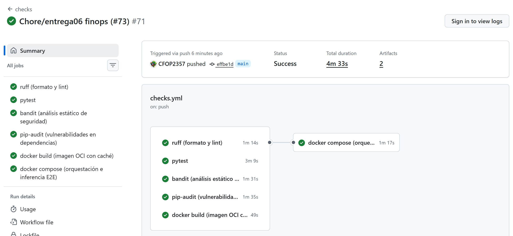

# Pipeline de CI/CD con GitHub Actions

El *workflow* `.github/workflows/checks.yml` corre en cada *pull request*, en cada *push* a `main` y a mano desde la pestaña *Actions* (`workflow_dispatch`). Tiene seis *jobs* en dos etapas.

**Tabla 2.** *Jobs* del *workflow*.

| Etapa | *Job* | Qué hace |
|---|---|---|
| 1, en paralelo | `lint` | Formato y estilo del código con `ruff` |
| | `test` | Las 215 pruebas de `pytest`, con datos sintéticos |
| | `bandit` y `pip-audit` | Análisis de seguridad del código y de las dependencias |
| | `image` | Construye la imagen del servicio con Buildx |
| 2 | `compose` | Levanta el sistema con `docker compose up`, espera los *healthchecks*, pide una predicción a P1, P2 y P3 y revisa cada respuesta |

La segunda etapa solo corre si pasan los cinco *jobs* de la primera. Es la prueba de despliegue: el mismo `docker-compose.yml` de la sección 1 levanta MLflow y la API en el *runner* y la API responde predicciones.

Tres configuraciones acortan el *pipeline*. Las dependencias de Python se guardan en el caché de `pip`. Las capas de la imagen se guardan en el caché de GitHub Actions, y el *job* `compose` reutiliza la imagen que construyó `image` en lugar de construirla otra vez. Cuando llegan *commits* nuevos a un *pull request*, la corrida anterior se cancela (`concurrency`).

Las reglas de `main` no dejan mezclar un *pull request* si fallan `lint`, `test`, `bandit` o `pip-audit`. La Figura 1 muestra una corrida en `main`: los seis *jobs* pasan en 4 minutos y medio.

