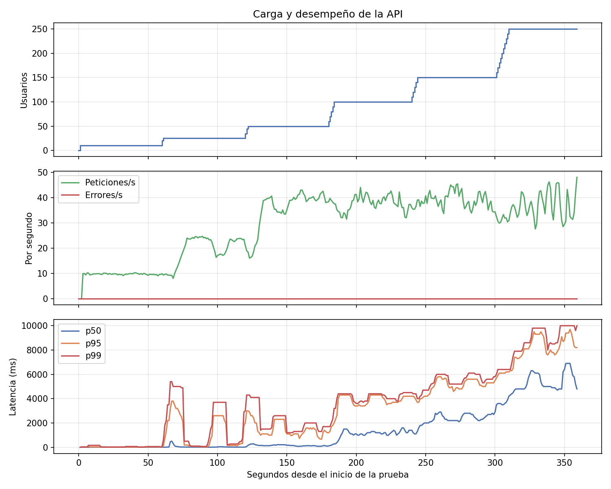
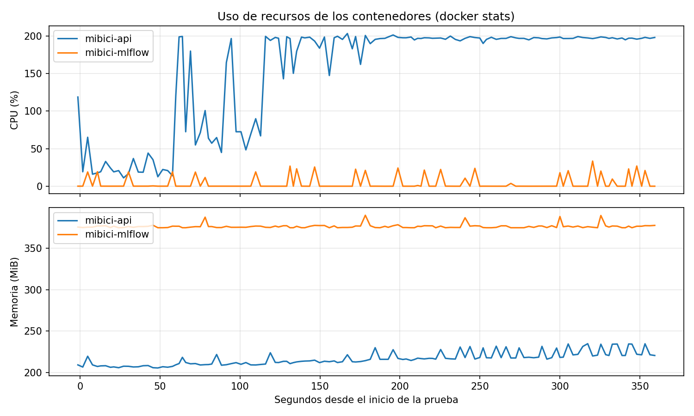

# Prueba de carga con Locust

## Escenario

`mibici/load_testing/locustfile.py` simula operadores de MiBici que consultan la API levantada con Compose, con los tres modelos `@champion` reales. Cada usuario manda una petición válida y distinta cada vez (estación, hora y valores históricos al azar) y espera entre 0.5 y 1.5 segundos antes de la siguiente. De cada 11 peticiones, 6 van a P1, 3 a P2, 1 a P3 y 1 a `/health`. La carga sube por escalones de un minuto, con 10, 25, 50, 100, 150 y 250 usuarios, para ver con cuántos usuarios la API deja de responder a tiempo. Mientras corre Locust, `docker stats` mide la CPU y la memoria de los dos contenedores. Todo se ejecuta con `make load-test`. La prueba corrió en una laptop (Intel Core Ultra 7 155H), con Locust en la misma máquina.

## Resultados

**Tabla 3.** Desempeño y uso de recursos por escalón. Ninguna petición falló en toda la prueba (10,843 peticiones).

| Usuarios | Peticiones/s | p50 (ms) | p95 (ms) | CPU API (%) | Memoria API (MiB) | CPU MLflow (%) | Memoria MLflow (MiB) |
|---:|---:|---:|---:|---:|---:|---:|---:|
| 10 | 9.8 | 7 | 17 | 28 | 210 | 3 | 378 |
| 25 | 21.6 | 15 | 190 | 96 | 224 | 3 | 387 |
| 50 | 38.0 | 130 | 1,200 | 188 | 222 | 7 | 390 |
| 100 | 39.0 | 1,200 | 3,900 | 197 | 231 | 4 | 378 |
| 150 | 36.7 | 2,400 | 5,300 | 196 | 232 | 0 | 377 |
| 250 | 37.7 | 5,000 | 8,150 | 197 | 235 | 7 | 389 |

**La API atiende bien hasta unas 20 peticiones por segundo.** Con 10 usuarios responde en 17 ms (p95) y usa 28 % de CPU, donde 200 % son las 2 CPU de su límite. Con 25 usuarios todavía atiende todo lo que llega, pero el p95 sube a 190 ms y la Figura 2 muestra picos de varios segundos: la CPU ya toca el límite por momentos.

**A partir de 50 usuarios está saturada.** Atiende unas 38 peticiones por segundo y no pasa de ahí aunque los usuarios se multipliquen por cinco. Las peticiones que no alcanza a atender esperan en fila, y por eso el p95 pasa de 1.2 a 8.2 segundos. No hay errores porque la API no rechaza peticiones: solo tarda más.

**El cuello de botella es la CPU de la API.** Desde 50 usuarios se queda en 197 % de las 200 % disponibles (Figura 3). La memoria casi no cambia: pasa de 210 a 235 MiB, el 11 % de su límite. MLflow no participa en las predicciones, porque la API carga los modelos en memoria al arrancar: usa menos de 390 MiB y su CPU se queda cerca de cero.

## Áreas de mejora

- **Cada predicción gasta más CPU de la necesaria.** Los modelos reparten cada predicción entre varios hilos y la API atiende muchas peticiones a la vez, así que hay más hilos que CPU y compiten por las 2 disponibles. La sección 4 mide cuánto mejora la API con un solo hilo por predicción.
- **P2 es el endpoint más lento:** su p50 en toda la prueba fue de 3.3 s, contra 1.2 s de P1 (anexo). La API evalúa el modelo dos veces por petición, una para la clase y otra para las probabilidades. Con una sola evaluación bastaría.
- **Con sobrecarga, la espera crece sin tope.** Conviene un tiempo máximo de espera en la API, para responder con un error rápido en lugar de tardar 8 segundos, y agregar réplicas antes de que la CPU llegue a su límite: con 96 % de CPU ya hay picos de varios segundos.
